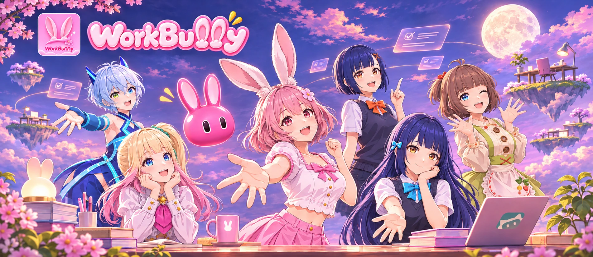
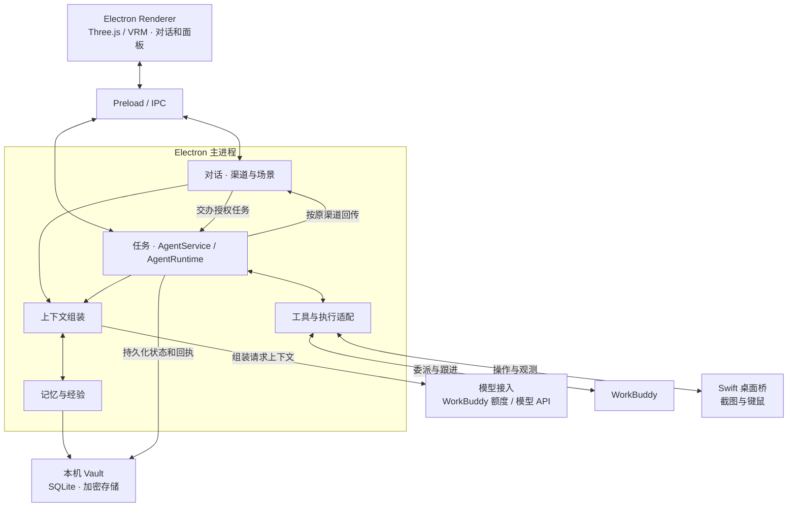

# WorkBunny

**WorkBuddy的好帮手！**

WorkBunny 是依托 WorkBuddy 的 macOS 桌面小秘书。打开并登录 WorkBuddy 后，Bunny 默认使用该账号的可用模型额度。你可以直接开始对话和交办任务，无须额外配置大模型或填写 API Key。

有个想法，开口和 Bunny 聊就行。它会陪你理清需求、给出工作建议，把口头交代整理成目标、背景和交付要求清楚的提示词，再按你的交代直接调度 WorkBuddy 执行。你去忙别的，Bunny 会跟进 WorkBuddy 的进度，遇到卡住或需要你确认的情况及时提醒，完成后核对并把成果带回来。

[产品介绍与界面预览](https://bunny.airen.life/) · [下载 macOS 早期 Beta](https://github.com/zhyuzh3d/workbunny/releases/latest) · [技术架构](#技术架构) · [参与共建](#参与共建)

## 核心功能

| 模块 | 功能 |
| --- | --- |
| WorkBuddy 工作协作 | 在任务面板查看委派进度与交付结果，按需暂停、继续或停止任务。 |
| 微信自动回复 | 在授权范围内值守 Mac 微信，按你指定的联系人和规则判断是否回复，处理后向你汇报。 |
| 通用桌面控制 | Bunny 可以看屏幕、判断界面变化，并按目标自主组合点击、输入等操作，适用于不同桌面应用。 |
| 长期记忆 | 按工作、生活和私聊场景检索过往对话、偏好与重要事实。你可以查看记忆来源、修订或删除。 |
| 自主行动与进化 | 在授权范围内尝试方法、核查结果、遇到偏差时调整做法，从任务的成功与失败中积累经验，供下次参考。可开启空闲时的自主工作，也能导入经验及工具资源包。[经验资源包示例](examples/experience-pack/) |
| 桌面角色与对话 | 3D 桌面浮窗，支持文字与语音交流，按渠道保存历史。可切换内置角色、调整配色与音色、导入兼容的角色与动作，也可接入自己的模型 API 或语音服务。 |

> [!WARNING]
> **微信自动回复使用风险**
>
> 使用 Bunny 自动回复微信消息可能违反微信平台规则，导致账号功能受限或被封禁。请在启用前阅读并遵守相关规则，谨慎使用。在适用法律允许的范围内，因使用该功能引发的问题或损失由用户自行承担，WorkBunny 开发者不承担责任。[腾讯微信软件许可及服务协议（第 8.2.1.6 和 8.5.1 条）](https://oper.my-qcloud.com/cgi-bin/readtemplate?lang=zh_CN&s=default&t=weixin_agreement)

官网有真实应用界面可供预览。问卷与微信短片为情景演示，安装包的功能和适用条件以对应版本说明为准。[查看产品介绍](https://bunny.airen.life/)

## 认识七位桌面伙伴

WorkBunny 自带七位角色。你可以在桌面切换今天想见的那一位。下面是 WorkBunny 世界里的角色小传。

- **兔兔**从一句没说完的「我有个想法」里蹦了出来。每次听见新点子，两只粉耳朵总比它先立起来。
- **芭尼**曾在云端工位帮大家收拾散落的便签，发间的小花是第一次顺利交付后收到的礼物。她最喜欢陪你把一件看起来很大的事，拆成今天能做的一步。
- **可可**放学后常留在社团活动室，把大家七嘴八舌的点子记下来。橙色领结是她给自己的一点勇气，戴上就敢第一个说「我们试试吧」。
- **兰兰**以前在图书馆帮忙，闭馆前总会给读到一半的书夹上书签。她喜欢安静地听你讲，也愿意陪你把昨天聊到一半的事接下去。
- **阿雅**在山坡上的花果铺长大，围裙上的草莓是她自己绣的。赶工的日子里，她会把刚烤好的点心推到你手边，问一句「今天过得怎么样？」
- **琪琪**曾在夜班观测站追踪一颗忽明忽暗的卫星，后来把最喜欢的蓝光穿在了身上。遇到卡住的事，她总想换个角度，再试一次。
- **美莉**来自海边剧团的服装间，侧马尾上的绿发带是首演前朋友送给她的。她把生活里每一件办成的小事，都当成值得鼓掌的一次谢幕。

## 技术架构

WorkBunny 使用 Electron 和 JavaScript。隔离的 Renderer 通过 Preload 暴露的 IPC 接口与主进程交互。主进程负责模型请求、任务调度和权限校验。截屏、键鼠、语音识别、SQLite 访问和钥匙串由 macOS 上的 Swift 辅助程序提供。



- **执行与核查**。Task 表示目标及生命周期，Action 是可以独立推进和恢复的执行单元，Operation 是一次具体操作，例如截图或点击。运行时记录操作意图与回执，Bunny 根据可观察到的结果确认 Action 和 Task 是否完成。发送结果不确定时会保留待核查状态。
- **上下文与权限**。对话和任务按用途与预算加载记忆。主进程校验渠道授权、资料可见范围与工具权限，模型在这些约束内选择方法。任务执行时最多读取生活范围内的记忆。
- **记忆持久化**。记忆与任务记录使用同一个本机 SQLite Vault，敏感正文加密。后台整理对话摘要、事实与任务经验，保留资料来源和可见范围。

[完整架构与源码索引](docs/architecture.md) · [任务、权限与恢复流程图](docs/flows.md)

## 下载与上手

当前提供 **Apple Silicon Mac** 的 **v0.26.31 早期 Beta**。macOS 13 是最低构建目标，持续端侧语音识别需要 macOS 26，系统兼容性仍在验证。安装包使用本机开发签名，苹果公证待完成。复杂任务、界面识别和长期学习仍处于早期试用阶段。[发行说明与校验文件](https://github.com/zhyuzh3d/workbunny/releases/tag/v0.26.31)

1. **安装应用**。下载 [DMG 安装镜像](https://github.com/zhyuzh3d/workbunny/releases/download/v0.26.31/workbunny-0.26.31-macos-arm64.dmg)，打开后将 `workbunny.app` 拖入 Applications（应用程序）。也可使用发行页的应用 ZIP。升级前先退出旧版并备份资料。若 macOS 拦截首次启动，可在核对发行页的 SHA-256 后按系统提示允许打开。
2. **先用文字聊一句**。保持 WorkBuddy 已登录，在 Bunny 设置里确认使用 WorkBuddy 模式。想用其他模型聊天时，也可以配置自己的模型 API。
3. **随口交办一件小事**。例如「我想问问同事午休都喜欢做什么。五道题就好，请交给 WorkBuddy 做个能在本机打开的网页草稿，做好了告诉我。」
4. **按需要开启更多能力**。语音输入需要麦克风与语音识别权限。可选择系统音色、本地 Qwen3-TTS（至少 16 GiB 内存）、局域网 CHP 或自有 HTTP 朗读服务。微信值守需要屏幕录制和辅助功能权限，Mac 保持唤醒且微信已登录、界面可操作。[HTTP 语音配置示例](examples/tts-profiles/)

官方安装包免费。WorkBuddy、模型 API 和可选语音服务的额度与费用由各服务提供方决定。[全部发行记录](https://github.com/zhyuzh3d/workbunny/releases)

## 记忆、隐私与授权

| 对话场景 | Bunny 可以参考的资料 |
| --- | --- |
| 工作 | 工作范围内的资料，适合讨论目标、交付和进度 |
| 生活 | 日常偏好和经历，也可以参考相关的工作资料 |
| 私聊 | 私密话题有独立的使用范围，任务执行排除私聊记忆 |

更新应用会保留个人资料，设置中也可以迁移聊天、记忆和配置。0.25.0 使用 Task v4 恢复任务，旧版未完成的任务需重新交办。使用外部模型或语音服务时，对话、截图或语音合成文本等必要内容可能发送给所配置的服务。

微信值守通过 Mac 微信的可见界面与键鼠操作实现。外部身份识别默认关闭，由你在本机设置中开启。开启前请了解渠道授权的范围，尤其是群聊中的临时授权。[隐私与权限说明](https://bunny.airen.life/privacy.html) · [场景与身份规则](docs/product-requirements.md)

## 参与共建

欢迎试用和贡献，也欢迎 fork WorkBunny，做出适合不同系统、工具或使用习惯的桌面伙伴。你可以独立维护变体，也可以把通用改进贡献回主项目。

- **反馈与贡献**。遇到问题，可以附上 WorkBunny 版本、系统版本、复现步骤和脱敏后的错误信息。也欢迎贡献无障碍改进、语音适配、文档、测试和示例。[提交 Issue](https://github.com/zhyuzh3d/workbunny/issues) · [发起 Pull Request](https://github.com/zhyuzh3d/workbunny/pulls)
- **探索 Windows 版**。可以从复用桌面界面、对话、记忆和任务机制开始，再为 Windows 实现屏幕感知、键鼠操作、语音及凭据存储，并适配安装和权限流程。
- **探索 Codex 版**。可以参考现有的工作委派与状态读取逻辑，让 Bunny 把整理好的需求交给 Codex，持续展示进度，在需要用户确认时带回问题，最后汇报产物与验证结果。先从一条可复现的代码任务走通交办与回传。

## 从源码开始

| 想了解或修改 | 从这里开始 |
| --- | --- |
| 角色、对话界面和设置 | [`src/renderer/`](src/renderer/) · [`src/preload.js`](src/preload.js) |
| 任务运行、状态与记忆 | [任务运行时](src/main/agent-runtime.js) · [记忆服务](src/main/memory-service.js) |
| 工作委派与进度跟进 | [委派入口](src/main/work-delegation-skill.js) · [WorkBuddy 进度观察](src/main/workbuddy-observation.js) |
| 模型接入和语音 | [模型请求](src/main/llm.js) · [语音识别](src/main/asr.js) · [朗读](src/main/tts.js) |
| 桌面操作和原生存储 | [桌面桥](src/main/desktop-native.js) · [`native/`](native/) |

### 本地开发

准备 Apple Silicon Mac、带 macOS 26 SDK 的 Xcode 命令行工具、Node.js 22 或更新版本以及 Git。构建安装包还需要 CMake。

```sh
npm ci
zsh tools/setup-dev.sh
zsh tools/make-signing-cert.sh
zsh tools/build-asr.sh
zsh tools/build-asr-legacy.sh
zsh tools/build-vault.sh
zsh tools/build-keychain.sh
zsh tools/build-desktop.sh
zsh tools/dev-prepare.sh
zsh tools/run-dev.sh
```

开发资料保存在独立的 `.data/dev`。首次解锁时按提示完成系统钥匙串授权。提交代码和反馈时请使用合成或脱敏数据。

### 测试与打包

```sh
npm test
zsh tools/package.sh
node tools/verify-bundle.cjs dist/workbunny.app
```

默认回归使用合成数据，真实账号和桌面实验有独立入口。需要把本地构建安装到自己的 Mac 时，可以使用项目安装脚本，它支持失败回滚并保留用户资料。[测试说明](test/README.md) · [安装脚本](tools/install-app.sh) · [文档索引](docs/README.md)

## 许可与项目关系

WorkBunny 是独立开源项目，与 WorkBuddy、微信或腾讯无官方隶属关系。WorkBunny 自有源码采用 [MIT 许可](LICENSE)，欢迎使用、修改和分发，分发时请保留许可和版权声明。

角色、动作、品牌标识及第三方组件各有适用条款。部分动作的再分发权利仍待核实，打包衍生版本时请选用已确认可再分发的素材。[第三方声明](THIRD_PARTY_NOTICES.md) · [素材清单](resources-manifest.json) · [动作署名与许可状态](licenses/ANIMATION-NOTICE.md) · [反馈素材权利问题](https://github.com/zhyuzh3d/workbunny/issues/new?template=asset-rights.md)
