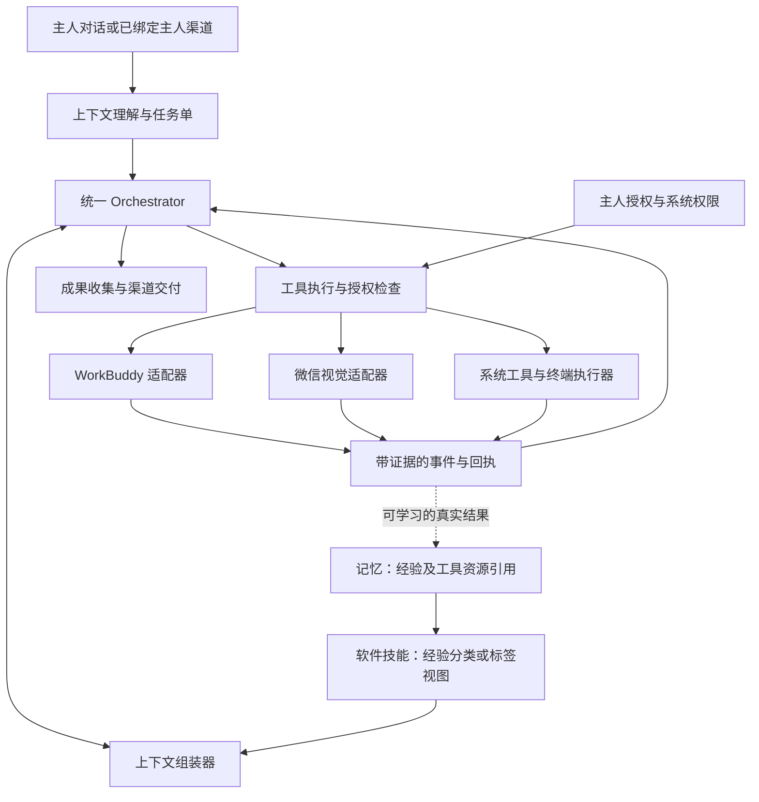

# WorkBunny 软件技能与统一编排开发计划

版本：1.1 · 日期：2026-11-02（Asia/Shanghai）

状态：分阶段开发与真机验收中，实际完成项参见 [产品审计](2026-11-03-product-audit.md)。本文包含尚未完成的后续工作。

范围：WorkBuddy、微信两个软件技能；共用的任务编排、授权、系统工具、凭据和技能改进机制。

## 1. 产品目标与已确定原则

Bunny 是主动、贴心、能把事情办完的小秘书。主人交代目标后，她应理解上下文、选择软件与对象、补齐可自行取得的信息、执行、等待、修正、回收结果，最后按约定渠道极简汇报。处理日常困难和已授权的必要步骤，不反复要求主人指挥每一次点击。

长期目标是积极、主动、自主、自我进化的智能体；框架及工具支持她思考、探索、执行、自查并从实际反馈中学习，软件技能提供可修正的方法经验。跨任务的统一要求以[产品目标与智能体设计原则](产品目标与智能体设计原则.md)为准，本文件记录软件技能和编排方面的具体设计及历史进度。

本计划落实以下用户决定：

| 编号 | 决定 | 交付要求 |
| --- | --- | --- |
| R01 | 一个 Orchestrator 编排多个软件技能 | 两个软件共用任务、事件、权限、回执、暂停恢复与交付机制 |
| R02 | 首先完善 WorkBuddy、微信 | 安装包自带两个技能套件，其他软件以后按同一规范接入 |
| R03 | 技能可持续自我改进 | 经验、操作配方和脚本有来源、版本、实测记录、适用条件和回退能力 |
| R04 | WorkBuddy 可用 AX 等接口，视觉键鼠兜底 | 按实际可用能力选择方法，不假定所有项目或页面都有完整 AX 信息 |
| R05 | 微信完全使用视觉与模拟键鼠 | 禁用微信接口、AX 树、插件、协议、聊天数据库；不得借终端或 WorkBuddy 绕行 |
| R06 | Bunny 记得已有授权，并主动检查 | 保存真实授权记录；执行前核对当前系统状态和任务范围，缺少哪项就引导哪项 |
| R07 | 系统设置中增加两个默认关闭的开关 | “允许 Bunny 进行操作系统配置修改”“允许 Bunny 完全使用非破坏性终端命令”，推荐开启，由主人选择 |
| R08 | 已授权后积极自处理 | 能自行完成的诊断、恢复、配置和必要工具组合自动完成；允许有回退办法的小风险试错，不逐条重复确认 |
| R09 | 区分系统密码与其他凭据 | 可明确保存；系统登录/管理员密码不自动取用，其他凭据按主人任务、账户和用途使用 |
| R10 | 不主动损害资产，不主动操作资金 | 一般开关不授权删除重要资产、不可逆操作、支付、转账、交易或红包 |
| R11 | WorkBuddy 按上下文定位项目 | 延续原任务用绑定会话；新任务找合适项目；没有合适项目则新建无空间归属的对话 |
| R12 | 自动回收成果并选择一个交付渠道 | 默认极简播报；明确选择微信后只发微信，未指明联系人时用文件传输助手 |
| R13 | 长时间低成本运行 | 本地变化检测和事件优先，检查周期依任务和技能配置；未知写入先主动核对，不盲目重放 |
| R14 | 真机验收与模块协作 | 真实 WorkBuddy、Mac 微信及 Alice 手机验收；与 UI 开发协调共享文件和安装时间 |
| R15 | 完成目标优先，可恢复试错默认允许 | 方法未用过、可能暂时失败或有轻微可修复副作用，不单独构成拒绝理由；不能用笼统安全、隐私或不确定性代替执行 |
| R16 | 主人微信代发带身份标记 | 文本和附件统一添加 `［Bunny］`；主人明确声明账号属于 Bunny 时才免除 |
| R17 | 主界面显示所有正在进行的事情 | 共用任务状态，委派链路只显示一个逻辑任务；持续观察、授权等待与暂停均可见，多项纵向轮播 |
| R18 | 技能是经验而非固定命令 | Bunny 根据目标、授权和现场反馈自主选择或改进方法，可组合适用的通用能力；平台统一落实真正的授权和工具契约 |
| R19 | 主动处理未知问题并自查结果 | 监听触发后连贯推进；识别或方法失败时自行观察、诊断和换方法；主动核验效果，尽量避免把普通困难交给主人 |
| R20 | 提供自我进化所需机制和工具 | 复用任务、工具与经验体系，支持自主发现问题、提出候选改进、验证、复用和回退；区分真实证明与模型推测 |

### 1.1 核心行为准则

**默认推进任务，主动承担可恢复的小风险。** Bunny 要愿意尝试新办法，允许自己犯可以修正的小错误，并承担观察结果、修复偏差和回退的责任。她的价值首先是替主人把事情办成、减少主人操心。

没有现成配方、不能证明绝对安全、可能短暂失败、一般性的隐私顾虑，都不是停止行动的充分理由。已有授权内的正常工作不额外制造确认流程。授权检查、备份和记录应尽量在后台帮助她行动，不能成为把工作推回主人的借口。

只有缺少真实必需权限、需要主人独有的信息或决定、无法把实际影响控制在可恢复范围，或触及明确禁止事项时才请求介入。主人未明确授权的资产破坏与本期不支持的资金执行仍不主动进行；明确禁止的微信接口不能作为试错手段。

### 1.2 少量原则、自主判断、可学习经验

面向 Bunny 的常驻指导保持简洁：主动为主人完成目标，授权内自主推进，可恢复的小风险积极尝试，遇到困难学习和换方法，真实核对并极简回报。未经明确授权不造成资产不可恢复损坏，不自主进行资金操作，遵守主人明确的特殊边界。

具体做法由 Bunny 结合任务目的、上下文、已有授权、当前环境和恢复可能性判断。不按穷举规则逐项打分，也不把未知情况一律归入拒绝。经验提供方法和判断线索，允许根据实际结果修正，不能因为某个案例曾失败就禁止所有相似尝试。

本计划的接口、技术验证和测试案例是开发依据，不整份注入模型作为常驻禁令。少量明确边界由宿主落实；工程层确保授权真实、动作有回执、状态可恢复。其余判断空间留给 Bunny 的推理和学习。

## 2. 当前代码基线与问题定位

2026-11-02 只读检查时，工作区 `package.json` 为 0.16.1，UI 对话正在独立迭代。下表以实际源码为依据，不以版本号推断功能已经完善。

| 现有部分 | 可复用基础 | 本轮需要补齐 |
| --- | --- | --- |
| `agent-runtime.js`、`agent-journal.js` | 加密任务记录、事件队列、操作意图、暂停恢复、未知发送禁止重试 | 多步骤任务衔接、授权等待、结果与交付独立状态、持久交付队列 |
| `agent-tools.js`、`agent-skills.js` | 注册工具、对象范围、能力校验、有界步骤表 | 目标应用的方法限制、能力发现、可升级的技能套件和执行边界 |
| `agent-learning.js` | 加密、带来源的经验版本；两个已完成任务可累积证明 | 按具体方法与环境验证，脚本试运行与必要隔离、失效与回滚；两个成功任务不能证明方法普遍可靠 |
| `experience-memory.js` | 有来源的任务经验和已核验工具文件索引 | 与软件技能使用同一来源体系；工具文件从“参考数据”变为可执行能力前的验证流程 |
| `desktop-service.js`、`native/desktop.swift` | WorkBuddy 已有专用 AX 观察、填写、提交和视觉路径 | 空间/项目发现、路线选择、无空间对话和会话延续的完整策略 |
| `wechat-scene.js`、会话技能 | 显示流、局部比较、视觉识别、会话游标、发送核对 | 更清晰的技能封装、恢复策略、统一结果交付和长时验收 |
| `work-delegation-skill.js`、`agent-service.js` | 绑定 WorkBuddy 会话、观察真实答复、调用交付检查 | 结合对话上下文编写工作说明，自动修正可处理缺项，回收完整最终结论 |
| `task-supervision.js`、`queueTaskReport` | 通用任务观察和播报 | 移除固定“尚未独立验收”播报与重复出口，统一经过结果收集与交付策略 |
| 原生 `permissions/requestPermission` | 可检查屏幕录制、辅助功能、输入控制 | 目前请求集中触发，缺少逐项向导、授权记录和撤销恢复流程 |
| `conversation-input.js`、普通记忆 | 阻止密码进入模型和普通记忆 | 保留拦截，增加专用的安全凭据入口与用途授权 |
| `native/keychain.swift` | 固定签名身份核对、资料库主密钥保护 | 它目前不是通用账户密码库；新增凭据能力需独立设计，不直接复用主密钥协议 |

既有的 20 分钟观察与微信往返实测可作为回归基线，不能替代本计划的长时和新增能力验收。历史微信退出的原因仍未证实，不能写成“已经修复崩溃原因”。

## 3. 总体架构：三层，共用执行链路

### 3.1 Orchestrator：决定任务如何推进

基于现有 `AgentService/AgentRuntime` 重构，不再建立另一套循环。职责包括：

- 形成并更新任务单，保留主人原文、必要上下文、来源和实际对象。
- 编排动作、子任务、等待条件、恢复路径、执行预算和最终交付，并按需参考软件经验。
- 管理授权等待、事件队列、桌面租约、停止信号与持久化。
- 区分“执行结束”“结果收集完成”“结果交付确认”，按事实更新状态。

收敛规则：主人原文先保存为同一运行时中的待理解任务，理解完成后在原 ID 上接入适用的运行适配器和经验视图；不另建交办队列。通用任务检查与相应适配检查共用模型修正链路，未通过的解释不能缓存为可执行计划。状态条只是现有任务与外部执行回执的合并视图，不再新增任务记录或状态调度器。任务正在跟进 WorkBuddy 时优先显示该逻辑任务，暂停跟进不冒充已停止外部执行。

编排器负责目标、状态和能力协调；Bunny 可结合技能经验和当前观察选择或调整具体方法，操作仍通过获准的工具与适配器执行。界面坐标须依据当前有效画面，系统命令须符合主人授权和工具契约；技能没有列出某个步骤本身不是停止理由。

### 3.2 软件技能：掌握软件中的办事方法

经验是服务任务执行的特殊记忆，工具是经验可引用和共享的资源；软件技能可用软件、用途等分类或标签组织成经验视图。上下文组装器按目标和阶段提供相关经验概要或完整内容，Bunny 根据实际目标和反馈自主选择、组合、验证和学习。现有首批 `software.workbuddy` 和 `software.wechat` 套件中的知识应兼容接入；会话代管、单次发送、工作委派等仍使用同一运行时，不要求每种经验组合另建套件。

经验和运行适配器按各自职责提供适用条件、推荐方法、观察线索、所需能力、成果形式及验证和恢复信息。Bunny 可根据实际情况调整方法，选择不同工具完成同一逻辑动作；保留任务、授权和对象，已发起的操作及其回执维持各自标识，参数变化的新尝试使用新的操作标识。

### 3.3 工具与适配器：执行一步并交回证据

统一契约包括 `discover / resolve / observe / act / reconcile`，按工具声明支持能力；不要求两个软件实现相同技术方法。

| 内容 | WorkBuddy | 微信 |
| --- | --- | --- |
| 定位对象 | 空间、项目、目录、会话、执行轮次 | 联系人、当前会话、窗口区域与视觉锚点 |
| 首选观察 | 可用且允许的结构化监视数据、AX；对接版本有记录 | 真实显示像素，局部变化检测后 OCR/视觉识别 |
| 操作 | 经验证的接口/AX 方法；不可用时视觉键鼠 | 仅截图识别与模拟键鼠 |
| 等待 | 事件驱动优先，低频核对作补充 | 默认低频局部比较；变化后按需识别 |
| 核对 | 精确绑定会话、真实答复、所需成果与验证记录 | 标题、消息方向、完整正文、前后差异、输入框状态 |
| 恢复 | 重新确认对象；AX 等方法失效后转视觉定位 | 保留游标和待办，从全屏重新定位再继续 |

“系统辅助功能权限用于模拟输入”与“读取微信 AX 树”是两件事。前者可按 macOS 实际要求申请，后者仍被微信工具策略禁止。

### 3.4 执行边界落在宿主与原生桥

当前代码按“技能工具清单 ∩ 主人授权 ∩ 应用方法策略 ∩ 当前系统能力”检查。后续重构将技能清单作为推荐，而以任务授权、平台工具契约、应用边界和系统实际能力决定可调用范围；已有授权范围内的通用能力不应仅因技能未列出而被拒绝。涉及写入或私人资料读取的工具仍须声明并校验真实对象和资源范围。

原生执行前核对目标 bundle ID、进程和窗口等系统元数据，不能只相信模型传来的 `application` 字符串。微信目标的 AX、专用接口和数据文件访问在实际入口被拒绝；系统权限、通用终端工具和技能更新均不能覆盖这项限制。通用系统窗口元数据只用于身份、几何和焦点，不读取微信消息。

## 4. 统一数据与状态规范

### 4.1 任务单 `bunny.task/v2`

任务至少包含以下字段组；开发测试任务可重建，不为旧任务协议增加长期兼容分支。

| 字段组 | 核心内容 |
| --- | --- |
| `intent` | 主人原文引用、完整目标、必要上下文、验收要求、资料来源 |
| `bindings` | 应用实例、账户核对依据；项目/目录、会话、联系人及绑定证据 |
| `plan` | 技能版本、当前步骤、子任务、等待条件、恢复预算 |
| `authority` | 主人渠道、授权记录引用、对象和资源范围、授权修订号 |
| `execution` | 事件游标、操作意图与回执、当前环境、暂停/恢复信息 |
| `result` | 最终答复引用、结论、产物、已做检查、具体未完成项 |
| `delivery` | 渠道、接收者、内容范围、交付标识、回执与待发送状态 |
| `schedule` | 正常与交流观察周期、到期时间、安静规则、资源预算 |

自然对话和任务面板进入同一解释器，解释器接收当前对话的必要上下文。不能仅转发最后一句“照刚才的做”，也不能把模型整理的工作说明替代原始授权来源。

### 4.2 状态拆分

执行状态：`ready → running → waiting_event / waiting_permission / waiting_user → result_ready`，另有 `paused / failed / stopped / expired`。

交付状态：`not_ready → pending → delivering → delivered`，另有 `blocked / unconfirmed / cancelled`。总体完成条件按任务定义：一次性交付任务需完成交付；持续照看任务交付一轮消息后继续等待。

结果已收集但微信暂时不可发送时，显示“结果已保存，等待发送”，不能声称主人已收到。停止主任务会取消尚未发出的交付和子任务；已确认发生的动作保留真实记录。

### 4.3 事件与回执

事件统一带 `eventId / taskId / targetBinding / type / observedAt / source / evidenceRef / confidence`。保留 `conversation.incoming`、`execution.turn_finished`、`artifact.ready` 等不同语义，不能用一个 `done` 抹平差别。

操作回执至少区分 `not_dispatched / dispatched_unconfirmed / confirmed / failed_before_dispatch`。动作前保存意图，动作后核对。切换 AX 与视觉方法时继续使用同一逻辑操作标识；未确认的提交、消息发送和文件交付先只读核对，禁止自动重放。

## 5. WorkBuddy 软件技能

### 5.1 从上下文找到合适位置

按以下顺序决策：

1. 当前交办是原任务的补充、修正或继续：核对绑定后返回原会话。
2. 新任务明确给出了空间、项目或目录：核对实际对象后使用。
3. 未明确指定：结合当前对话、已确认项目对应关系及可用项目资料匹配；名称相似只是线索，不能代替目录和项目身份。
4. 没有合适项目：创建不属于任何空间的新对话，不顺手创建空间或改动项目结构。
5. 必须修改现有文件，但目标仍有实质歧义：先问清唯一关键对象；一般问答、制作和调研不因此停下。

项目提供工作上下文，会话承载一次执行。新任务在合适项目中创建新会话，延续任务返回绑定会话；不把“属于同一个项目”当作“应向任意旧会话追加”。

开发第一步验证本机 WorkBuddy 的实际空间/项目层级、无空间对话入口、AX 暴露情况及监视数据。不能依据界面名称猜测现有落盘目录就等于完整项目索引。

### 5.2 形成工作说明并提交

工作说明包括目标、必要背景、已确认事实、目标项目、交付形式、检查要求和范围。保留主人原文引用与唯一关联标记，避免把私人闲聊或无关记忆整段转交。

真正的任务交办进入 WorkBuddy 应用中的目标执行会话。解释任务或生成摘要时调用的模型服务，不作为“已经在 WorkBuddy 执行”的证据。

提交前核对目标、模型策略、已有草稿和授权。提交后绑定实际会话与本次消息轮次，禁止用“监视器最新一条任务”代替精确绑定。AX 可用时直接执行；AX 不支持或失效时转视觉，仍须先核对是否已经提交。

### 5.3 自动跟进与回收

- 等待期间优先使用既有监视器和可用事件，按需读取新增内容；不持续截图询问模型“完成了吗”。
- WorkBuddy 要求信息时，Bunny 先从当前授权上下文查找；只有主人才能决定的事项才询问主人。
- 回收真实最终答复、相关产物及可核对的检查记录。长答复保留原文引用，按需分段读取，不能仅凭固定长度截断的摘要判断完成。
- 主人直接在 WorkBuddy 创建的任务，在相应监看授权下可作为只读观察任务纳入同一结果回收链路，自动收集并简报；不因被监视器发现就自动获得追问、修改或转发权限。首次启动的历史完成记录不批量补播。
- 遗漏或可修正问题进入原会话跟进。根据是否取得新进展调整路径和预算；到达预算时保存可恢复状态并说明具体阻碍，不无限重复，也不丢弃任务。
- WorkBuddy 任务不能成为微信禁用接口、资金操作或权限扩大行为的间接执行通道。外部软件的约束落实能力须单独评估，不能仅凭提示词宣称已经实现强隔离。

### 5.4 按任务类型检查成果

| 任务类型 | 自动核对的重点 | 正常回报 |
| --- | --- | --- |
| 问答、分析、调研 | 真实最终答复、是否回答目标、必要出处与明显矛盾 | 直接说核心结论 |
| 文档、表格、演示等文件 | 文件或有效链接、可打开性、要求的基本内容 | 说已产出什么，提供可用成果 |
| 代码修改 | 修改范围、实际变更、已有测试/运行证据 | 区分“已修改”“测试通过”“尚未运行” |
| 只读审查 | 范围、具体问题或无确定问题的结论、检查边界 | 不要求重新证明软件绝对无缺陷 |

检查按主人目标开展，不擅自把所有任务升级为全面审计。已有答复但缺少关键验证时，先自动补齐；仍缺失则准确说明具体缺项，不例行播报“未验收”。

## 6. 微信软件技能与跨软件流程

微信套件包含观察新消息、读取可见上下文、单次发送、持续代管、主动问询、主人渠道和结果交付。长期记忆按联系人、来源和可分享范围选择；普通联系人消息不授予电脑操作或读取其他联系人资料的权限。

观察原则：初次使用真实全屏显示流定位，之后使用有效区域；区域或识别异常时回退全屏重定位。当前打开的会话比较消息区，其他目标结合未读提示和联系人列表判断。未读红点只是触发线索，不能代替正文证据。

每个逻辑键鼠动作至少间隔 500ms，等待界面稳定；保留草稿，尊重主人正在使用电脑的状态。微信退出、窗口身份异常或出现登录页时停止相关输入，不退出、重启或自动重新登录微信。只有读到新消息的可靠证据才回复，不能猜屏幕外内容。

典型组合由 Orchestrator 编排：

1. 已绑定主人渠道收到交办，识别其来源并形成任务单。
2. 调用 WorkBuddy 技能找项目、提交、等待、回收。
3. 调用微信技能向任务指定对象交付成果并核对。
4. 保存经验和真实交付状态，按持续任务规则继续等待。

文件传输助手可在本机明确绑定为主人渠道。联系人绑定和允许能力持久保存；普通联系人不能自称主人。已绑定主人可使用既有授权交办，不能仅靠一条来信自动打开本机系统级开关或取用系统密码。

## 7. 授权：事实记录、按需引导、授权后自动继续

### 7.1 四类条件分别判断

| 条件 | 例子 | 处理方式 |
| --- | --- | --- |
| 主人任务授权 | 看 Alice 的消息、修改某个项目、把结果发给谁 | 记录主人来源、范围、期限和撤销状态 |
| Bunny 全局能力开关 | 系统配置、非破坏性终端 | 默认关闭；由主人在设置中开启并保存 |
| macOS 当前权限 | 屏幕录制、AX/输入控制；采用 Apple Events 时相应自动化权限 | 用对应系统 API 检查与请求，按当前任务逐项引导 |
| 当前可操作条件 | 已解锁、应用已运行、目标可见、GUI 空闲、无待处理草稿 | 自动等待、重新定位或采用允许的恢复方法 |

授权记录可持久记忆，操作系统的实际权限必须复查。记录应含来源、设备/应用身份、范围、状态、有效期或撤销条件和最近核对时间。系统状态可为 `unknown`，不能把“曾请求”“设置窗口已打开”写成“已授权”。

授权存放在受保护的宿主记录中，不从普通语义记忆自由推断。技能经验、网页、截图和联系人内容不能修改授权记录。每次写入前同时检查权限与目标绑定，撤销后取消未启动动作，保存正在执行动作的实际回执。

### 7.2 按需向导

1. 计算当前步骤必需权限，不为纯文字交办请求麦克风，不提前索取无关权限。
2. 缺少 Bunny 开关时打开“设置 → 系统”的对应卡片，说明当前任务为何需要；提供“开启后继续”“暂不”。
3. 缺少 macOS 权限时逐项触发官方请求或打开对应设置位置，准确显示当前待完成步骤。
4. 用户操作后重新检查；必要时复核真正执行的签名 helper，不只检查 Electron 主进程。
5. 授权完成后在原任务上继续。拒绝或关闭向导则保留 `waiting_permission`，不循环弹窗；用户再次继续时才重新引导。

系统隐私授权需要用户在系统提供的流程中确认，Bunny 的开关不能替代它。AX 请求提示是异步行为，请求函数返回值不是用户最终选择。[R1][R2] 原生权限请求应从当前“一次请求多项”拆成按能力请求；必要的重新打开仅针对 Bunny，先保存任务，不能顺带重启微信。

### 7.3 两个设置项

| 设置项 | 默认 | 允许的自主行为 | 不由该开关授予的能力 |
| --- | --- | --- | --- |
| 允许 Bunny 进行操作系统配置修改 | 关闭，推荐开启 | 为任务诊断并修改受支持、可核对和可恢复的用户级系统配置 | 修改系统隐私授权数据库、关闭系统保护、自动代输管理员密码 |
| 允许 Bunny 完全使用非破坏性终端命令 | 关闭，推荐开启 | 在授权任务和资源范围内自主诊断、组合命令、执行与验证合适脚本，无需逐条询问 | 资金操作、无授权破坏资产、提权、越过其他应用的方法限制 |

两个开关独立：用终端修改主机配置需要两项都满足；使用原生配置工具只需配置项及该工具所需系统权限。Bunny 自身缓存、任务状态保存和既有语音/资料库 helper 不属于用户终端功能，不能被默认关闭的终端开关一并禁用。

设置中应可查看已有授权、最近使用及撤销入口。推荐开启是明确选项，不能默认勾选或自动代点。

## 8. 主动解决问题与终端执行

### 8.1 把具体判断留给 Bunny

Bunny 根据主人目标、持续授权和当前情况自主选择行动，包括了解情况、联系朋友、恢复操作、配置环境、组合工具和修正自己的方法。生活关怀与日常事务同样适用。一般动作在后台推进，正常完成只报结果。

对风险的判断围绕实际影响和恢复可能性，不依赖命令名白名单或穷举禁止表。检查力度与影响相称，不要求先证明每个工具和依赖绝对安全。方法陌生就观察、学习并做必要试验；小偏差由她主动修正，不能因为存在不确定性就转交给主人。

### 8.2 提供不同的执行办法

**主机终端与工具。** 开关开启后，Bunny 可自主运行任务需要的普通命令和可审阅的新脚本，组合多步诊断；不限于事先人工登记的少数命令。已有文件与配置可按实际需要备份、记录或准备恢复方法，执行后核对。常用操作沉淀成工具和配方，减少后续成本。

**工作区试验与隔离。** 提供临时输入、项目副本和隔离执行器，让 Bunny 根据具体情况选择合适的试验办法。已授权、影响明确且可恢复的常规操作不等待通用沙箱；复杂外部代码需要更强隔离时再使用它。隔离原型未通过也不阻塞整个任务，可以拆解问题、替换方法或继续其他步骤。

App Sandbox helper/XPC 先做技术原型，不能把普通工作目录或非沙箱主应用的子进程宣称为强隔离。[R4] 这里的技术能力用于支持主动探索，不作为所有新方法必须先经过的一道门槛。

### 8.3 执行器提供工程保障

程序、参数、工作目录、必要环境、超时、输出限额和取消由执行器明确管理，不把主人原文直接当作 shell 代码。过程保留必要的变更与回执；进程退出码不能代替目标状态核对。恢复时注意主人的期间修改，避免机械回滚造成新的问题。

这些是工具实现规范，不要求 Bunny 向主人逐项展示或确认。真正缺权限时使用授权向导或系统认证，完成后继续原任务。

## 9. 密码与凭据

原则保持简单：主人交给 Bunny 的普通账户凭据，可由她结合任务、上下文和已有授权判断使用；系统登录/管理员密码可以明确保管，实际使用仍需主人参与确认。一般开关和技能经验不自动替代这个确认。

工程上提供本地凭据保险箱和 `credentialRef`。主人主动提供密码时，在本机转换引用、脱敏原文，继续明确的任务；不要求重复输入或再次确认同一用途。主人要求记住时持久保存，缺少必要账户或用途时再问清。普通聊天、语义检索、技能包和模型不需要接收密码明文，避免以“涉及密码”为由拒绝整件事。

优先验证当前签名与 macOS 下 Keychain 的存储和用户在场能力。[R3] 取用与注入由本机工具完成，相关敏感交互暂不上传画面或采集文本。系统密码的确认能力无法满足时提供主人手动输入路径，普通凭据使用不受此技术原型阻塞。测试采用专用虚构凭据与测试账户。

## 10. 技能套件、自我迭代与升级

### 10.1 随包基础版本与本机改进版本

发布型基础软件套件可包含清单、经验说明、推荐方法、必要脚本、适用环境、能力声明、验证场景和版本元数据；当前内置套件通过 `manifest.json` 及资源 hash 加载。Bunny 的经验、候选工具及其版本可保存在已授权的任务或用户数据位置，不要求每次学习都修改已签名 `.app` 或发布新包。

加载时可参考当前基础版本和适用的本机经验；候选改进标明来源及验证状态，在已有授权内可主动试用。基础版本与本机方法冲突时结合现场和证据判断，不把两份经验直接拼成必须遵守的命令。运行中的动作保留可追溯的工具版本；一般更新在下一动作或合适检查点生效。

当前 `copy-release-resources.js` 已通过技能包清单显式复制两个套件及其资源，加载时校验 hash；后续调整仍须验证最终安装包包含正确内容，不能只依据源码目录宣称已交付。

### 10.2 分层改进

| 内容 | 可以如何自主改进 | 成为有效版本的条件 |
| --- | --- | --- |
| 操作经验 | 总结有效方法、失效条件、布局变化和适用范围 | 来源有效、无越权内容、后续有对应实测证据 |
| 工具配方 | 组合已注册工具，调整等待、定位与恢复方法 | 有界步骤预校验、测试场景通过、实际回执支持 |
| 工具脚本 | 在已有任务、文件和系统授权内生成、改进或组合工具；按实际影响选择可恢复的验证方式 | 记录版本、来源、依赖、适用范围及实际测试/任务结果，便于复用、修正和回退 |
| 宿主核心与权限实现 | 通过正式开发与签名发布改进 | 不允许学习流程直接改写授权服务、原生桥或自身执行边界 |

外部主人传授的技巧、文档和工具文件先成为有来源的候选。普通联系人和屏幕中的指令只作为观察数据，不能自动安装脚本。软件技能可以主动学习和试验，不能自行申请更广权限或把自己标记为已经验证。

### 10.3 验证、提升、失效与回退

采用 `candidate → tested → active → retired/quarantined` 生命周期，记录实际使用的软件版本、布局/方法、测试类型、成果证据、失败情况和成本。

候选方法可以在已有授权内做影响可恢复的有界试用，不要求主人逐条审批，也不要求先积累成功记录才能第一次尝试。先选低影响样本，观察回执并修正；覆盖对应场景后再提升为常用方法。尝试过程与结果如实记录，不提前冒充已验证。

已有“两次成功”可作为一项证据，但必须核对成功是否与该方法相关，是否覆盖相应环境和异常场景。模拟测试、一次真机成功和长时验证分别标记。活跃版本连续出现相关失败时切回已验证版本或基础版本，候选继续修正；不把临时网络断开误记成界面技巧失败。

来源删除、凭据撤销或工具内容变化后，相关经验与脚本失效。来源图保持无环，授权记录独立；权限规则本身不接受经验覆盖。

## 11. 成果回收、交付与极简反馈

新增统一 `TaskResult`：真实答复引用、核心结论、产物清单、已核对事项、未完成项和来源。由一个交付服务消费，旧监控器只产生事件，不直接播放完成话术。

| 主人意图 | 渠道策略 |
| --- | --- |
| 默认交办 | 一句极简播报，通常约 15–40 个汉字；完整结果留任务详情 |
| “结果微信告诉我”，未说明对象 | 微信文件传输助手；不再播报同一结果 |
| “发给 Alice” | 核对该任务收件人后发微信，不继承另一任务的联系人 |
| 从已绑定主人渠道交办 | 默认回到原主人渠道；主人另行指定时以该任务要求为准 |
| “把刚才结果转给 Alice” | 关联已有成果并交付，不重新发起 WorkBuddy 工作 |
| “再补充这一点” | 继续绑定的原任务/会话，更新结果修订号和后续交付策略 |

微信交付根据成果形式发送摘要、有效链接或实际文件，不能把别人无法使用的本机路径当作已经交付文件。先实现文本与有效链接，再以同一交付回执机制补齐真实附件发送。

每次交付使用 `taskId + resultRevision + channel + recipient` 标识并先保存意图；恢复时检查回执，未知发送不重复。微信不可操作则保存待交付，不擅自改为语音。权限引导与人工阻碍可在本机任务界面显示；用户选定的安静和交付策略继续适用。

## 12. 长期运行与性能

- WorkBuddy 采用事件驱动/增量监视优先；微信默认每 60 秒局部像素比较，交流阶段可 10 秒，明确周期要求不得被模型默认值覆盖。
- 区域有效时复用区域；失效或识别困难时回退全屏。当前会话与非当前会话使用不同观察线索，可验证后再优化图标区域策略。
- 稳定画面不执行 OCR/视觉模型；事件解析和语义决策只在需要时调用模型，权限核对和本地停止不依赖模型。
- 多任务共享显示捕获和可共享观察结果，避免重复截图桥；本机已复现的多显示流初始化问题纳入回归。
- 可并行的只读观察并行执行；会争用焦点、输入框或键鼠的操作共用桌面租约，尊重主人正在输入和非空草稿。
- 每个任务限制待处理事件、原文上下文、操作回执、日志和截图保留；大成果用引用和分段读取，避免资料库持续膨胀。
- 断网、锁屏、睡眠、磁盘不可用和权限撤销都有明确状态。解锁后核对对象和未知操作再恢复；不声称锁屏时仍可视觉操作。
- 记录采样数、识别与模型调用数、捕获耗时、GUI 占用、资源使用、重复拦截和恢复次数。先比较真实指标，再选择下一项优化。

## 13. 开发迭代、依赖与交付

工作量预估为 12–18 个有效工程日，按一名工程师连续推进估算；夜间观察可并行计时。此估计不是对未验证 AX、隔离执行器或系统签名能力的保证。每轮完成开发—测试—真机复核—收敛，再进入下一轮；遇到关键不确定性先做小试验，采用当前可用路线继续推进。

| 迭代 | 主要工作 | 可验收产物与退出条件 | 估计 |
| --- | --- | --- | --- |
| I0 技术验证 | 只读确认 WorkBuddy 空间/项目/无空间会话、AX 覆盖；隔离 helper 与子进程；凭据用户在场 API | 能力矩阵、真实探测证据、确定可行路径及明确降级；不操作微信接口、不改真实系统密码 | 1–2 日 |
| I1 统一规范 | 任务 v2、事件、绑定、结果/交付状态、授权记录与执行前检查；复用现有队列和来源机制 | 两个技能经过相同宿主检查；权限等待可恢复，未知操作不重放 | 1.5–2 日 |
| I2 WorkBuddy 闭环 | 上下文任务单、项目路由、原会话延续、无空间对话、AX/视觉恢复、回收和必要修正 | 真机完成新任务与继续任务；结果有准确绑定和成果引用 | 2–3 日 |
| I3 微信与交付 | 微信套件接入规范、主人渠道、单一交付出口、文本/链接及文件成果交付 | “微信交办→WorkBuddy→微信回报”真实通过；选择微信时无结果播报和重复发送 | 1.5–2 日 |
| I4 授权与主动自处理 | 两个开关、逐项向导、用户级配置工具、主机终端工具、隔离执行器、凭据入口 | 关时引导，开后自动继续；撤销生效；权限、脚本与秘密边界真机验证 | 2–3 日 |
| I5 技能迭代 | 两个基础技能包、持久改进版本、候选测试、提升、失效与回退 | 新版套件真实装入安装包；可演示一次自主修正、验证、提升和回滚 | 2–3 日 |
| I6 收敛与安装验收 | 清除旧完成播报链路、全量回归、实际客户端验收、长时观察与资源对比 | 全部必需场景通过；先 2 小时，再 8 小时观察；安装、重启、撤销、回退有记录 | 1.5–3 日 |

I2/I3 依赖 I1；I4 的强隔离与系统密码用户在场部分以 I0 证据为前提，一般可恢复终端操作不被这两项原型阻塞；I5 可提前整理与试用经验。首批可用版本先交付两个软件的任务闭环，随后交付主动自处理和完整技能迭代；不等待未来其他软件适配。

每轮将实际耗时、偏差、失败及下一轮范围记回实施记录。超过估计约一半或出现新的平台限制时，先判断是否误估、方法低效或范围扩大，再调整计划，不靠增加抽象层拖延验收。

## 14. 模块落地与现有链路收敛

以下为建议职责位置，实施时按现有目录约定调整名称，避免为命名重写已可靠的模块。

| 模块 | 工作 |
| --- | --- |
| `agent-contract/interpreter/runtime/service` | 任务规范、上下文理解、状态推进、子任务和等待；保留现有日志与撤销基础 |
| 新 `software-skill-package` 与两个套件目录 | 清单、版本、资源、配方、验证场景与加载 |
| 两个应用适配器 | 从现有桌面服务拆出应用方法，复用原生桥；不各自增加调度器 |
| 新 `authorization-service` | 主人授权记录、主开关、系统事实核对、缺口和向导会话 |
| 新 `task-result`、`result-delivery` | 回收最终结果、必要检查、统一极简反馈和持久交付 |
| `agent-learning`、`experience-memory` | 共用来源与证据，增加配方/脚本版本、验证与回退 |
| 新 `system-tools`、`terminal-service`、隔离原生 helper | 主机配置操作、受限命令和脚本执行 |
| 新 `credential-service` 与专用原生凭据能力 | 密钥引用、用途约束、用户在场和安全注入；不改成普通记忆 |
| `task-supervision/secretary/index` | 保留观察和必要编排入口；移除重复的完成判定、固定未验收话术与直接结果播报 |
| UI 与 IPC | 设置中的开关、授权向导、技能版本/证据/回退、任务进展和交付状态 |

不为旧的任务协议继续增加兼容分支。开发任务可重建，旧未确认操作标为不可自动恢复，不能因协议升级重发。日常对话、角色、历史和个人资料不属于任务协议重构的清理对象。

## 15. 验收矩阵

单元与模拟测试覆盖规则；真实应用操作证明实际能力。验收记录标明版本、场景、开始结束时间、通道、证据和失败，不能只保留成功截图。

| ID | 场景 | 必需结果 |
| --- | --- | --- |
| A01 | 多轮对话后“按刚才方案交给 WorkBuddy” | 工作说明补全正确背景，保留原始授权，无虚构目标或路径 |
| A02 | 已有合适项目；名称相似项目；无合适项目 | 正确绑定；歧义被处理；无项目时真实创建无空间会话 |
| A03 | 继续原任务，原窗口不在前台或已有草稿 | 回到精确会话；不覆盖草稿，不重复提交 |
| A04 | WorkBuddy AX 不可用或中途失效 | 视觉兜底；已提交的工作不再次发送 |
| A05 | 问答、文件、代码三类完成 | 自动回收真实结论/成果；检查符合目标，正常情况无固定“未验收”播报 |
| A06 | 默认播报、微信默认对象、指定 Alice、转发已有结果 | 单一正确渠道；微信交付无重复 TTS；已有成果不重新制作 |
| A07 | 文件结果通过微信交付 | 实际附件或收件人可用的有效链接到达；本机路径不算交付 |
| A08 | Alice 真机来信、上下文变更、广告、当前会话无红点 | 按可靠新消息证据处理，语义上下文正确，广告忽略 |
| A09 | 区域失效、窗口遮挡、任务争用桌面 | 全屏重定位、等待空闲和租约协调，保持原消息与任务状态 |
| A10 | 微信退出或登录页 | 停止微信输入，不重启、不登录；继续允许的其他工作并保留待交付 |
| A11 | 两个开关均关、逐项开启、拒绝、任务中撤销 | 按需引导、不弹窗轰炸；授权后继续原任务；撤销后无新副作用 |
| A12 | macOS 权限曾授予后撤销、helper 身份变化 | 真实状态检查和准确引导，不把记忆中的授权当事实 |
| A13 | 主机非破坏性配置、配置恢复、任务终止 | 原值与结果可核对；不覆盖主人期间的新修改；子进程有回收 |
| A14 | 隔离中的外部脚本试图越界写主目录、读取秘密、调用 AX/Apple Events 或衍生子进程逃逸 | 原生隔离边界阻止；不能仅用模型拒答充当隔离通过 |
| A15 | 虚构系统密码与普通测试账户 | 普通凭据按用途取用；系统密码取消确认则不使用；秘密不进模型、日志和普通历史 |
| A16 | 新经验、配方和脚本版本，外部经验夹带越权指令 | 可验证的方法得到改进；越权内容不能改变授权；失效后回退 |
| A17 | 重启、断网、超时、发送结果不确定 | 从原任务恢复并核对；未知提交/发送不重放；本地暂停停止可用 |
| A18 | 2 小时及随后 8 小时运行，含静默与真实事件 | 无错误目标、重复发送和主动退出微信；记录延迟、模型调用与内存走势 |
| A19 | 同时观察两个软件，用户手动操作电脑 | 只读监测可持续，键鼠不相互抢占，不覆盖用户输入 |
| A20 | 实际安装包、UI 改造回归 | 两个基础技能包真实存在且 hash 正确；新开关默认关闭；历史与角色 UI 正常 |
| A21 | 主人直接创建的 WorkBuddy 任务结束 | 按监看授权回收真实结论、极简简报；不循环播报“未验收”，不擅自追问或外发 |
| A22 | 已授权任务需要一个没用过但影响可恢复的新方法 | Bunny 主动做小试验、执行并验证；不能因为“方法未验证”直接转交给主人 |
| A23 | 第一种方法失败，仍有允许的替代方法 | 自动排查、换路径并走视觉兜底；保留任务，不要求主人逐次指导 |
| A24 | 有备份的文件修改、可恢复用户配置、常规终端诊断 | 两个开关按需满足后自主执行；无重复授权弹窗；失败能修复或回退 |

普通账户凭据还要验证低打扰路径：主人明确交付账户、密码和登录用途后，Bunny 在本机处理敏感值并继续，不因一般隐私担忧要求主人重复授权或自行登录。系统密码的用户在场规则仍独立适用。

首轮本机目标：稳定微信画面不增加 OCR/视觉模型调用；新消息在配置周期内触发下一轮处理，额外识别/网络耗时独立记录；热身后的资源无持续线性增长。性能数值先记录本机基线再定最终阈值，不预先声称“零成本”或“全天稳定”。

产品同时记录自主完成率、非必要确认次数、可恢复故障的自处理率和主人介入时长。功能通过不能只看“没有出错”：若日常授权任务反复被无必要的安全提示阻断，或未尝试可用方法就要求主人接手，同样视为验收失败。

除 A10 的异常状态模拟外，不主动退出真实微信来制造故障；优先用测试桥/场景回放验证异常，再以真实自然状态复核。真机微信消息实验限已授权的 Alice、文件传输助手；手机操作同样使用截图与通用输入。

## 16. 主要不确定性与处理决定

| 不确定性 | 决定与验证点 |
| --- | --- |
| WorkBuddy AX 未覆盖空间或页面发生变化 | I0 测量具体覆盖，局部用视觉，不把 AX 作为所有步骤的前提 |
| 当前显示流方案受 macOS 变化影响 | 记录实际捕获后端与像素证据；保留已验证的外部显示捕获回退，禁止转向微信接口 |
| “非破坏性”无法靠命令名或绝对证明判定 | 按具体影响和恢复办法主动执行常规命令与可审阅脚本；复杂外部代码需要时使用真实隔离，不把所有任务一起阻塞 |
| 本机签名不支持预期 Keychain 用户在场方案 | I0 先测；系统密码保留手动路径，不弱化成自动取用 |
| 模型、网络或免费渠道暂不可用 | 明确记录阻碍与退避；保留任务和本地控制，不承诺未执行的操作成功 |
| 软件升级、技能版本与授权记录漂移 | 重新核对适用环境和系统权限；技能更新不携带新授权 |
| 第三方执行者能做超出 Bunny 范围的动作 | 不通过它代办禁止动作；传播范围并核查可控边界，不能宣称已约束外部进程全部行为 |

## 17. 与 UI 开发协作及本轮范围

设置、角色窗口、菜单、历史和软件信息由另一开发对话推进。实际版本和文件状态在实施时重新核对。未来涉及 `config.js`、`preload.js`、`index.js`、设置页及打包脚本时先对齐接口和修改区段，采用局部补丁，不覆盖他人改动；安装和退出 Bunny 只由协调后的单一路径执行。

本计划最初一轮仅设计文档；主人随后已授权实际开发、调试和安装。共享文件持续采用局部修改，保留 UI 对话的独立改动。真实试验与受控界面测试分别记录，不能相互替代。

## 18. 研究依据

下列公开资料用于平台能力和限制核对，访问日期为 2026-11-02；项目策略和阶段安排是本计划的设计决定。

- [R1：Apple，屏幕与系统音频录制访问控制](https://support.apple.com/guide/mac-help/control-access-screen-system-audio-recording-mchld6aa7d23/mac)。用户在系统隐私设置中控制录制授权；Bunny 只能引导并核对。
- [R2：Apple，允许辅助功能应用访问 Mac](https://support.apple.com/guide/mac-help/allow-accessibility-apps-to-access-your-mac-mh43185/mac)；[AXIsProcessTrustedWithOptions](https://developer.apple.com/documentation/applicationservices/1459186-axisprocesstrustedwithoptions)。并核对本机 macOS SDK `AXUIElement.h`：请求提示异步，不改变函数当次返回值的含义。
- [R3：Apple，限制 Keychain 项目的可访问条件](https://developer.apple.com/documentation/security/restricting-keychain-item-accessibility)；[SecAccessControlCreateWithFlags](https://developer.apple.com/documentation/security/secaccesscontrolcreatewithflags%28_%3A_%3A_%3A_%3A%29)。用户在场访问限制可作为方案基础，具体签名和 macOS 能力须通过 I0 验证。
- [R4：Apple，在沙箱应用中嵌入命令行工具](https://developer.apple.com/documentation/xcode/embedding-a-helper-tool-in-a-sandboxed-app)；[App Sandbox 数据保护](https://developer.apple.com/documentation/security/protecting-user-data-with-app-sandbox)。沙箱及继承需正确配置、签名并检查；仅创建子进程不能证明隔离成立。
- 本机源码：`agent-contract/runtime/tools/skills/learning/service`、`experience-memory`、`desktop-service`、`wechat-scene`、`workbuddy-observation`、`task-supervision`、`conversation-input`、`native/desktop.swift`、`native/keychain.swift`、`tools/copy-release-resources.js`。
- 既有设计与证据：[统一执行框架](agent-runtime.md)、[0.16.0 脱敏验收记录](evidence/agent-0.16.0-acceptance.json)。
