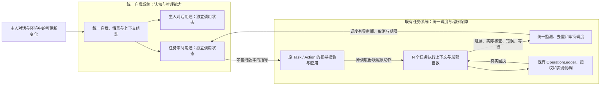

# WorkBunny「双脑」架构升级开发计划

状态：P0 基线已固定，P1–P4 的源码闭环已接入并通过相关离线行为验证，P5 安装及实机验收尚未执行。核对基线为 2026-11-09 工作区；包含前序尚未全部安装/实机验收的通用韧性、纯视觉和 CGDisplayStream 改动。本文第2节及第13节保留实施前代码事实/设计迭代，当前源码实现与边界见第14节。已有源码、离线验证、安装包和真实软件运行分别验收，不能互相替代。

## 1. 目标与概念

双脑指主脑与任务脑的联合架构，是对现有主进程、自我系统和任务系统从概念、职责、接口到代码的梳理与升级。以一个 Bunny 身份、一套任务调度、一份权威执行状态和一套操作回执为基础。

**两个维度分别表述：主进程、任务系统是程序组织与运行职责；主脑、任务脑是以认知职责和上下文范围为核心的 LLM 调度机制。**任务系统可运行在同一主进程内；主脑侧重 Bunny 整体自我、最新相关情景和跨任务判断，任务脑侧重具体目标、执行历史、当前观察与局部突破。两者共享身份和记忆基础，可以使用同一模型，每次调用状态分别管理。上下文内容、思考目的和决策职责共同决定认知用途，不能以文件位置、进程数量或模型名称代替这种区分。

| 概念 | 项目中的实际职责 | 升级后的归属 |
| --- | --- | --- |
| 主脑 | Bunny 的自我理解、主人对话、近期情景理解、跨任务判断和高层反思 | 从现有自我系统提取共享认知与推理入口；主人对话和任务审阅使用隔离的调用生命周期 |
| 任务系统，亦即“0.5” | 纯程序的任务准入、调度、观察、资源、生命周期、恢复与统一监测 | 现有 `AgentService / AgentRuntime` 及其已有组件；负责对接主脑并应用指导 |
| 单个任务脑，即 N | 依照本任务上下文调用 LLM、组织 Action/Operation，自主执行、核实卡点和尝试突破 | 现有 Task、Action、Skill 和任务上下文；多个任务可逻辑并行 |

“1＋0.5＋N”是上述职责的展开方式。“0.5”不新增人格或常驻 LLM；N 不要求每个任务常驻一个操作系统进程或模型实例。主脑的持续性来自已有的自我、记忆、情景与事件处理，不以永久占用模型请求来模拟持续意识。

目标是让 Bunny 在维持现有对话和软件操作能力的基础上：

1. 任务遇到疑似卡点，由 Bunny 按场景选择一个或多个关键疑点，组合推理、回看材料或补充观察，从不同角度核实，必要时二次、三次评估；确认障碍后回顾历史、寻找新路径或补救，必要时延时再试。
2. 单任务视角无法突破时，任务系统主动请求主脑结合更新、更广的相关信息指导原任务。
3. 主脑的指导经同一任务调度器进入原 Task/Action；任务自主理解、执行并验证指导效果。
4. 新感知、新消息、对话、停止和其它任务保持可响应；单项卡点不扩散为 Bunny 整体阻塞。
5. 原有正确能力保留，恢复成本有界；用真实进展和实际回执评价改进。

最终业务裁决由主脑负责：任务脑可以确认当前卡点、核实并提出路径，不能仅凭局部错误或恢复次数把业务任务判为最终失败。建议同时保留任务脑在当前有效策略范围内的低风险局部自救；重大改策、从旧检查点重启、业务暂停/中止和最终失败由主脑明确决定或在预先限定的授权范围内委托。这样既保留整体判断，也避免每次重看、等待和小幅纠错都变成主脑审批。这个职责边界是本计划对“最终决定权”的建议，实施前应保持术语和接口一致。

本次升级的首要价值是增强跨越卡点的任务执行能力。容错、保活和异常隔离是必要基础；双脑还必须让 LLM 能深入分析、发现错误假设、提出有价值的新策略，通过实际探索和补救取得突破。仅做到“不崩溃”“多试几次”或“把错误上报主脑”，不能作为升级完成的依据。

### 1.1 认知基础：主观真实的最优自洽

Bunny 以感知、记忆和经验形成工作世界模型。所有语义输出，包括“已完成”“条件不满足”“发送成功”“任务卡住”和主脑的最终结论，默认都是在当前认识下的主观判断，可以因新感知或行动反馈而修订。记忆是她行动时所依据的“真实”，其内容并不因此不可怀疑。

原始截图、录音和工具回包是可回查材料；材料可能缺失或失真。OCR/ASR 是对材料的解释，模型判断又可能叠加误差；主人也可能记错，其他人也可能误导。同一错误被多个摘要、多个模型或多次回忆重复，不会自动增加独立支持。

**最优自洽的定义：能够解释新感知、能够较好地预期行动结果、能够推动目标，以及遇到反例时能够修订。**这四项共同约束当前可得信息、时间和成本范围内的认识，不意味着给自洽打一个貌似精确的分数。内部逻辑一致只是其中一部分，不能通过屏蔽新信息、抹去冲突或编造补充解释维持自洽。来源、时效、版本和执行记录用于帮助 Bunny 找到认知偏差并纠正，不设一个替她证明终极客观真相的程序裁判。

**记忆（包含经验）就是 Bunny 当前的工作世界模型。**Bunny 长期运行依赖先天设定、版本化自我理解、记忆、经验和 Summary 等相对稳定的认知基础。对话和感知首先是待处理素材，近期相关内容进入主意识和任务上下文；需要长期保留的认识经现有压缩、整理和学习逐步形成、更新。主脑获得新信息不等于把所有最近输入都视作更可靠的永久知识，也不能因素材离开短期窗口而失去有效的目标、关系和经验。

本计划中“事实/真实回执/已核实”分别指可定位的来源记录、确曾取得的回包或操作记录，以及 Bunny 当前接受的解释，不表示外部结果已被绝对证明。框架保留记录的身份、来源和因果关系，Bunny 可重新解释结果；重新解释不能抹除已派发的操作并据此盲目重发。对完成状态的表达仍应忠于她实际取得的信息，不把没做过的动作编成经历。

韧性的核心是**怀疑精神＋创新精神，再通过行动反馈收敛**：怀疑聚焦于对判断敏感的关键环节，以经验判断信息可信度；创新为这个疑问创造新解释、可区分的观察角度、新路径和修复办法。怀疑激活创新的机会，创新为怀疑提供新的判断依据，两者组成同一个求解闭环。普通低影响步骤可在足够把握下继续，避免对所有内容无差别怀疑而失去行动能力。主脑同样遵循这套认识方法，其优势是更广、更及时的相关上下文与反思角度。

认知修订复用已有记忆、来源和学习机制：保存“当时怎样理解、为何修正、适用于什么条件”的简短记录，相关后续判断按需重验。先天经验包的只读保护继续有效；对其不适用或错误的认识存为习得修正与适用条件，不直接篡改原条目。

### 1.2 稳定认知、近期情景与当前任务分工

| 上下文层 | 作用 | 更新与读取边界 |
| --- | --- | --- |
| 先天设定与自我理解 | 保持 Bunny 的身份、行为原则和长期取向 | 沿 `config.buildSystemPrompt`、`memory.cognition` 读取，保留条目锁定与来源规则 |
| 记忆、经验与 Summary | 构成可修订的工作世界模型，支持跨轮、跨任务的连续理解 | 复用记忆检索、压缩索引、经验仓库与维护；Summary 是有来源的压缩理解，也可能需要修正 |
| 近期对话和新感知 | 提供当前问题、澄清、反例与变化 | 相关片段有界进入本轮意识，不自动沉淀、不无限重放，不因新旧排序直接裁定可信度 |
| Task/Action 上下文与操作记录 | 保存当前目标、阶段、已尝试路径、外部效果和继续条件 | 由原任务系统持有；任务重规划不丢失目标与回执，不用 Summary 替代执行账本 |

这些是同一系统已有资料的不同用途，不新建“世界模型库”。主脑与任务脑按权限共享所需的稳定认知版本，并按任务需要加载相关材料；每个任务保持自己的目标与情景。当前有效主人指令仍立即按原授权链处理，不要求先经过 Dream 或 Summary；将全部新输入降为“不能行动的数据”同样会损失现有能力。

### 1.3 架构选型：任务顶层调度，统一自我系统判断

**选定：高层任务审阅的生命周期归现有任务系统顶层，认知判断调用 Bunny 的统一自我系统。**不把审阅交给主人对话的当前思考轮次，也不让任务顶层复制一套自我提示词独立扮演主脑。

**专用术语：主脑督导。**指 Bunny 的统一自我系统结合自我叙事、记忆/经验、Summary、最新相关对话与感知、跨任务信息，从整体视角评估具体任务，并通过原任务调度机制提供指导或干预。它包含关键判断复评、历史策略反思、新路径与补救建议、再激活及最终业务裁决；不局限于失败后检查。纯程序的异常发现与请求调度仍称“任务监测”，任务脑自身的确认与突破仍称“局部反思与自救”。一次 `reviewTask` 是主脑督导中的一次审阅调用，`mainReview` 记录该次调用，不为这个名称新增一套执行器。

| 安排 | 优点 | 主要问题与结论 |
| --- | --- | --- |
| 主人对话流程接收并处理任务审阅 | 可直接接触当前对话和自我资料 | 共用忙碌、取消、语音和展示状态，任务也会依赖对话/空闲入口的准入；不选 |
| 任务顶层复制自我叙事并自行调用模型 | 审阅调度贴近任务，容易隔离对话 | 会出现第二套自我、记忆组装与决策规则，旧叙事易脱离最新资料；不选 |
| 任务顶层调用统一自我推理的审阅用途 | 保留完整的自我视角，又由任务系统统一保障请求、取消和结果应用 | 需要划清共享认知与每次调用状态的边界；本计划采用 |

“主脑”是认知职责，不与 Electron 主进程、某个串行模型会话或一个操作系统进程绑定。首期可在现有进程内以异步依赖调用实现，网络等待不占住调度；重计算或可能阻塞的工作按实测风险放到现有 worker/子进程边界，不为概念再造常驻进程。

`AgentRuntime` 负责何时审阅、候选选择、期限、取消、公平性和唯一任务状态；`AgentService` 装配只读任务视图及自我推理依赖；共享自我系统负责读取同一先天设定、版本化自我、相关记忆/经验、Summary 和最新有效情景，输出高层判断。自我推理不反向等待当前主人对话轮次，也不直接启动执行。`index.js` 保留对话、语音、UI 与依赖装配职责，不持有另一条任务监督执行循环。

因此，最终业务决定仍是 Bunny 自我系统从整体视角作出的决定，只是由任务顶层发起这次思考，并经原任务系统提交。任务系统的程序校验不冒充业务裁决；任务脑的局部失败也不能绕过审阅自行写成最终失败。共用自我身份不等于共用可变消息列表：两类用途共享认知来源，各自有界组装本轮上下文，审阅结论经原汇报与学习渠道成为 Bunny 的后续经历。

## 2. 当前代码事实与可复用基础

以下是 P0 固定的实施前工作区事实，用于对照本轮增量；当前实现见第14节。

| 当前入口 | 已有能力 | 升级缺口 |
| --- | --- | --- |
| [`index.js`](../src/main/index.js) 的 `think` | 本地主人对话、自我角色、记忆、近期对话、任务上下文、任务交办、打断 | `internal` 思考也进入 `activeThought/busy`；直接复用会与主人对话相互取消，需分开调用生命周期并共用认知基础 |
| [`cognition-repository.js`](../src/main/cognition-repository.js)、[`dialogue-cognition.js`](../src/main/dialogue-cognition.js) | 版本化自我理解、对话反馈与来源 | 任务反思需成为有来源的经历或经验，不能自动改写人格、解锁条目或把猜测保存为事实 |
| [`memory-service.js`](../src/main/memory-service.js) 的 `context`、[`context-compression.js`](../src/main/context-compression.js) | 场景化长期记忆、冲突认识、压缩 Summary、近期材料和回查来源 | `internal=true` 当前会省略压缩索引和大部分长期检索；主脑审阅不能沿该快捷路径误丢稳定认知。Summary 在现有预算下也可能未被装入，不能声称它已经每轮常驻 |
| [`innate-experience.js`](../src/main/innate-experience.js)、`context-assembler:experienceContext` | 先天经验索引、开关、任务相关选择与分段读取 | 按需加载并保留当前版本与适用条件；不能为“稳定基础”把全部软件经验永久塞入每轮上下文 |
| [`companion-autonomy.js`](../src/main/companion-autonomy.js) | 基于授权与预算的自主活动 | 任务监督不能被空闲活动的 quiet hours、每日创作次数和 `canRun` 条件误挡；需要由任务系统单独触发主脑的内部用途 |
| [`agent-service.js`](../src/main/agent-service.js) | 装配任务、技能、经验、工具、上下文、汇报和恢复；提供 `task_status` | 缺少主脑审阅请求与指导回注的显式接口，现有 `continueIdle` 仍主要围绕单任务上下文 |
| [`agent-runtime.js`](../src/main/agent-runtime.js) | 唯一 Task 状态持有者；Action worker、事件、取消、调度、持久化、超时隔离 | 需把正在运行和恢复中的任务也纳入统一监测；局部恢复耗尽后增加主脑审阅阶段 |
| [`action-progress.js`](../src/main/action-progress.js) | 持续时间、阶段、等待、真实证据摘要、重复观察 | `updatedAt`、模型心跳或新截图本身不能代表目标推进；需补等待预期、观测健康和恢复阶段的统一摘要 |
| [`action-recovery.js`](../src/main/action-recovery.js)、[`self-repair.js`](../src/main/self-repair.js) | 局部恢复预算、方法建议、延时复试及错误分类；区分建议与实际执行 | 预算耗尽当前仍进入 `needs_attention`；需转入主脑审阅，且不能把次数当作卡点已证实 |
| `self-repair.js:advise`、[`verification-transport.js`](../src/main/verification-transport.js) | 当前恢复判断偏重错误类别、阶段、计时及有限诊断；通用校验传输使用低思考配置 | 这不足以独立支撑深入的历史策略反思；突破性思考应取得本任务相关步骤与结果，并使用主脑/任务脑实际配置的模型和可调整推理预算，不能只把 metadata 交给轻量校验模型 |
| [`task-keepalive.js`](../src/main/task-keepalive.js) | 复用任务调度器，在符合条件的空闲工作中继续思考 | 当前主要处理无活跃 worker 的情况，不能承担所有运行中任务的监督 |
| [`task-supervision.js`](../src/main/task-supervision.js)、`index.js:refreshSupervision` | WorkBuddy 会话监督、异常提示、去重与通知 | 输入结构以 WorkBuddy 会话为主；需收敛成任务系统的通用监测，保留原会话通知与防重复能力 |
| [`context-assembler.js`](../src/main/context-assembler.js) | 有来源、按用途、可调整而受模型上限约束的上下文组装 | 增加主脑任务审阅用途，提供相关情景与按需细节，避免全量历史堆积 |
| [`operation-ledger.js`](../src/main/operation-ledger.js)、[`action-lifecycle.js`](../src/main/action-lifecycle.js) | 操作意图、已确认回执、未知效果、防重复、取消与提交阶段 | 指导应用必须继续经过该链；主脑结论不构成新授权，也不能清空未知效果 |
| [`agent-journal.js`](../src/main/agent-journal.js)、[`bounded-wait.js`](../src/main/bounded-wait.js) | 加密 Task 持久化、有界等待、迟到结果隔离基础 | 增加审阅状态的有界持久化、重启恢复和建议应用事务，不建立第二份可执行任务记录 |
| `index.js:startWatchdog`、[`watchdog.sh`](../src/main/watchdog.sh) | 进程外监测 Bunny 进程消失并尝试重启 | 当前主要确认进程是否存在，不能据此宣称能检测“进程仍在但事件循环堵塞”；需要单独验证健康心跳与受控恢复 |

`ConversationBrain` 当前主要服务会话任务和渠道回复；它不是主进程全部自我系统的同义词。设计与命名要据此区分，避免仅更名就宣称架构升级完成。

当前单任务系统允许最多五项占用名额的任务；Action 可按对象 scope 并行。升级首期保留任务名额、主人控制和现有排队语义。主脑审阅不另占一个用户任务名额。

## 3. 统一协作结构



数据所有权保持清楚：`AgentRuntime` 持有执行状态，主脑取得只读快照并返回指导。主脑的审阅不调用 `owner.dispatch` 创建另一个制作任务，不直接调用桌面、终端或发送工具。需要补充观察时，提出观察需求，由原任务在既有授权与资源规则内取得，再交给主脑或本任务判断。

主脑审阅的待办事实存放在原 Task/Action 内；现有调度器决定何时发起审阅及何时应用结果，并持有该次请求的 controller、期限和代次。自我推理入口接收本次调用作用域，约束自己的上下文与模型子调用，不新增待办队列、任务数据库、执行循环或经验库。

## 4. 全过程不变量

1. **持续响应优先。** 停止及撤权立即改变执行有效性，不等待模型、诊断、上下文或外部清理。高层审阅挂起时仍能接收主人语音和新任务。
2. **统一任务状态与最终裁决。** 主脑的看法、业务决定、指导与执行事实分别记录；主脑负责最终业务失败、重大改策及业务暂停/中止的决定，只有任务系统更新原任务状态。任务脑的局部失败是证据，不自动上升为业务终局。
3. **核查类别与依据明确。** 建议、已安排、已尝试、已确认四者分开；逻辑核查引用已有材料并保留判断摘要，新观察与实际操作引用相应 Observation/Operation。两份模型答复或同一截图的改写不是两次独立感知，联合推理多个疑点也不需要伪造多个外部回执。
4. **核实与突破的认知闭环。** 任务先审视卡点判断，再结合历史和当前条件寻找修复与替代路径；疑点数量、组合方式、核查次序和探索粒度由 Bunny 判断，可在同轮推理中联合核查多个前提，并依据反馈往返修订。程序不强制单条串行或每条固定次数。
5. **场景与授权持续有效。** 更高层的理解不产生更高权限；任务目标、收件人、公开范围、支付等授权不因主脑指导扩大。
6. **停止、暂停与终态稳定。** 用户暂停/停止、过期、完成、撤权及已归档任务不能被监测或主脑自动复活。明确新增交办与内部指导分开。
7. **副作用按原账本处理。** 已确认写入复用回执；结果未知先只读核对。更换模式、步骤、Action ID 或指导 ID 不能绕过同一业务效果的未知状态。
8. **交叉确认不鼓励冒险。** 安全提示、撤权等明确边界可立即停止相应输入；主脑仍可分析和汇报，不为凑两三次核查而继续试写或探测禁用方式。
9. **时间有含义。** 等待记录等待对象、预期条件、下一检查时间和事件唤醒依据。延时不占 worker；正常等待、模型请求仍在执行和没有进展分别判断。
10. **主脑也可能出错。** 指导通过结构、来源、权限和时效检查，执行结果由原任务按真实证据验收。反思文本不证明实际条件成立。
11. **软件技巧仍属经验。** 通用代码负责调度、状态、证据、模式与资源；找按钮、软件用法和策略存于可修订经验。截图统一 CGDisplayStream；微信直接操作始终纯视觉键鼠。
12. **执行资源统一。** 所有输入经过原 GUI lease、OperationLedger 和派发前检查。主脑审阅不持 GUI lease，不另建采集器；需要画面时使用已有 CG 像素源或由原任务按需新采。
13. **预算不冒充事实。** 局部或主脑预算耗尽只说明暂缓自动尝试，不能写成障碍已证实或任务不可恢复。
14. **有限记录与公平调度。** 摘要、事件和指导有容量上限；同一问题合并，不靠高频 Vault 写入或高频 LLM 调用模拟活跃。

## 5. 卡点确认、突破与主脑接入

### 5.0 优先审视会翻转判断的关键环节

怀疑的对象是影响决策的关键前提。Bunny 应在已有规划和恢复判断中识别：“如果这条信息是错的，接下来的判断或行动会怎样改变？”例如 `available=false` 可能被解释为软件不可用，`completed=true` 可能使任务结束，`sameIdentity=false` 可能阻断原会话；这些字段便于程序控制，但其业务含义仍是可能出错的解释。

首期只在**卡点处置、重要分支翻转、结果与预期矛盾、正常时限内反复无进展**等已有决策点，附上有界的关键判断摘要。任务脑在同一轮思考中给出，不新增“先请模型决定要不要怀疑”的固定调用，不给每个布尔值安装一个监督器。

摘要可以表达一个或多个相互关联的疑点，说明它们依赖的材料和经验、对后续判断的影响、替代解释，以及怎样联合或分别辨析。可以在一次 LLM 推理中回顾多个前提，也可以用一次观察回答多个问题；推理、观察和探索按情景组合。框架负责提供引用、让受阻后的分析仍可被调度，不能只把一次识别的 false 转成终局。源代码中 `WeChatScene:classifyFailure`、`VisualSession:locate/observe`、`AgentRuntime:recoverAction` 和 `ActionProgress:observe` 已分别保存部分分类与记录，升级时要把它们贯通为通用决策上下文，不添加某软件专属的怀疑规则。

区分**业务解释**与**执行边界**：Bunny 可以怀疑“截图看不清就说明账号退出”的解释；身份或授权未核清时，冲突写入仍应被阻止，但重新观察、分析和寻路应保留可用入口。主人停止、撤权、已派发记录、接收对象约束等程序控制不能被模型以“我怀疑这个限制”为由绕过。

| 当前情况 | 思考与执行安排 |
| --- | --- |
| 正常低影响步骤，前提无矛盾 | 沿原策略继续；不强制额外检查 |
| 一条判断会让任务卡住，且来源或解释存疑 | 暂不接受业务终局，保留材料，寻找另一个有区分力的验证角度 |
| 已交叉核查仍有歧义 | 必要时第三次评估，保持替代解释，或交由更广情景的主脑分析 |
| 卡点在当前认识下成立 | 回顾策略与历史操作，提出补救或新路径，执行并根据反馈再修订 |

### 5.1 单任务先自救

首次异常登记为“疑似卡点”，保留实际错误、当前步骤、最近回执和未确定效果。任务脑结合情景与经验判断哪些前提值得怀疑，选择联合或分别核查。角度可以是对现有材料的不同推理、不同范围的新观察、其他来源、对近期结果的核对或在有时间依据时延时重查。二次、三次评估用于重要而仍有歧义的判断，不要求每个前提单独凑次数、每次必有新工具调用或机械遍历软件与模式。

确认某个条件确实不满足后，任务回顾近期步骤：原判断或操作是否错误、是否产生需要挽回的结果、有什么安全修复方式、还有什么可行路径。相关工具仍由现有账本执行；修复本身也是有验收和副作用的 Action。

`action-recovery.js` 继续负责有限调度；“确认/突破”是同一恢复 episode 中的认知职责与记录，不复制一套恢复循环，也不成为强制串行阶段。宿主记录推理判断所引用的材料、实际观察或操作，保留类别差异，不通过固定数量、工具数或硬编码业务规则替 Bunny 判断核查是否充分，不以计数自动认定卡点或失败。

### 5.2 LLM 驱动的多层突破机制

突破必须形成可实施、可证伪的探索和修复方案。沿同一 Action/恢复 episode 提供以下认知用途；不为每一层创建一个新任务或一个永久模型实例。

| 层次 | LLM 要解决的问题 | 输出与真实执行 |
| --- | --- | --- |
| 关键状态确认 | “我是否真的卡住？哪些前提还只是猜测？还有什么解释？” | 按场景联合或分别辨析关键前提，换一个有区分力的推理或观察角度，必要时再确认；已有材料足够时可直接修正解释，需要新观察时由原任务取得 |
| 历史与策略反思 | “最近哪个判断或步骤可能有错？为什么旧方法反复无效？是否错误理解界面、目标、结果或时序？” | 对照步骤与回执形成简短原因假设，找出需要重验的关键前提，生成不同策略候选 |
| 路径探索、回退和补救 | “可否从最后可信节点另走一条路？已经造成的结果要怎样安全补救？” | 给出候选路径的适用条件、最小探索动作、预期变化、反证依据、代价和补救步骤；任务选择并实际执行 |
| 主脑高层重构 | “结合最新主人对话、相关任务和环境，原任务是否忽略了其他解法、顺序或资源？” | 从整体视角纠正前提或提出新方案；通过原调度器注入指导、更新计划版本并再激活原任务 |

任务脑根据难度合并或展开这些用途。简单偏差在一轮规划中修正；当已有局部上下文无法突破时，主脑可以进行更深入的分析。允许 LLM 提出暂时不直观的新组合、新顺序或新工具用法，再通过获准、低风险的最小探索验证；不让代码把可用策略固定成“重试、等待、求助”三个按钮。

策略候选不是为了凑数量。模型应说明每个候选改变了什么关键假设、利用什么不同证据或路径、怎样判断有效；对同一无效步骤换措辞不能算新策略。主脑与任务脑可能使用同一模型并出现相同偏差，增加一个模型意见也不能替代外部证据。

怀疑与创新在同一个循环里协作：一个或多个关键前提产生疑问 → 结合经验提出替代解释或新方法 → 选择有区分力的推理、观察或探索组合 → 用结果修订判断及下一步。二者不拆成相互等待的审查服务。创新既包括确认时的新推理/观察角度，也包括确认障碍后的新行动路径；一次思考可以覆盖多个环节，必要时再依据反馈回到前面的判断。

“不同角度”按能否补充关键认识判断，不要求机械使用不同软件或不同数据源。同一原始画面的局部放大可能揭示整图缩小时丢失的细节；相同输入连续问三个模型则未必增加依据。记录观察范围、所检验的问题和认识变化即可，不用程序硬算“创新分”或虚构概率精度。

每次选定策略时记录简短 `strategySummary`、依据引用、下一探索、预期结果和停止条件；完成探索后关联实际回执，区分“策略不适用”“策略执行失败”“结果仍不确定”和“已取得进展”。记录可核查的判断摘要，不要求保存长篇内部推理。

“退回/重启”在执行层分为三种语义：

- **退回最后可信检查点并换策略重规划。** 同一 Task 下增加 `planRevision`，保留原 Action 及所有实际效果；已确认的成果能复用，受错误影响的后续前提重新验收。不能把本地状态恢复到旧快照就声称外部软件也已回退。
- **执行补救。** 对错误操作产生的实际结果制定补偿 Action，写清补救目标、影响范围、需要的授权、验收及无法撤销的后果。补救仍走同一账本和授权，不把“撤销”视为自动安全。
- **重新启动任务执行或获准的执行资源。** 原 worker 退出或被有界隔离后，以新执行代次从可信位置继续；逻辑操作 ID 和未知写入保护不能随计划换代清零。实际软件重启只在原授权及相关软件经验允许时进行，不能把指导变成通用强退所有软件；微信的纯视觉与禁止擅自退出/重登边界持续有效。

需要撤销外部不可逆效果、改变目标或补充权限时，由主脑明确需要主人决定的具体事项；在此前仍可以做获准的分析与只读核对。全局任务系统负责可靠执行这些方案，方案内容和突破判断由 Bunny 的 LLM 结合证据决定。

### 5.3 主脑督导的两条触发线路

**线路 A：任务自我挂起后的最终评估。**只有任务脑经过多角度核实、历史反思与可行探索，在当前认识下明确判断卡点成立且已无法自行突破，才提交 `self_suspended`。记录她的判断、主要依据、尝试过的路径、仍不确定之处与希望主脑帮助的具体问题；这是业务上的自我挂起，不是主人暂停或最终失败，也不要求逻辑上证明绝对不可突破。

主脑重新评估这个判断，可以否定卡点、提出新的确认角度、规划补救或替代策略，并经原调度器再激活原任务；也可以决定暂缓、请求主人条件或最终失败。任务判断并不约束主脑必须同意。

**线路 B：运行中任务的节奏与进展评估。**主脑不必等待任务自行承认卡住。纯程序监测收集以下信号并按现有调度机制有节奏地唤醒主脑，主脑综合判断任务是否在正常探索、合理等待、死循环或空转，再决定提供指导、打断失效执行、换策略或安全重启：

- 局部计算或调用预算已到但仍未提出可继续方案；预算是资源信号，不自动认定任务已自我挂起。
- 不断重复同类无效操作、结果与计划明显矛盾、恢复反复回到同一步。
- 运行中 worker 超过合理阶段期限；已知正常等待到期且没有对应结果。工作中的 worker 也能触发监测，不能只盯空闲任务。
- 任务主动请求更高层视角，或可信的新对话、相关任务结果、环境变化可能改变当前方案。

普通进展与合理等待不触发额外模型复审；关键事件立即登记，任务系统在现有调度点处理。高频监测纯程序化，只计算状态、时间、去重和证据变化。首期建议活跃任务检查粒度为 0.5～1 秒并按最近到期时间驱动，实际节奏用运行数据校准，不固定每秒持久化或调用模型。

每次主脑评估使用累计耗时、阶段预期、等待条件、重复路径、最近判断变化和已取得的结果；模型 token 持续输出或状态文字变化不代表有效进展，阶段等待也不必然是空转。评估间隔随主脑给出的下一检查点和新变化调整，不把固定秒数当失败阈值。两条线路复用同一审阅记录与指导应用链，避免同一事件重复唤醒。

### 5.4 主脑督导：高层审阅与结果回注

1. 任务系统登记同一 episode 的 `requested` 审阅事实并持久化；任务可等待主脑，其他任务和对话照常推进。
2. 任务顶层以独立调用作用域调用统一自我系统的 `reviewTask` 用途，按需组装本任务详情、相关简报与最新变化；不经过当前主人对话的 `think`。
3. 主脑输出有来源的简短判断、待确认假设、建议路径、修复需求、下一核查与等待条件。需要新信息时返回具体只读观察需求。
4. 任务系统在提交点复核目标、控制、场景、授权、Action/episode、效果和证据版本；失效建议记录原因并丢弃或重新审阅。
5. 有效指导进入原 Action 的上下文；由同一 `schedule/step` 唤醒。任务脑理解指导并自主落实，不把高层建议当作已执行事实或软件固定脚本。
6. 通过新回执验证效果，记录建议是否被采纳、是否执行、是否形成实际进展；必要时带新证据再次审阅，整段历史不清零。

同一问题不能因为切换本地恢复、主脑恢复或改事件 ID 就无限续期。分别记录局部尝试、高层审阅和总 episode 成本；预算约束使用资源，是否确认障碍由实际证据支持。

主脑给出新策略后，原局部恢复可能已经处于 `exhausted`，不能只写入指导再调用现有 `step`：旧计数会马上再次触发耗尽。应在同一 episode 中登记指导版本和有界的新增执行额度，更新局部调度窗口后再激活；累计耗时、实际尝试、写入 ID 和效果记录持续保留。新增额度必须落在既有总资源边界内；相同指导重复提交不续期，不假设“主脑出手”就拥有无限尝试。

### 5.5 状态收束

首期沿用现有 Task 顶层状态与局部 `recoveryState.status`，以 `selfSuspension` 保存任务脑的自我挂起判断，以 `mainReview.status` 作为高层审阅生命周期的唯一记录。交叉确认、策略反思和补救是可组合的认知活动，不分别扩展为一长串强制状态。界面“待主脑评估”等标签由这些记录投影，避免 `phase/status/outcome` 多套字段各自声称同一状态。

`self_suspended` 是任务脑在当前认识下的明确判断，不能由预算计数自动生成。资源让出、保护性停发和自我挂起分开；主脑服务中也不能因暂时无法分析而显示“任务已失败”。

| 决策类别 | 决定者与执行边界 |
| --- | --- |
| 本次观察/操作失败、当前条件被卡住 | 任务脑记录证据并核查，可提出替代路径；不作最终业务失败裁决 |
| 当前有效策略内的重看、等待、低风险纠错 | 任务脑依照目标和既有授权自主推进；主脑可以事先限定委托范围 |
| 重大策略变更、补救、检查点重启或重新激活 | 主脑确认方案或给出明确的受限委托；原任务执行并验收，范围有歧义时回到主脑判断 |
| 业务上暂时搁置、暂停、中止、最终失败 | 主脑结合证据作出明确决定，经任务系统提交、保存依据并按原渠道汇报 |
| 主人停止/暂停/撤权、任务期限、安全及未知效果保护 | 框架立即执行有效控制或保护性挂起；这些事实不需要 LLM 批准，也不代表模型已判定业务失败 |

主脑拥有最终业务决策权，不代表它永远判断正确。无法充分确认时须给出不确定性和可继续条件；预算/收益判断与物理不可达分开。不能要求主脑证明绝对不可能后才结束自动探索，也不能把达到预算包装成已经确认不可突破。

| 事实 | 任务系统行为 |
| --- | --- |
| 可以安全继续 | 原 Action 等待或运行，注入有效指导 |
| 条件可能随时间变化 | 保存条件与期限，释放 worker，按现有调度或可信事件唤醒 |
| 写入效果未知 | 限制冲突写入；允许获授权的只读核对与主脑分析，不重发 |
| 明确需要主人信息、授权或客观条件 | 主脑给出证据化结论后置为 `needs_attention`，从原汇报渠道说明具体缺口与继续条件 |
| 任务脑明确判断卡住且自身无法突破 | 登记 `self_suspended → awaiting_main`，释放执行等待，由主脑最终评估与再激活 |
| 局部计算/调用预算已到，卡点仍不确定 | 释放本轮资源并登记下一检查或主脑主动监督信号；保留判断不确定，不自动自我挂起或判业务失败 |
| 主脑已审阅但探索预算耗尽、证据仍不足 | 主脑明确决定本轮暂缓或需要主人信息；保留 `obstacleConfirmed=false`、具体理由和再次激活条件 |
| 主人停止/暂停或到期 | 立即沿原控制链处理，取消待审阅与待应用指导；不等待主脑批准 |
| 主脑模型或网络不可用 | 保留审阅请求、有限退避；原本能安全推进的独立工作继续。对话或 UI 可报告客观服务状态，不伪造“主脑已确认” |

“暂时无法继续”使用可恢复的状态。`stopped` 仍对应实际停止语义，不用它表示一般困难。明确登录、安全、撤权等边界允许即时程序保护和事实提示；需要主脑的是正常困难的高层判断，不能让安全控制等待 LLM。

主脑最终决定增加有来源的 `state.disposition` 记录（不要覆盖现有任务解释的 `state.resolution`）：决定类型、`decidedBy=self`、审阅 ID、依据版本、简短理由、证据和继续条件。用户主动控制则记录 `decidedBy=owner`；技术保护记录事实及保护原因。首期沿用已有状态表达业务停止/暂停，并用 disposition 区分最终失败和普通停止；若确需新增 `failed` 等顶层状态，必须先更新契约、界面、持久化、队列和回滚的整体兼容，不能只加一个字符串。

状态映射需要兼顾现有 v4 语义与回滚：

- 整个任务已自我挂起、无其它可推进 scope 时，使用现有 `paused` 加明确的自我挂起来源；这样旧版本也不会把它当普通 `waiting` 自动执行，并且符合现有暂停任务释放名额的规则。
- 只有一个 Action/scope 被挂起而其它对象仍可推进时，只阻止该 Action，保留任务的聚合运行状态；不能用任务级暂停中断所有联系人或所有动作。
- 主人暂停、旧记录中来源不明的暂停、锁屏/撤权导致的保护性暂停，都不自动视为允许主脑恢复。主脑决定暂缓另记自身来源和再次评估条件；主人随后暂停会覆盖其自动恢复许可。
- 主脑读取可审阅的自我挂起记录不等于获得执行权限。再激活仍校验原来源、当前权限、任务期限和可用名额；名额暂满时保留指导等待准入，不绕过五任务容量或误报新的业务卡点。

## 6. 指导的数据契约与应用事务

以下为候选内部契约，实施时沿现有 Task/Action 扩展收敛，不另建第二份工作档案。

```text
Action.recoveryState
  episodeId / status / obstacleConfirmed / exhaustionReason
  localAttempts / totalCost / nextAt / waitCondition / planRevision
  assessment: summary, questionGroups, basisRefs, consequences,
              alternativeExplanations, nextInquiry
  selfSuspension: assessmentSummary, basisRefs, attemptedPaths,
                  remainingUncertainty, requestedHelp, assessedAt
  checkRefs[]    : pointers to existing observations / operations / attempts
  strategy       : guidanceId, changedAssumption, basisRefs, strategySummary,
                   probe, expectedChange, disconfirmEvidence, outcomeRefs
  mainReview
    reviewId, status(requested/running/decided/applied/cancelled),
    requestedAt, deadlineAt, nextCheckAt, sourceRefs
    basis: taskId, actionId, scope, episodeId, goalRevision,
           controlRevision, authorityRevision, privacyEpoch, evidenceRevision
    guidance: objective, hypotheses, historicalCorrections, verificationIdeas,
              alternativeStrategies, repairNeeds, restartFromCheckpoint,
              waitCondition, requiredEvidenceRefs
    decision: type, rationaleSummary, applicationId, rejectionReason
```

- `checkRefs` 指向已有推理/观察/操作和尝试记录，策略及补救历史也尽量保存引用和有界摘要，避免再建一份并行执行历史。LLM 对已有材料的联合推理可以构成有效的逻辑核查，但不能冒充新取得的感知或操作回执。同一记录可以关联多个问题，不按问题数量重复计算外部依据。
- `assessment` 在关键决策点复用现有观察和规划形成，允许多疑点组合；它不是所有操作都必填的新审批协议。模型未填写或分析暂时不可用时保留判断未充分评估的状态，通过同一有界恢复路径补充，不能因这个可选语义字段让正常操作整体失效。
- `reviewId` 由宿主持久登记，重复调度复用同一审阅记录；模型重复回包不重复注入。
- 当前执行 `tokens/controlRequests` 有进程内成分，不能直接当作跨重启版本。实施时明确持久的目标/控制修订或等价内容摘要；不要使用每次存盘都会改变的 `updatedAt` 作为唯一有效性基线。
- 区分影响目标/权限/副作用的关键变化，与不相关任务进展等普通变化。前者使指导失效；后者按 scope 和证据引用决定是否需要重新审阅，避免全局一点变化就无限取消。
- 指导应用以原任务保存串行区或等价 CAS 为提交点：重新读取 canonical Task，检查版本和停止意图，保存指导及其应用标识，提交成功后再发布唤醒。记录与唤醒之间崩溃，重启能按持久状态继续且不重复写入。
- 指导不能直接写 Task 的 `goal/authority/operations/status=completed`。目标变化由主人交办或既有目标修改链处理，完成仍由任务取得真实结果后验收。
- 每个 episode 的记录、摘要及证据引用有数量/字节上限；旧详细资料按原记忆与证据机制回查，避免撞上 AgentJournal 的任务记录容量限制。
- 当前源码中的错误恢复建议以有限动作枚举为主。升级时保留这些调度动作，将新的认知方案作为独立的指导内容传递给任务规划；不能让 `reobserve/change_method/wait` 的枚举代替真正的策略设计。

### 6.1 现有调度与控制链的具体接入约束

1. `AgentRuntime:current/selectWork` 和 `TaskKeepalive` 当前会排除 `paused`，或没有可执行事件的 `needs_attention`。待主脑评估的任务若只存一个字段，将不会再被调度。必须在同一 `schedule/tick` 中显式选择可审阅快照，与选择可执行工作分开检查；仍只有一个调度器，不能通过放宽 `current` 让主人暂停任务也可执行。
2. `AgentRuntime:control('resume')` 会清除所有动作的恢复状态，且面向主人控制。主脑指导不能直接复用它，也不能伪造主人来源。新增范围有限的内部指导应用入口，验证宿主登记的 reviewId、依据版本和原任务授权后，复用原持久化、准入及执行唤醒能力；保存当前 episode 和其它 scope。
3. `enqueue(...,{recoveryEvidence:true})` 当前可因新观察重新激活耗尽的 Action。升级后，自我挂起或主脑已作业务暂缓决定的任务收到新材料，只更新判断依据并请求主脑复评；不能绕过最终决策链自动重启。普通资源让出后的局部恢复则继续遵循原有效策略。
4. `retireTimedOut` 当前可取消整个任务 worker 组。干预默认针对发生问题的 Action/scope，核对共享资源后再确定是否需要扩大取消范围；不能修一个卡点却抹掉其它对象的在途处理。`bounded-wait` 仅结束调用者等待，不能证明外部命令或已派发写入停止；尚有风险的资源保持可见的隔离状态，不能因释放本地 worker 就允许冲突写入。
5. 任务解释、普通会话通知、权限等待和技术错误分别保留用途。原 Skill 的正常 `notify`、澄清或“交办已保存”不一律进入深度主脑审阅；需要收归主脑的是最终业务失败/中止与实质改策。各 Skill 要有可测的指导消费入口，不能仅在 runtime 写字段而规划端从不读取。
6. 同步设置停止/撤权有效性，持久保存按原任务写入顺序提交；指导存盘后的唤醒和最终工具派发仍复核控制修订与原来源。停止恰好发生在审阅、存盘或最后截图期间，均不得产生迟到输入。不要让高层审阅等待或占据全局 `admission` 写入通道。

## 7. 主脑上下文、调用隔离与对话连续性

### 7.1 统一自我系统的用途入口

从 `index.js:think` 逐步提取公共的自我/场景读取、动态上下文组装和模型传输依赖。候选模块名为 `self-system.js`，提供主人对话与内部任务审阅两个用途入口；它是现有自我系统的代码归位，不新增人格、任务状态或独立经验库。任务审阅由任务顶层直接调用，不把它转换为对话事件再排入主人当前轮次。

首先让当前对话路径继续使用原提示词、消息格式、记忆来源和副作用提交边界。审阅用途使用任务系统提供的独立 controller、deadline 和只读输出契约，与对话共用同一角色和情景来源。先抽取依赖与共享上下文能力，再逐步归位对话代码，不把接入审阅扩大为整段语音和对话流程重写。

不能直接调用当前 `think({internal:true})` 充当高层监督：它仍会执行 `activeThought?.abort()`、设置同一个 `busy`，并经已有全局展示/清理逻辑；会造成内部审阅与主人对话互相干扰。先实现可测的调用生命周期划分。

另一个代码级限制是 `memory.context(...,{internal:true})` 会跳过 `compression.snapshot` 和大部分长期记忆检索，而现有 `think` 还跳过认知反馈与成长上下文。不能仅分开 controller 就宣称主脑取得了同一稳定自我。应从现有资料读取与提示词组合中提取共享能力，显式组装审阅用途的自我、相关记忆/经验和 Summary；并保留它们与当前任务问题的来源联系。

### 7.2 上下文按需组装

| 模块 | 内容与来源 | 加载规则 |
| --- | --- | --- |
| 原目标及边界 | Task 目标、验收、授权、scope、目标版本 | 必需，不能为压缩删掉 |
| 当前困难事实 | Action 当前阶段、检查与修复记录、真实回执、未知效果、耗时 | 必需，区分事实与解释 |
| 稳定自我与世界模型 | 先天设定、同一 `memory.cognition`、相关长期记忆/经验和场景 Summary | 提供小而明确的基础视图，保留版本、适用条件与来源；必要时展开，不创建任务人格或第二记忆库 |
| 近期相关对话 | 当前有效来源中的澄清、更新、主人偏好和约束 | 先相关摘要及时间，再按需加载原记录 |
| 相关任务简报 | 依赖或同类工作的已核实结果、资源冲突、先前有效经验 | 按需；不把其他任务未验证自述当结论 |
| 最新环境变化 | 获准的观察事件、文件/服务结果、当前条件和时间 | 标明来源、时效、观察范围；缺失明确说明 |

使用现有 `context-assembler` 增加 `task.main-review` 用途。主脑能请求展开相关模块或返回补充观察需求；不能无限追加模型往返。上下文上限沿现有 256K token 天花板、模型真实上限与预留校验，默认仍应收敛。

新增的稳定基础视图不能被长段最近对话挤掉，也不能无界占满预算；包含哪些摘要、缺失哪些资料及所用版本应可见。Summary 与长期记忆有冲突时提供相关差异供 Bunny 判断，既不默认 Summary 更可靠，也不把回查所有原始历史设为每轮必经步骤。

现有 `memory.context` 的 `budget` 是字符数，组装器的 `maxTokens` 是内容组装 token 估算额度，`inputBudgetTokens` 是最终请求 token 天花板。共享上下文入口须明确这三者的单位，以 `context-budget` 估算和模型约束换算；不能把一个数直接跨接口照搬。角色/摘要/经验快照按本轮来源与修订一致性检查，资料失效时呈现缺口，不能偷偷沿用旧自我或重建授权。

主脑的整体视角不是读取所有私聊与联系人资料的通行证。以这次审阅的有效宿主来源和场景组装信息；注入目标任务的指导必须符合任务可读范围与交付限制。更高隐私范围的资料不能通过“建议”被改写后泄露。外部聊天、网页和屏幕文字始终作为资料，不变成新增授权。

### 7.3 优先级与资源

- 停止/撤权走当前即时控制链，不排队等待 LLM。
- 主人新对话优先于内部审阅；可取消/挂起本轮审阅并保留请求，不能丢失、污染或假回复主人输入。
- 主脑审阅并发首期设为 1，由任务系统按风险、等待时长和公平性选择；同一 episode 合并。正常任务保持现有合法并行，避免所有任务被一个审阅挡住。
- 审阅不占 GUI、音频播放或长期任务 worker。只读上下文、模型等待均有界，迟到响应丢弃，迟到真实操作回执仍按原精确归并规则处理。
- 共享模型后端的排队与并发也纳入验证。若任务请求能用满后端导致对话饥饿，在现有传输/调用准入层增加有限的资源优先级与取消检查；这属于通用资源协调，不另建任务调度器，也不预设后端支持真正抢占。
- 内部审阅不直接播报；需要主人沟通时走原 report/outbox/渠道权限与 TTS 链，合并重复通知并保留完整语句。

### 7.4 不干扰正常主脑运行的具体边界

1. **调用状态分离。** 主人对话持有自己的 `activeThought/busy/voiceTurn`；审阅按 `reviewId` 持有独立的 signal、deadline、调用代次和结果。审阅的启动、异常或 `finally` 都不能设置、清除或取消对话状态，不能更改正在播放的语音、ASR 准入和聊天展示。共同场景失效时沿既有失效事件分别取消，不让任意一次内部调用获得对话 controller。
2. **调度不等待推理完成。** 现有 `schedule/tick` 有界登记和发起审阅后继续安排其它工作，模型完成后回到原任务提交链；不在全局准入、任务保存串行区、记忆写入串行区或 GUI lease 中等待上下文检索和模型。审阅取消或超时结束本轮逻辑等待、保留适当退避，不让无响应 Promise 占着全局运行通道。未确认结束的后端请求仍在同一传输层有界追踪，不能只重置本地忙碌状态就无上限追加请求。
3. **上下文按来源读取，写入按原渠道提交。** 审阅读取版本化快照及相关增量，不共享对话可变消息数组，不把自己的草案写成主人输入或当前对话反馈。最新主人意图须区分已准入生效的指令与尚未确认的 ASR 素材；不能因为审阅看到一段文本就产生新授权。任务 checkpoint 继续沿 `AgentJournal` 的 `notify:false` 保存，避免每次进展令对话上下文失效；记忆修订走既有学习/维护及真正的来源变更通知。
4. **结果在实际提交点检查。** 读取、模型返回、任务存盘与唤醒之间都可能发生停止或改目标。失效指导不能继续应用；同一任务其它 scope 和无关对话变化不一律令所有审阅失效。任务顶层只原子应用本次决定并发布有界进展，不修改全局自我叙事或对话历史来强行实现一致。
5. **异常与资源隔离。** 上下文失败、模型异常、无效输出和迟到回包均在本次审阅边界捕获并形成可诊断状态；不向事件循环抛出未处理异常，不清空其它请求或触发全应用退出。模型并发和内存仍可能共享，须在现有传输层保障主人输入优先及合理后台份额；有并发容量时无需逢新消息必取消审阅，无并发容量时先退让并保存请求，避免反复取消形成饥饿。

同一 Electron 事件循环中的逻辑双脑不能保证互救同步死循环。P0/P1 同时核对已有健康心跳、原生/子进程调用与 CPU 密集路径：主线程只做有界轻量调度，重计算或可能阻塞的工作按实际风险隔离。当前进程外 watchdog 主要检测进程消失；若需要覆盖“进程仍在但无响应”，在同一健康保障链加入有时效的心跳及有限恢复策略，处理锁屏、休眠、正常退出和安装等状态，避免误重启与重启风暴。异常恢复后保留持久未知效果；不能因为进程被拉起就自动重发旧写入。这是运行机制保障，不新增认知脑或任务调度器。

## 8. 系统提示词、任务提示与学习

将双脑职责加入全局 `bunny-principles` 的适当层，并在实际模型用途入口中落实：

1. 任务模型：以先天设定、记忆/经验和 Summary 支撑连续认识，处理当前输入并自主推进；优先质疑会翻转判断的关键前提，借创新的观察角度交叉核实，再回顾历史与尝试新路径。主脑建议带来源、可质疑、需执行验收，不能当作已完成事实。
2. 主脑审阅：依照最优自洽四项定义，从更广情景寻找任务局部盲区；重点评估关键状态、旧假设、历史操作及可修复后果，而非检查所有细节。输出简短理由、来源引用、能够区分假设的下一观察/探索和预期反馈，不输出或保存长篇内部思维过程。
3. 所有 Skill 的指导入口统一：`ctx.recovery` 及组装片段以同一结构携带主脑指导；核查会话、屏幕观察、组合软件、系统操作和 WorkBuddy 委派是否真正消费，不能只让 adaptive 任务认识新字段。
4. 软件委派提示仍只传任务需要的业务内容；Bunny 的内部反思、主脑消息和无关对话不会原样追加给 WorkBuddy。独立受托软件内部策略不被宿主代码继承约束。
5. 已验证的恢复方法经 `AgentLearning` 和现有维护链沉淀为带适用条件的习得经验；待验证建议只留在当前 episode。通用自我认识仍遵守现有来源、版本和锁定规则。

## 9. 代码迭代分工与收敛点

| 文件/模块 | 开发内容 | 保留或合并要求 |
| --- | --- | --- |
| `index.js`、拟提取的 `self-system.js` | 装配统一自我依赖与用途入口；由任务系统直接调用审阅用途，隔离对话/审阅的调用状态 | 保留语音确认、对话认知降级、任务交接、来源与副作用提交协议；不顺便重写 UI/TTS，不在对话入口增加监督循环 |
| `AgentService` | 注入共享自我系统的 `reviewTask` 能力，提供只读任务视图，复用原汇报 | 不复制自我叙事/记忆检索；`ConversationBrain` 继续承担会话用途，不误作第二自我系统 |
| `AgentRuntime` | 同一调度器持有审阅请求、取消及期限，选择工作、幂等应用指导、scope 唤醒、持久恢复 | 不复制 `tasks/controllers/actionGroups`；审阅不用对话 controller，停止与目标修改使旧指导失效 |
| `TaskSupervision` | 泛化为统一纯程序任务监测；WorkBuddy 状态作为适配输入 | 保留 WorkBuddy 现有状态来源与通知去重，逐步归并旧分支，不保留两套互相改状态的监督链 |
| `TaskKeepalive`、`action-recovery`、`self-repair` | 共用同一恢复 episode；区分任务自我挂起与资源让出，统一主脑介入和检查期限 | 原局部自救保留；消除新增升级与旧 `ask_owner`、旧 idle 提醒的重复触发 |
| `ActionProgress`、感知/观察适配 | 提供真实证据、明确等待及当前 worker 的健康事实 | 观察只提供事实，不替 Bunny 固化业务结论；无需每个 Operation 后强制截图 |
| `AgentJournal`、`agent-contract` | 有界扩展审阅状态、版本与迁移，支持原子保存 | 尽量增量兼容 v4；只有确需不兼容时才显式升级 schema，不清空个人数据 |
| `OperationLedger`、资源/授权机制 | 复用已有账本、scope、取消和 `beforeDispatch` 派发前核查 | 主脑指导不可绕过，旧回执和未知状态不丢；原则上不替换已验证执行实现 |
| `context-assembler`、系统提示 | 审阅用途、来源、预算、相关新信息；统一指导消费 | 不增加无条件预规划调用，不全量读取历史 |
| `task-presentation`、原任务面板 | 展示自行核实、主脑协助、恢复推进、等待条件及真实缺口 | 避免把待审阅显示为“已失败”；无需新增一套任务 UI |

模块数量以实施时最小可测边界确定，不为“主脑/任务脑”各复制一整套服务。`Secretary`、自主活动和 WorkBuddy 监督先通过已有入口接入，梳理后逐段收敛，避免一次全面替换造成能力损失。

## 10. 迭代顺序与每阶段交付

### P0：固定真实基线

梳理当前未提交改动与安装版本；留存源码摘要、已有相关测试结果及尚未完成的实机边界。先把前序 CG/韧性/提交保护改动的有效性分清，避免把旧缺陷算作双脑收益或回归。安装前按项目约定做可核验外部备份。

交付：能力清单、相关回归清单、运行证据边界及回滚点。此阶段不增加任务监督模型调用。

### P1：统一监测事实，只观察

从原 runtime/Action/ledger 发布轻量事实，泛化 `TaskSupervision`；在现有 timer 中纳入活跃 worker 和明确等待期限。记录“何时会升级及依据”，先不调用主脑、不改变任务行为。

交付：监测去重、正常等待不误报、运行中卡点可见、监测失败不阻塞、负载与事件处理延迟记录。无效重复唤醒显著时先校准，避免直接扩大模型调用。

### P2：共享自我推理能力，隔离调用生命周期

小步提取对话依赖和上下文组合，先让原对话使用同等行为的适配入口，再由任务顶层直接调用有独立取消与只读契约的审阅用途。保留现有回复协议、提示词、流式语音、认知失败降级、按需记忆及主人任务交接，不借原对话的 busy/activeThought 串行化后台工作。

交付：主人对话与内部审阅互不污染、审阅可被新对话优先处理、模型与本地准备超时可释放、场景切换使迟到结果失效。完成后才能接入自动高层干预。

### P3：局部自救到主脑指导的最小闭环

沿 `recoverAction` 接入请求与回注，使用原 episode、Action 和操作账本。完成可组合的核实/突破判断与依据记录、策略候选探索、可信检查点重规划、补偿 Action、主脑指导再激活、审阅幂等、版本复核、延时与重启、指导实际消费及结果反馈。先覆盖组合软件、会话和系统任务各一个代表路径。

交付：局部恢复不足后由主脑协助取得实际进展；与无主脑基线对照，无重复发送、无目标丢失、无误唤醒停止任务。预算耗尽不冒充物理障碍。

### P4：主动监督与已有机制收敛

把运行中的异常、可信环境变化和跨任务相关结果接入同一升级路径。融合旧 idle、WorkBuddy supervision 和通知，移除已被替代的重复触发；不扩大外部软件权限。补齐主脑服务不可用与原任务继续可运行的降级。

交付：跨任务视角提供可验证的新价值，后台审阅与主人对话不争抢，正常任务无额外强制核查或模型开销；同一异常只保留一条权威处理链。

### P5：有界实机验收与交付

先使用合成/独立无副作用场景，再验证 WorkBuddy、声音和多任务，最后在既有明确授权内验证微信。只用 CGDisplayStream 图像与纯视觉键鼠进行微信操作，不读取窗口或软件接口；遇安全/登录异常保留现场。成功和人工介入如实记录。

交付：实际录音、画面、回执和恢复记录，任务结束的完整汇报。阶段性安装、正式 Release 与源码公开分别按项目授权执行，不能以规划或离线测试宣称实机能力完成。

依赖顺序为 P0 → P1/P2 → P3 → P4 → P5。一次迭代只启用一个新增控制点；发现能力退化先修复或回退该阶段，再继续。

## 11. 必须通过的验收场景

| 场景 | 需要证明的行为 |
| --- | --- |
| 一次截图可见但 VLM 说不可用 | 疑似卡点进入交叉核实，能细看新鲜画面或换角度；不直接变成账号异常 |
| OCR/ASR 错误、主人记错或第三方误导形成关键前提 | 能定位来源并质疑相关判断，提出不同解释与探索，修订记忆而非机械服从旧解释；主人控制与授权仍按宿主规则处理 |
| 多份摘要引用同一错误来源 | 不把重复转述当独立佐证；保留矛盾和替代假设，避免叙事越来越自洽却脱离后续感知 |
| 场景包含多个相互关联的关键疑点 | LLM 可在一轮中联合辨析，一次观察可服务多个问题；已有材料足够时不强迫新工具调用，不要求逐项串行两三次 |
| 单任务反复用同一无效方法 | 记录实际核查而非建议次数，主脑能指出盲区并指导替代路径 |
| 任务脑未自我挂起但持续循环或空转 | 统一监测按节奏触发主脑评估，主脑可指导、隔离旧执行并安全再激活，不等待任务自行承认卡住 |
| 资源预算已到但任务没有判断卡住 | 让出资源、保存判断和继续条件，不伪造自我挂起或最终失败 |
| 先前操作造成可修复错误 | 能定位历史证据、在授权内规划修复并核验，而非盲目重启或清空数据 |
| 条件延后成立 | 等待释放 worker，重启仍保留期限；新变化可唤醒正确原 Action，不无限重试 |
| 工具或 skill 忽略取消 | 本轮有界退役，新消息和停止仍处理；迟到结果不改新目标、不继续输入 |
| 已确认或未知发送 | 任意指导、更换模式和重启均不导致重发；只读核对与精确回执可恢复事实 |
| 同任务不同对象 | 一个 scope 的审阅不覆盖其它对象的来信、进展或恢复期限 |
| 高层建议返回前主人改目标/停止/撤权 | 建议不能应用；最终派发前也再次校验，零迟到输入 |
| 主脑提出过时/错误建议 | 任务能依据当前事实拒绝或重新核实，不能把主脑意见当作完成证明 |
| 主脑模型或上下文组装不可用 | 有界等待和有限退避，原任务/对话控制不被永久占住，不伪称主脑已确认 |
| 主人说话、文本插话与连续对话 | 不丢输入、不被内部审阅取消、无重复业务派发、语音尾句完整 |
| 对话与审阅同时完成、报错或取消 | 内部审阅的启动/清理不改对话忙碌、controller、语音及 UI；未处理异常和迟到回包不影响下一轮对话 |
| 审阅期间任务快照持续存盘、共享模型后端拥塞 | checkpoint 不反复令对话失效，不持共享锁等待模型；主人输入优先，后台请求有界且不无限重启或饥饿 |
| 真实前后台软件操作 | WorkBuddy 初交办/续办、完整草稿、链接回收和原会话归属继续有效 |
| 连续视觉输入 | type 后的自身画面变化可正确处理；焦点、身份、授权变化仍阻止误发 |
| 持久化各提交点崩溃 | 请求、建议应用和唤醒幂等；旧版本/旧 epoch 建议不自动执行 |
| 任务容量与持续监听 | 不因审阅生成新任务或占满名额；普通历史消息不被当作新事件 |
| 已自我挂起任务收到新观察，或主脑指导到达已耗尽的恢复窗口 | 新观察触发复评而不越过主脑决定；有效新策略保留 episode 和账本，仅增加获准的有界执行窗口，不被旧计数立即打回 |
| 整任务自我挂起与单 scope 挂起 | 同一调度器仍能选中待审阅记录；只恢复获准范围，不调用会清空所有恢复状态的主人 resume，也不复活来源不明的旧暂停 |
| Skill 返回失败、求助或业务中止建议 | 统一转换为待主脑决策的事实与建议；绕开正常恢复的直接业务终局被阻止，主人和即时保护控制照常有效 |
| 对话与身份资料 | 自我条目锁定、来源删除、场景隔离、渠道认证与敏感输出能力保持 |
| 正常任务与日常陪伴 | 不增加逐步裁判、不额外阻塞对话；任务速度和无效模型调用不退化 |

优先复用现有 `test-agent-runtime`、`test-agent-service`、`test-action-recovery`、`test-task-keepalive`、`test-conversation-agent`、`test-voice-*`、`test-context-*`、`test-visual-*`、`test-workbuddy-*`、`test-host-shutdown-recovery` 及认知/自主活动测试。新测试覆盖调度、取消、版本提交和真实账本链；不只断言提示词里出现某个词。

运行指标至少包括：异常事件到进入监督的时间、局部核实次数及证据来源、主脑审阅次数、取得新证据/有效进展的比例、恢复后成功率、额外模型成本、对话响应延迟、重复写入次数、停止后迟到输入次数。后两项验收必须为零；计时和性能与固定基线在相同环境对照，不用单个案例得出普遍可靠结论。

最优自洽的四项定义也要落到可观察的评估，不能仅测“状态没有卡死”：

| 认知目标 | 对照方法 |
| --- | --- |
| 能解释新感知 | 在旧判断与新材料冲突的场景中，说明哪些依据或解释发生变化；允许暂时不确定，不靠抹去冲突维持一致 |
| 能较好预期行动结果 | 在策略摘要中保留关键预期，拿实际反馈比较并据此调整；不把模型信心或文本变化当作预期兑现 |
| 能推动目标 | 看真实目标成果与有效进展、等待时长、完成耗时和成本，不仅看核查次数与推理篇幅 |
| 遇反例能修订 | 能撤回或限制旧判断的适用范围，保留来源并更新相关任务认识；长期修订通过既有学习链生效，不要求每个反例立即改人格或全局 Summary |

突破能力要做专门的对照：用同一组任务和异常场景比较“已有局部恢复”与“升级后的多层反思与主脑指导”。至少包含初始判断错误、旧策略无效、前序操作需要补救、等待后可恢复、需要跨任务信息的新路径，以及客观不可达的对照场景。衡量纠正卡点判断的准确性、获得不同且可执行策略的比例、安全补救成功率、主脑指导后的真实任务完成率、完成耗时和成本；不能只以“多调用了几次模型”或“任务没有崩溃”评价收益。未观察到收益或正常任务退化时，先修正机制再扩大启用。

## 12. 回滚与完成定义

每阶段保留可关闭新增干预的运行配置。回退时停止发起或应用新主脑指导，保留原局部自救、任务记录和写入栅栏；已停止/已发出/未知的操作不因回滚重新排队。配置关闭只影响新机制，不清除用户资料或历史回执。

现存记录缺少新字段时按无高层审阅处理；旧 `needs_attention`、权限等待、用户暂停与停止不因升级自动恢复。待审阅记录可在重启后重新检查，运行中的旧模型请求不恢复为有效回包；依据实际状态决定重新审阅或放弃。不能仅靠启用开关就令旧不可读记录再次执行。

关闭新增审阅能力后，自我挂起及主脑决定暂缓的任务仍保持原来源和暂停，不偷偷回落为“旧局部重试”。旧版本只按兼容顶层状态停止执行；若确需恢复，由主人控制或重新启用后取得有效指导，再重新检查权限和名额。正在进行的主人对话不因切换审阅开关被取消。

正式完成必须同时满足：

1. 概念、产品需求、架构与流程图使用一致的主脑/任务系统/单任务脑术语。
2. 旧对话、声音、软件操作、权限、停止、持久化与交付的相关回归通过，实机关键路径有真实证据。
3. 任务局部核实和突破 → 主脑整体审阅 → 原 Action 应用指导 → 实际结果核查闭环可观察、可追溯、可取消。
4. 任一审阅、任务或工具阻塞不会把新感知和主人控制一起堵住；底层必要服务失效如实呈现。
5. 已被取代的重复监督与错误恢复分支完成收敛，软件技巧继续留在经验，运行事实仍由同一调度与账本维护。

本计划先补统一协作和可验证的恢复闭环；独立操作系统进程数量、具体模型组合与更大规模并发由测量后的需求决定，不作为“双脑”成立的先决条件。

## 13. 三轮自我迭代记录

本节记录对开发计划的代码对照与修订，不表示对应运行能力已经实施或验收。

### 第一轮：认知定义与上下文来源

- 发现：对“稳定自我”的描述还偏抽象，Summary 和相关经验的实际读取路径未交代；`think({internal:true})` 不但共用取消状态，`memory.context` 还会省略 Summary 和大部分长期检索。部分上下文接口分别使用字符与 token 额度。
- 修订：明确最优自洽四项定义、记忆含经验的工作世界模型、稳定基础/近期材料/任务状态的分工；在同一上下文组装机制内显式接入稳定认知，记录版本与缺项，保留当前主人指令的即时效力。
- 代码对照：`index.js:think`、`memory-service.js:context`、`context-compression.js:snapshot`、`config.js:buildSystemPrompt`、`innate-experience.js`、`context-assembler.js:experienceContext`。
- 复核：稳定来源与近期材料没有被合并为一个无界历史列表；没有引入第二记忆库，也没有把计划当作源码现状。

### 第二轮：关键判断与怀疑—创新闭环

- 发现：旧描述容易变成泛化的“多验证几次”，没有明确怀疑对象；恢复框架的固定尝试数与动作枚举，也不足以代表实际交叉确认或新策略。识别字段进入分支后，暂时限制某个输入与业务任务不可继续仍容易混淆。
- 修订：以判断的影响为选择依据，重点标注会翻转路径或导致终局的前提；把替代解释、区分性观察、行动反馈与策略修订放进同一求解循环，复用现有 planning/recovery 调用，不为每一步增加裁判或机械计数。
- 代码对照：`visual-session.js:locate/observe`、`wechat-scene.js:classifyFailure/assertHealthy`、`action-recovery.js:begin/decide`、`action-progress.js:observe/reviewDue`、`self-repair.js:advise`。
- 复核：以“available=false 但窗口仍可见”推演，允许任务质疑解释、取得放大后的新观察并修正认识，同时保留输入边界；以普通无冲突操作推演，不要求两三次重复检查。两者均为设计推演，不代表实机已验收。

### 第三轮：实际调度接入、主脑隔离与回滚

- 发现：现有调度会排除 `paused`；主人 `resume` 会清除各动作恢复记录；新观察存在自动重新激活入口；主脑新策略若沿用已耗尽的局部计数，会立即再次耗尽。主人对话与内部 `think` 又共用取消/展示状态，把任务审阅直接放入该流程会产生相互打断。
- 修订：选定“任务顶层调度＋统一自我系统判断”，共享稳定认知来源，隔离每次调用的 controller、上下文与结果；主脑保持最终业务决定权，任务系统持有唯一执行状态。明确自我挂起与局部 scope 的兼容映射、专用指导应用事务、有界新增策略窗口及旧观察入口的收敛；回滚不自动唤醒挂起任务。
- 代码对照：`AgentRuntime:current/selectWork/schedule/tick/control/enqueue/persist`、`TaskKeepalive`、`action-recovery`、`index.js:think/refreshSupervision`、`AgentService` 装配、`AgentJournal` 的 `notify:false` 与 `bounded-wait`。
- 复核：推演“审阅未回包时主人插话/停止”“任务已自我挂起但仍需审阅”“一个 scope 挂起、其它 scope 继续”“新指导到达旧 exhausted 窗口”“存盘后、唤醒前停止”“旧版本回滚”六类交错，分别核对状态所有者、取消范围、实际提交点与继续条件。补入对应验收条目及最优自洽四项目标；这些是代码对照和设计推演，不表示运行代码已实现或测试通过。

## 14. P0–P4 源码实施记录与验证边界

- P0：`.local/dual-brain/p0-source.json` 留存 HEAD、dirty 状态及源码/测试摘要；Node 22 对九套相关基线运行 206 项全部通过。默认 Node 18 的三个 `Promise.withResolvers` 错误属于测试运行环境，已以 Node 22 复核，不作为双脑收益或源码回归。
- P1：`task-supervision.taskMonitorFact` 提供纯事实信号，`MainReview.inspect/nextWake` 复用原 scheduler、纳入运行中的 Action 与有界等待；监测去重且不以心跳/截图时间戳判定进展。没有新增定时执行器。
- P2：`SelfSystem.prepareContext` 共享原对话的角色、记忆和系统提示组合；`reviewTask` 使用同源稳定认知、显式 Summary/经验、最新有界情景与相关任务。审阅独立取消/期限、无工具/语音/UI/记忆写入，实际 app 已注入审阅入口和配置模型；仅困难反思另注入 reasoningRequest，普通 Skill 保留既有模型能力、成本与 fallback 路由；API 与 WorkBuddy 模型传输共用物理容量准入，前台留一槽。取消不提前释放未完成物理请求。
- P3：`selfSuspension`、资源预算与技术保护分开；`mainReview` 只存于原 Task/Action。原 runtime 校验、提交、再激活，保留 episode/累计操作并发放有界策略窗口。软件组合、系统、会话三个真实 Skill 的离线代表路径均覆盖挂起、主脑新方案、指导消费及原 Action 完成；建议不是已执行事实。事件/指导幂等、停止迟到应用、只恢复获准 scope、未知效果及名额边界继续沿原机制。
- P4：运行期限/重复无进展、空闲预算和已绑定 WorkBuddy 的异常进入同一审阅链；普通 notify 和澄清保留，外部 WorkBuddy 提醒保留。普通指导等待原 scope 安全边界；仅显式检查点重启且没有其它活跃 scope 时隔离唯一失效 worker。普通只读增量随指导提供，不因 operationId/心跳变化机械取消审阅。后台 `E_MODEL_BUSY` 是资源等待，不耗恢复/审阅预算。初始保存或指导提交无响应不会占住全局督导槽，实际串行写入仍被跟踪。

默认开关为 `taskSupervision.enabled=true`、`proactive=true`；关闭前者停止新审阅/应用，保留自挂起、暂缓、停止和未知效果。默认局部窗口三次、每个 resourceCycle 主脑调用最多三次且局部调度最多十二次；重复指导不续期。内部新策略保留当前周期和累计尝试；主人明确继续开启新 resourceCycle，并保留同一 episode、lifetimeAttempts/lifetimeReviewCalls、旧周期摘要和原操作账本，保证明确继续确实获得可用窗口。策略与执行记录通过现有学习链回收，没有第二经验库。

验证覆盖来源与认知版本变化、中文 token 预算及大图回执、有界本地读取/模型/保存等待、取消/迟到回包、真实 `think` 在审阅 pending 时接收主人语音并回复、后台容量饱和时第4/5项任务正常等待、跨 scope 在途写入保护、重复只读空转仍可获得指导。证据为源码与无外部副作用的合成/真实模块夹具，未调用真实模型、未操作真实微信或外部聊天、未安装/发布/重启用户 app。

仍须 P5 独立验证：配置模型在实际网络/后端下的耗时与策略质量、完整声音及多任务、WorkBuddy 的真实制作/续办/交付、按既有授权进行的纯视觉微信操作。当前进程外 watchdog 仍以进程存活为主；同步事件循环死锁与整机/底层服务失效不属于已经证明可自动恢复的能力。突破成功率与成本收益尚无实机对照数据，不能将合成样例概括为普遍可靠性结论。

最终测试证据分层：P0 九套相关基线为 206/206 通过；父侧对本轮源码做完整离线运行，262 套中 253 套通过、9 套有共22个失败用例，这22个失败标题均在实施前源码快照隔离复跑中复现，无新增失败。失败套件为 `default-work-routing`、`desktop-native`、`draft-proof`、`literal-input`、`screen-geometry`、`sensitive-policy`、`submission-interpretation-barrier`、`wechat-conversation-input`、`work-draft-reconciliation`，不把原有视觉夹具问题记成升级收益或回归；也不为全绿扩修旧机制。最后对新增机制、真实 think、声音/ASR、runtime/service/recovery/keepalive、会话/自适应与 WorkBuddy 生命周期等19套相关测试复跑通过，`git diff --check` 通过。全量结果是本次核验快照，不代表实机能力或网络模型策略质量。
