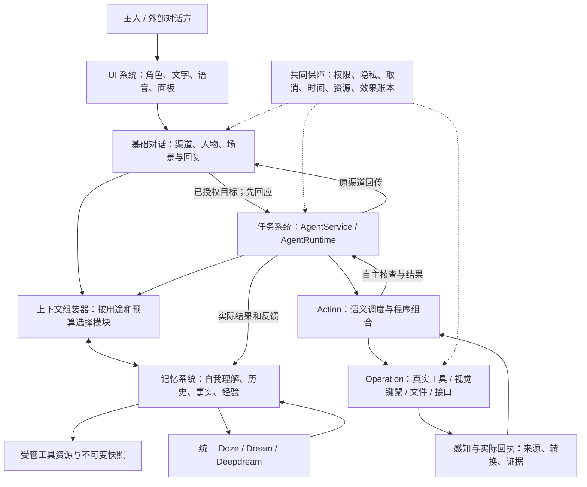
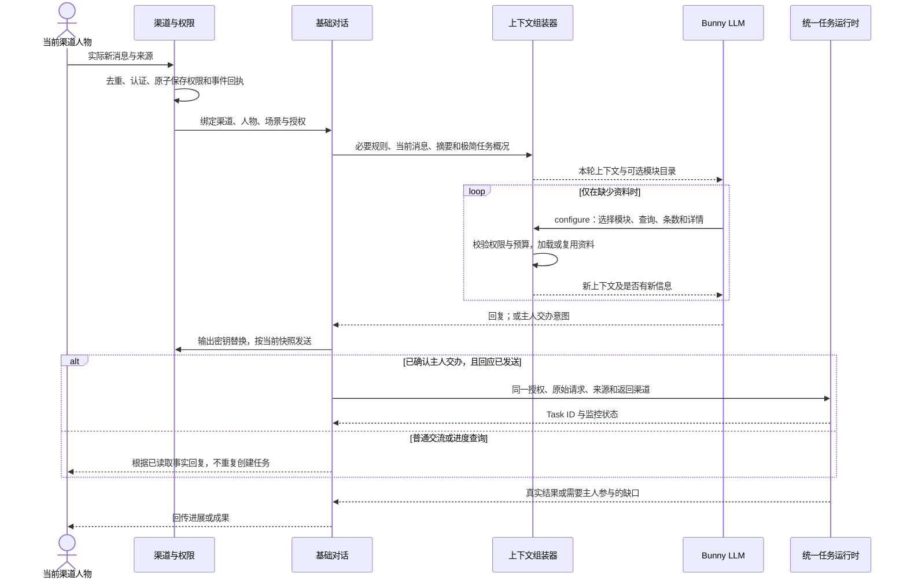
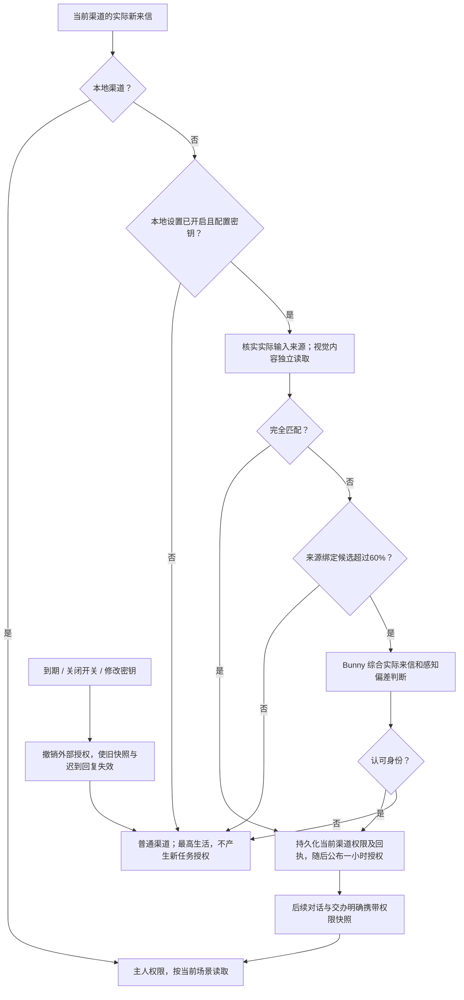
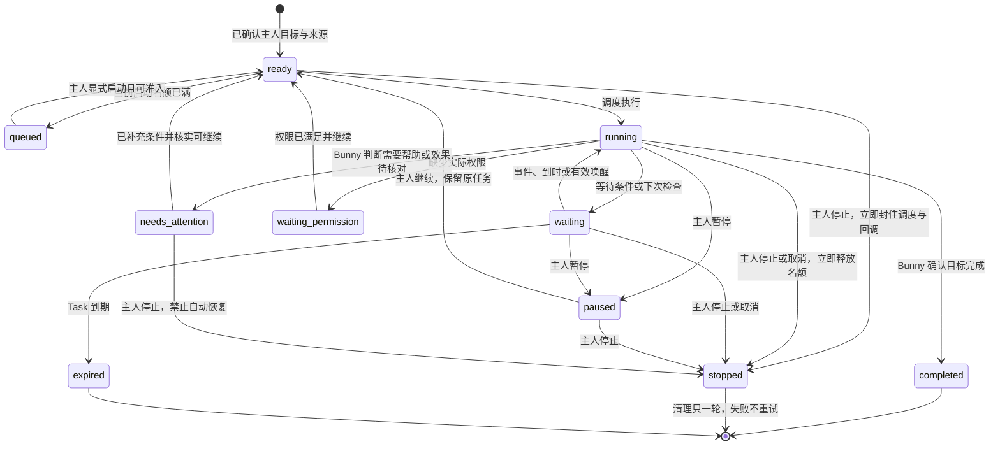
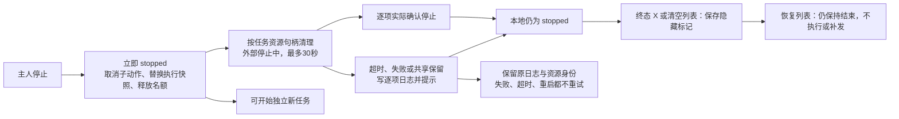
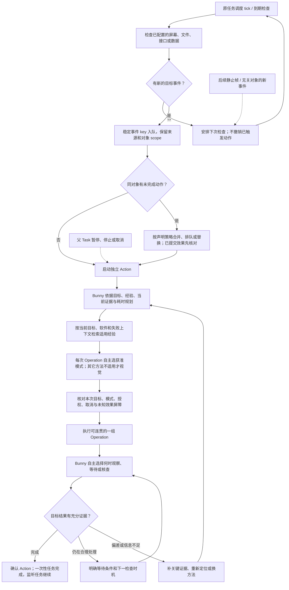
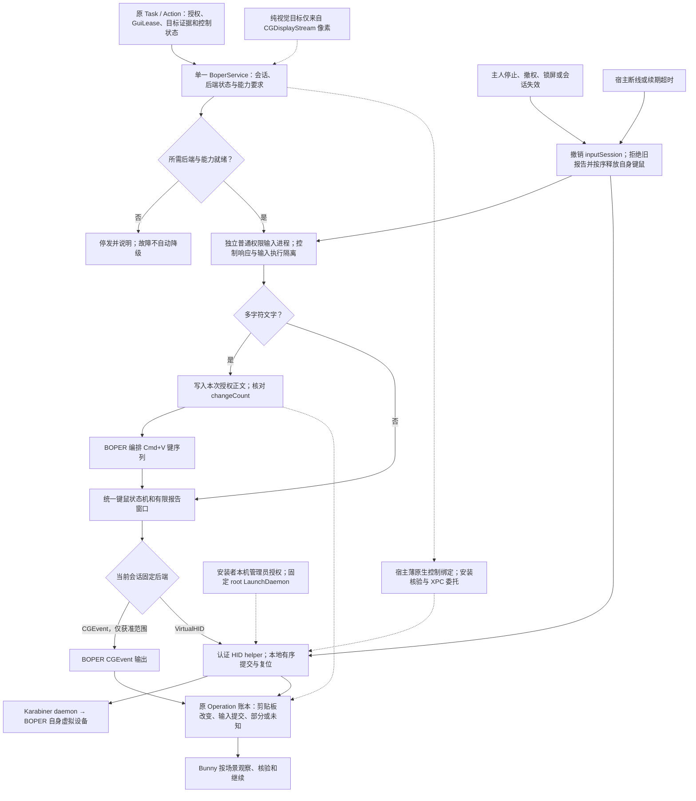
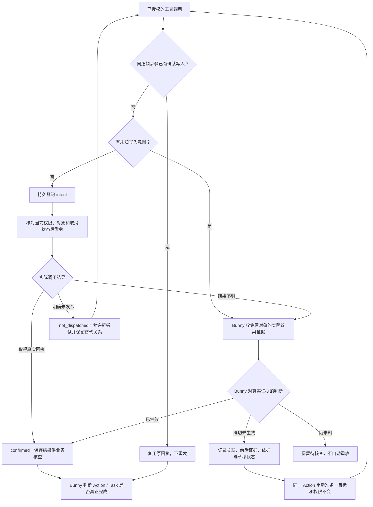
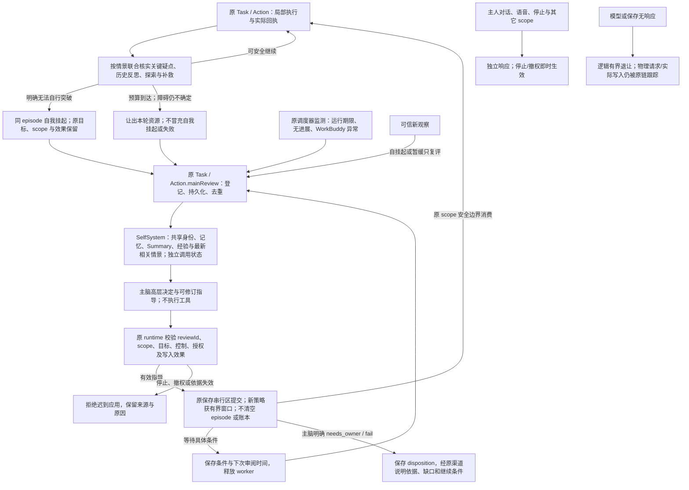
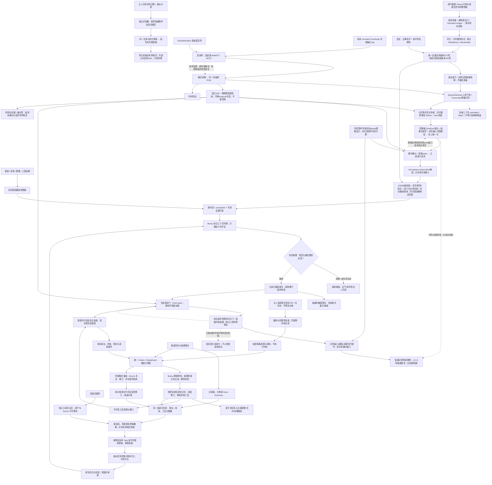

# WorkBunny 架构与执行 FLOW

流程记录当前源码的逻辑责任与主要路径，更新日期为 2026-11-12。数据字段和实现边界见[架构设计](architecture.md)。

## 1. 系统总览

## 2. 对话、按需上下文与主人交办

## 3. 外部主人认证与撤权

授权属于渠道，包括群聊；不是依据每个发言人的昵称授权。只有本地设置能修改开关。身份密钥在输出边界被替换；感知识别与上下文中可保留必要信息。

## 4. Task 生命周期

原文收到 → 内部待理解记录 → 语义判断 → 聊天/澄清或真实业务采用。接收阶段只确认收到，业务采用之后才按真实状态回执；话题切换不自动控制旧任务。

首次交办、主人续办、自动修订 → 整理后的目标、必要背景、约束和验收 → 共用正文封装 → WorkBuddy。主人原文与原始历史只留私有来源记录，不附正文或敏感任务附件。未知草稿恢复沿用原先保存的精确正文，不因策略升级改写或重发。

这是主要迁移示意；实际迁移还校验来源、代次、权限、未知写入和恢复资格。状态切换不撤销已发生的外部效果。

## 5. 监听、异步 Action 与连续 Operation

监听和动作是并行职责。LLM 调度的有效性由当前任务、取消与对象规则判断，不能因为后一轮画面无变化就丢弃结果。Operation 不强制逐次核查。服务、终端/代码、结构化界面与纯视觉键鼠是独立通道，同一 Task/Action 可跨软件组合；经验不增加权限，未知副作用先只读核对。微信的直接 Operation 仅授权视觉键鼠，不将该限制程序继承到独立受托应用内部。

纯视觉链：普通显示像素 → 截图与 VLM 确认身份/区域/焦点/监测区 → 有界帧与局部像素时效 → displayInput 全局键鼠 → 按需要观察与结果核验。没有窗口列表、PID、应用接口或 AX 回落。视觉小区域变化由通用 sample/commit 稳定性机制处理，未知目标或焦点停止；暂停/取消立即使迟到派发失效，已发生输入仍如实保留回执。

每次异步返回 → 核对发起时的视觉会话 → 仅当前会话可写入锚点/帧/采样或派发。重置后的旧成功与旧失败均不能修改新会话；派发后失效只标记实际回执，不重复操作。微信观察缓存失效时分离旧识别请求，新结果不再等待或继承旧缓存。

语音定稿 → 以识别器和音频段核对来源 → 不同段保留相同短句，同段重复不产生新音频覆盖 → 新鲜静音及真实收尾 → 同一语义调度与提交门。识别器停止/换代同时退休当前候选和仍保留的前句待提交输入。

### BOPER 键鼠执行目标流程

以下流程已接入 0.26.43 并在当前 Apple Silicon Mac 重装；安装者本机管理员授权、VirtualHID、MCP 控制及合成接收窗口全链路已验收。其他 macOS、自动物理接管和指定联系人微信任务仍待实测。详细边界及进度见 [BOPER 开发计划](boper-development-plan.md)。

沿用现有任务调度与 GuiLease，不另建业务队列；清理失败有界退出占用，但 BOPER 保持故障，禁止新的输入。截图与软件检查不进入输入进程，长轨迹不阻塞控制和语音。

设置 → 键鼠：启用组件 → 完成本机管理员安装及官方驱动批准 → 返回重新检测 → 单独允许屏幕识别 → 生活场景可选验证输入。页面按真实状态给出下一步，操作即时生效；查看其他设置页不触发屏幕权限查询。

粘贴动作只由 BOPER 键盘快捷键产生，VirtualHID 模式使用虚拟键盘；系统剪贴板写入是前置数据准备。只有明确无法粘贴或确认未插入才选逐键策略，部分插入或结果不明先核对，不再粘贴或整段重打。默认不读取、备份或自动恢复旧剪贴板。

原按 PID 的后台 CGEvent 输入不能直接换成全局 HID；VirtualHID 提前返回不支持，由宿主取得新的前台授权和焦点，或选择其他已获准通道。它不在后台悄悄换回 CGEvent。

停止和报告提交在最后出口复核会话，复位按序处理；已进入系统的事件不保证可撤回。重连只恢复接纳资格，不重放旧输入。输入能力不扩大联系人、正文或渠道授权。

桌面桥退出/断管/异步写入失败 → 封住原桥接纳 → 按原 owner/scope 停止 BOPER 并有界等待 → 保留实际派发或未知回执 → 完成清理后才允许新桥。旧续租失败仅能处理自己的活动会话，不能误停后来的输入。

## 6. 写入账本与不确定效果

同一外部会话中的新一轮交办仍需要本轮消息回执。首次、主人续办与自动修订共用制作正文分工；已有会话绑定只用于定位，填写草稿或发出提交动作后先显示待核对，观察到本轮新消息才确认交办。未观察到时保留原草稿与记录，读取原会话补证，不复用旧回复或重复发送。

填稿前建立新轮次和消息基线 → 仅展示本轮输入/提交阶段 → 当前阻断绑定同一工作与轮次。前轮已确认的交办和成果独立保留，不能让新草稿直接变成已接收；旧失败不会覆盖更新的实际阻断，控制请求返回也不等于业务完成。成果网址先按原答复的 Markdown 边界整理；只有真实验收缺项才考虑必要修订。

当前补充确证未派发 → 绑定前轮正向回执与保留成果 → Bunny 在原验收中判断补充是否仍必要。原目标已满足且明确选择放弃 → 完整归档补充稿和拒绝证据 → 按前轮成果汇报；否则保留待核对，不派发本次验收生成的补充。unknown、已派发或新消息出现不进入此分支；同组证据不反复自动复核，暂停和停止优先。

旧成果状态不完整时：未派发证明 → 原 session/messageKey 的只读完成回执 → 克隆候选与 snapshot 同步事实 → 严格资格检查。不同消息、失败/未完成记录或无合法时间不能补成完成；坏任务单独记录脱敏阶段与原因，后续任务继续核对。

正常退出 → 取消本进程控制器并保存 host-suspend → 按原业务状态和提交屏障恢复；用户/业务停止 → 保存 terminal → 重启和挂起均不复活。旧停止意图不明确 → 完整证明只能开放本次明确只读重验 → 当前进程许可校验 → 重新验收；不自动发送、不清草稿、不把 unknown 降级。状态及生命周期变化都会产生新 checkpoint，拒绝原因包含固定检查布尔与有限 Vault code/op。

恢复核对把“查到本轮回执”和“Bunny确认原提交未生效”作为不同分支：前者直接补全回执；后者在完整记录、原会话、精确草稿和当前画面支持下保留正文与轮次，核查当前权限后续交一次，再等待新回执。未知判断保留缺口等待新事实，迟到回执、草稿变化和取消优先于任何恢复输入。权限维护不阻塞恢复核对，界面显示实际检查与下一恢复时点。

## 7. 异常、自主恢复与保活

普通建议不取消正常 worker；仅明确检查点重启且无其它活跃 scope 时可隔离唯一失效调用。所有新输入仍走原权限、GUI lease、操作账本和派发前检查。后台模型满额是普通等待，为主人对话保留容量；主脑督导不直接说话，不借主人对话的 busy 或 controller。主进程与任务系统是程序组织，主脑与任务脑是 LLM 认知用途；不存在第二人格或执行账本。

## 8. 感知、经验吸收与工具演进

私聊记忆不进入任务经验提炼，Task 读取最高生活；导入不等于执行或授权。经验更新和模型解释都不能被当作外部效果已经发生的证据。

任务列表清理：本机主人请求 → 快照旧任务 → 本地同步停止并释放名额 → 至多30秒的一轮外部清理 → 记录错误 → 加密保存列表隐藏标记。终态 X 直接保存同一隐藏标记；“恢复已清理任务”只移除标记，保留终态和取消的旧报告。整个过程不级联删除资料或文件。

操作取证：既有 Operation/控制器上下文 → UTC+单调时钟+序号 → 截图采集/同轮VLM/区域变化/输入预检/派发请求/原生回执或未知 → 白名单异步滚动元数据。异常 → 关联原 Operation 的脱敏引用进入原错误链 → 复用最近已采像素及随后正常观察的有限关联帧 → 有钥匙则异步本地加密，否则记录缺口。该支路不调度额外截图或输入，不解除暂停，不影响业务回执；已有授权内精确单帧读取并校验完整性，重建只报告最近关联动作和证据覆盖范围，不自动给出退出原因。
