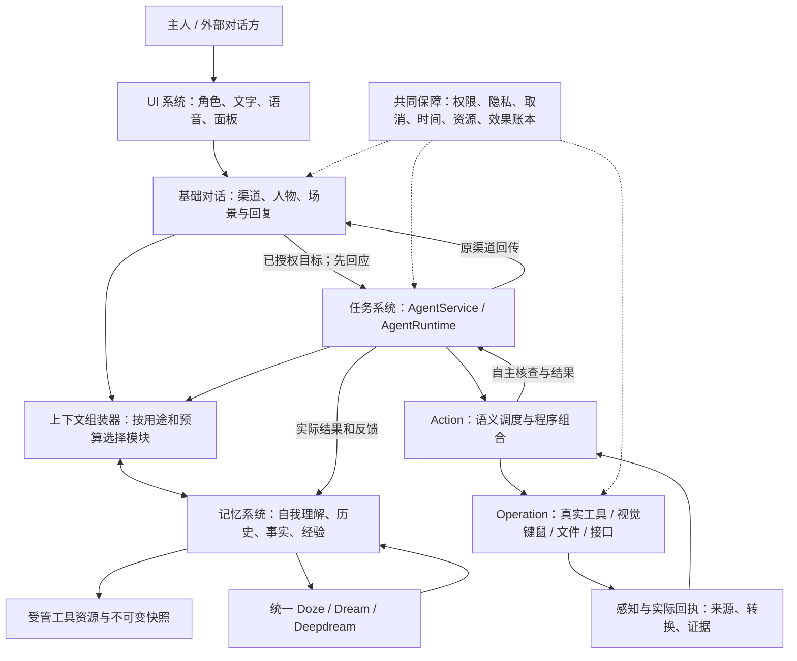
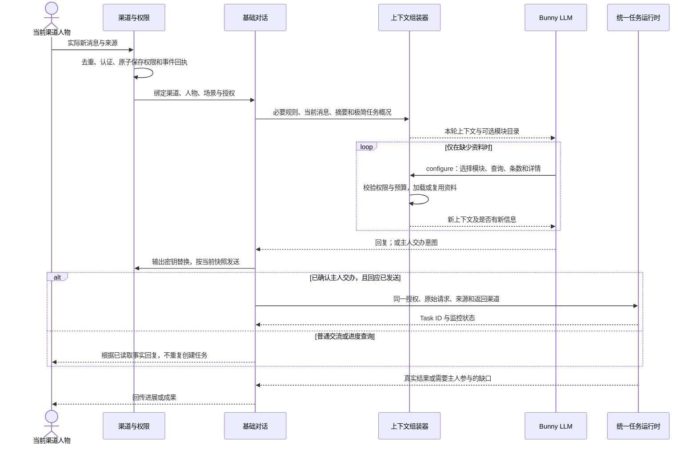
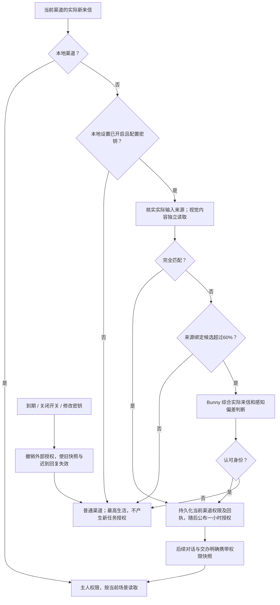
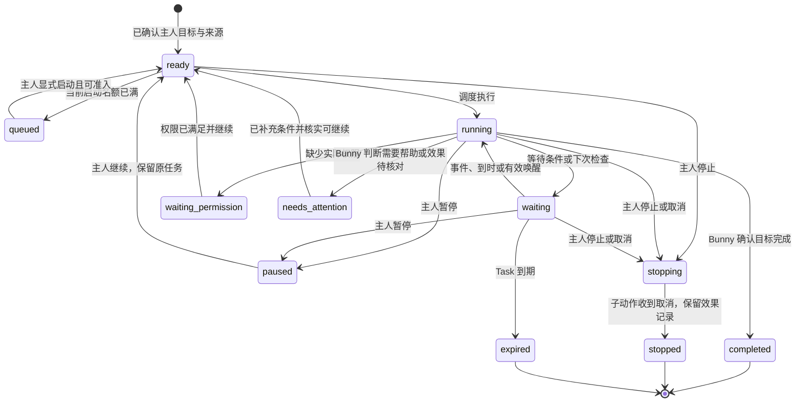
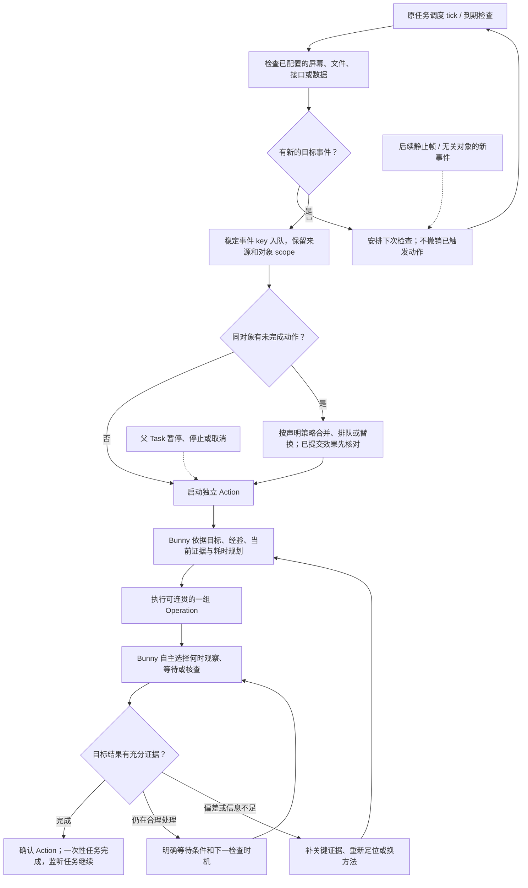
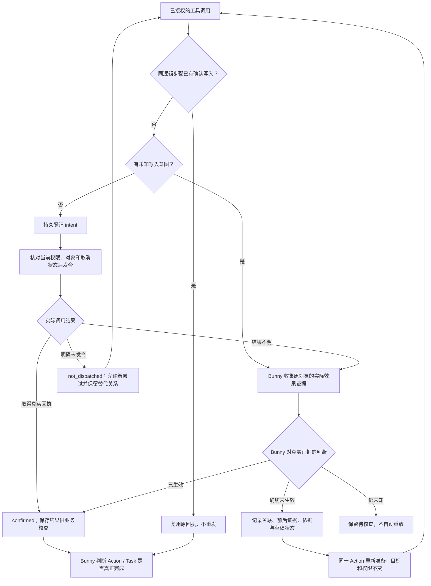
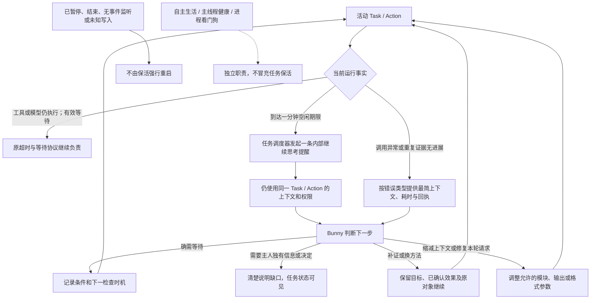
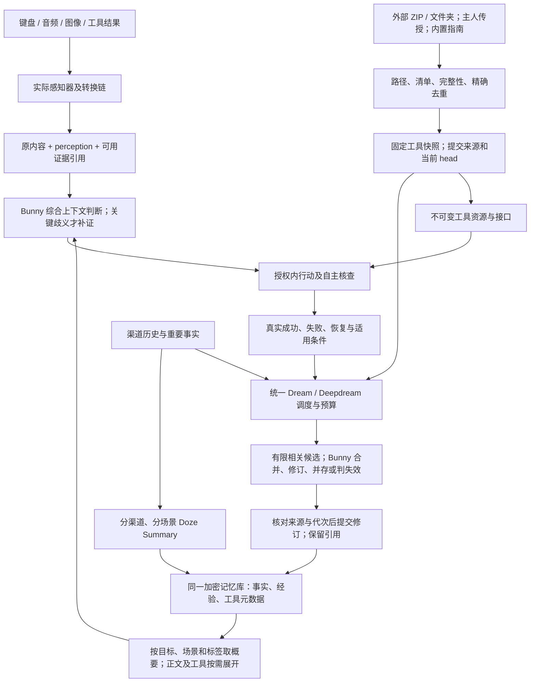

# WorkBunny 架构与执行 FLOW

流程对应 0.25.0 早期 Beta，更新日期为 2026-11-06。图示记录逻辑责任与主要路径。数据字段和实现边界见[架构设计](architecture.md)。

## 1. 系统总览

## 2. 对话、按需上下文与主人交办

## 3. 外部主人认证与撤权

授权属于渠道，包括群聊；不是依据每个发言人的昵称授权。只有本地设置能修改开关。身份密钥在输出边界被替换；感知识别与上下文中可保留必要信息。

## 4. Task 生命周期

这是主要迁移示意；实际迁移还校验来源、代次、权限、未知写入和恢复资格。状态切换不撤销已发生的外部效果。

## 5. 监听、异步 Action 与连续 Operation

监听和动作是并行职责。LLM 调度的有效性由当前任务、取消与对象规则判断，不能因为后一轮画面无变化就丢弃结果。Operation 不强制逐次核查。

## 6. 写入账本与不确定效果

## 7. 异常、自主恢复与保活

## 8. 感知、经验吸收与工具演进

私聊记忆不进入任务经验提炼，Task 读取最高生活；导入不等于执行或授权。经验更新和模型解释都不能被当作外部效果已经发生的证据。
