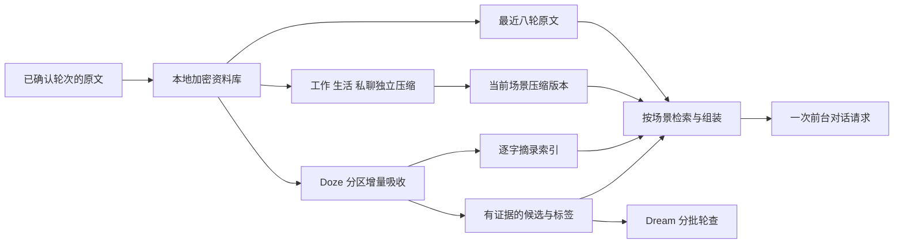

# 0.7.0：长期记忆、三场景压缩与可核对的个性化

2026-10-27。承接 `workbunny-个性化记忆与陪伴系统设计-2026-10-26.md`。本文记录这轮已经写入代码的机制、验证证据与后续边界，产品长期目标仍以 `concept.md` 为准。

## 本轮的产品判断

Bunny 的“进化”首先应当是更准确地理解同一个用户：积累经历、记住约定、识别信息变化、逐渐减少重复解释。它不能依靠不断加长提示词，也不能把每次模型归纳都当作事实。共通人格与用户明确设置保持稳定；自动整理只生成有来源的资料、导航和待核对内容，不改授权、任务标准或角色设定。

因此采用本地加密原文、分段索引、三场景独立压缩、按需检索和保守整理的组合。没有为记忆引入一个替代 WorkBuddy 的工作执行框架。

## 三个场景的独立上下文

| 当前场景 | 可参考原始范围 | 独立压缩记录 |
|---|---|---|
| 工作 | 工作 | `context-head:v1:work` |
| 生活 | 工作、生活 | `context-head:v1:life` |
| 私聊 | 工作、生活、私聊 | `context-head:v1:private` |

资料的业务分类 `domain` 与可见下限 `visibilityFloor` 分开保存。例如，使用私聊资料派生的 WorkBuddy 工作结果仍保留私聊下限。Doze 按六个合法 domain/floor 分区处理；上下文压缩则按上表三个可见视图独立处理。两者不是同一组水位。

每个视图保留最近八个用户轮次，包含尚未得到回复的轮次。更早的原文按完整轮分批，单批最多40条消息、28,000字符；不把超长轮截掉一半后宣称已经处理。分页与水位使用稳定的摄入序号，不依赖时钟或随机ID的先后。

每批形成一个不可变压缩段：正文最多1200字符，并附1–8条逐字核验的原文引文。来源包含该批全部模型输入，不能只链接模型选出的几句。摘要是历史导航，不能替代原文或自动成为已确认事实。

每个场景的当前记录保留最多四段元数据，组成不超过1800字符的阅读窗口；优先保留最新正文和完整引文。更早的段及原文保留在库内，可按问题检索。压缩器不把上一份长摘要再次交给模型反复改写，避免连续归纳扩大偏差。

前台只读取已保存的当前场景版本，再组合相关记忆、旧段和近期原文。不存在“先调用一次压缩模型，再开始回答”的步骤。压缩缺失或暂时落后时，前台仍可使用近期原文与检索结果。

## Doze、Dream 与后台让路

Doze 保留原文，生成待确认的模型候选、主题标签和摘录。候选的事实证据单独保存为 `evidenceSourceId`，完整输入依赖保存在 `sources`。这一区分很重要：删除或更正一个候选的证据，不能误删同一模型批次里的其他原始对话。

Dream 先补齐 Doze 和场景压缩，再整理旧记忆。现在采用每分区持久游标、固定扫描边界和分批续跑，每页最多40条、每次每分区最多200条；尚未检查的冷区会继续排队，不再始终只看最新200条。没有新摄入时，同一本地日完成过的扫描不会重复进行；在途扫描不会因为跨日或时钟回拨重新从头开始。

当前自动归档只针对同分区、内容/类别/键完全相同的普通已确认记忆。周年、临时项、固定或受保护项、模型候选、用户复核项不参与自动归档。旧正文及来源保留。精确索引ID由本地密钥的HMAC生成，避免把正文摘要直接暴露在索引ID中；既有索引命中后仍重新比较实际内容。

每日本地05:00到期检查，启动与解锁后可补跑；不额外安装系统常驻唤醒任务。手动“小憩”“整理记忆”复用同一调度器。关闭“整理新记忆”会暂停自动队列和迟到提交，手动请求仍可执行。

Doze 与压缩共用持久调用账本：每分钟最多三次，滚动24小时默认最多一百次。后台只使用当次模型目录能确认零倍率的 WorkBuddy 模型；目录不可用或没有确认免费的模型时保留进度，不暗中切换付费模型。前台使用用户选择的 WorkBuddy DeepSeek 4.1 Flash/high，两条用途分开。

## 更正、遗忘、恢复与人格连续性

- 语音轮次拥有会话内外稳定的 `turnId`；记忆写入回执返回真实原文记录。回复和任务引用这条最终识别记录，不再用预请求文字与最终标点做字符串匹配。
- 对话引用的压缩版本、任务和持续关注状态进入来源链；删除来源会递归移除相关派生项。场景切换、清空、更正和锁屏使迟到的模型结果失效。
- 压缩段与水位原子写入；提交前复核原文、范围、序号和版本。模型失败或取消不推进水位。头记录缺失时可复用已核验的不可变段，重建不依赖模型恰好再次生成相同文字；损坏的段不会被静默覆盖。
- 加密备份包含原文、范围、来源图、摄入序号、水位及共通/三个场景角色设定；不把推理平台密钥当作可迁移人格的一部分。恢复到新记忆密钥后，继续整理仍沿用原有水位；运行模型配置与当前场景保持用户选择。
- 共通角色设定、当前场景补充与记忆资料分工明确。记忆整理不修改昵称、人格、用户称呼或权限。

口述、记忆编辑、后台提取和压缩统一使用普通凭据识别规则；旧备份中可识别的凭据仍可在本机查看，但不进入近期上下文、相关记忆或压缩输入。外部任务状态进入对话前也检查明显凭据。它仍是有限的文本保护规则，不是通用DLP或独立密码库。

## 最小可用的困惑处理

本轮先覆盖两类明确而稳定的用户信息：姓名和生日。使用规范值比较，避免把同一生日的两种措辞误判为冲突，也不接受不存在的日期。

同一精确分区内出现不同说法时，新增记录保存双方来源与时间，标为“用户说法待核对”。只在本轮明确询问相关信息时，最多将两条待核对事项带入上下文；无关聊天不会因此反复被打断。一般模型候选继续标为“整理候选”，两者不混同。

记忆面板提供“采用这次说法”。用户选择后，旧事实退为历史，新说法成为当前已确认信息；同一旧说法下其他待核对项退役。新事实不再依赖旧事实，之后删除旧来源也不会误删已经确认的新事实。这个动作不会修改共通人格或角色称呼设置。

确认状态本身也进入模型上下文，包括用户核对的时间及已替代早期说法的关系。真实应用验收曾发现：只展示新值而不展示这个选择，模型仍可能受旧对话影响而再次询问。因此，对所有用户复核项统一投影这个语义；不是仅修改生日回答。面板计数使用当前活动记录，归档和已替代记录继续保留在完整备份中。

这还不是通用的语义矛盾理解、主动探索或主动搭话系统。偏好随时间变化、条件不同而并存、任务经验出现分歧，后续需要独立的有效时间、主体和情境处理。

## 性能与验证证据

隔离真实SQLite检查覆盖：三视图范围、最近八轮、完整轮分页、全输入来源、共享预算、取消、源删除、换密钥导出恢复、继续整理及困惑显式解决。完整流程使用随机测试密钥和替代模型，不能据此声称真实模型的多年理解质量已经通过。

实际 WorkBuddy 账号的免费 Hy3 压缩探针使用合成故事：返回有效JSON和3条可核验引文，保留后来更正的数量；耗时约15秒，返回credit为0。这证明本机账号调用合同可用，不是抽取质量的大样本评估。

原生常驻循环的定向A/B发现：2400条合成记录、1200组重复query/get后，修复前RSS从约9.8MB增至184.5MB；为每请求和输入读取增加短 `autoreleasepool` 后，从约9.4MB到10.8MB，后续采样基本持平。证据支持临时Foundation对象滞留是主要增长来源，尚不能据此声称消除所有内存增长。

修复后的一次7500条合成消息整体观测：离线替代模型压缩376段约9.72秒；每场景15次上下文组装，工作/生活/私聊p95约43.2/43.0/52.7ms。原生vault采样峰值约33.5MB，Node采样峰值约144.7MB；这些是记忆基准进程，不是含3D、ASR、TTS模型的整个应用内存。

复测入口：

- `tools/test-memory-evolution.js`：完整存储、压缩、恢复、删除和取消流程。
- `tools/test-memory-lineage.js`：语音回执、完整来源、证据删除边界、账本点读。
- `tools/test-memory-secret-boundaries.js`：旧数据、记忆编辑与模型输入之间的凭据边界。
- `tools/test-context-compression.js` / `tools/test-memory-dream.js` / `tools/test-memory-conflicts.js`：各子系统边界。
- `tools/benchmark-context-compression.js` / `tools/benchmark-vault-rss.js`：合成性能与定向RSS观测。

正式安装路径验收使用 `~/Applications/workbunny.app` 的0.7.0：十二轮合成对话后，真实账号免费后台完成24条原文整理并生成三个独立压缩头；工作/生活/私聊的标签召回分别只得到允许的1/2/3类标签。随后在实际面板点击“采用这次说法”，重启保留该选择；修复确认语义后，连续两次相同提问均使用当前值，不再重复澄清，约2.43秒返回。共通角色与场景设定未改变。

当前前台实测使用 WorkBuddy 的 `deepseek-v4.1-flash/high`。原有辅助功能、屏幕录制和键鼠权限沿用，钥匙串辅助程序CDHash保持不变；两份本地语音模型文件保留。验收后的40条合成消息及其派生资料已清理，恢复生活场景与原监听、播放和自动整理开关，并以不开放调试端口的方式启动。SpeechAnalyzer实际收到音频帧，`captureReady=true`；恢复正常运行后新产生的对话予以保留，不继续清空。

当前整库备份仍有50万记录导出上限和256MiB恢复文件上限。资料库本身与前台检索不以这个数量为容量上限，但高频使用多年后的备份需要升级为流式、分段校验的格式；不能把本轮的112条换密钥恢复或6600条恢复性能检查当作无限规模迁移已验收。

其他Mac、数年真实使用、真实入站微信自动回复及全池语义整理不属于上述证明范围。

## 接下来的迭代顺序

1. 收集独立的中英文长期对话样本，评估遗漏、误召回、人物混淆、时间变化和重复追问；评估前后使用同一批样本，不用为样例硬编码语义映射。
2. 将稳定事实扩展为带主体、条件、有效时间及证据强度的资料；Dream输出语义关系与困惑提案，先不自动覆盖旧事实。
3. 增加受保护的小本本与独立凭据保管入口。密码不进入普通记忆、摘要或对话模型；普通输入拦截不能替代完整的秘密保管设计。
4. 将已验收任务的工具与经验建立版本和适用范围，按需检索，保留修订来源。Bunny继续负责秘书式协调，由WorkBuddy承担复杂工作。
5. 只有当独立样本证实词法召回不足时，再比较本地语义索引的质量、常驻内存、增量重建和迁移成本，不为引入框架而引入框架。
