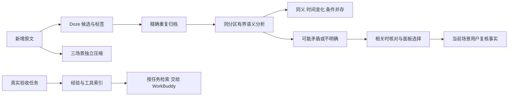

# 0.8.0：Dream 语义关系、困惑核对与经验复用

2026-10-27。产品方向继续以 [concept.md](../concept.md) 为准。本轮接续 [0.7.0](workbunny-0.7.0-长期记忆与三场景压缩.md)，把“记忆整理”推进为有证据、能核对、可迁移的个性化积累；不把 Bunny 改成另一个复杂工作执行器。

## 设计判断

长期记忆的准确性比自动压缩掉多少条更重要。同义、时间变化、不同条件和真正矛盾不能用同一种“覆盖旧值”处理。模型提议的语义关系与用户明确确认的事实分开保存；用户共通人格、称呼和三个场景设定继续由设置管理，Dream 没有修改这些设置的能力。

研究参考了 [Mem0 的提取与更新研究](https://arxiv.org/abs/2504.19413)、[Zep 的时间关系研究](https://arxiv.org/abs/2501.13956) 和 [Letta 的只读记忆块](https://docs.letta.com/v1-sdk/memory/memory-blocks)。对本项目的设计启发是：区分资料层级、保留变化与出处、保护明确设定。这是工程判断，不沿用这些项目的性能或效果结论。本轮继续使用已有本地加密 SQLite，没有引入新的图服务器、外部记忆服务或常驻模型。

## Dream 的实际流程

1. Dream 先补 Doze 与场景压缩，再做完全重复归档和语义分析。保留原有来源、稳定摄入序号、每天05:00检查、前台让路及断点续跑。
2. 语义分析仍按六个合法 domain/floor 精确分区，不跨分区合并。每次每分区最多检查40条，每组最多8条、约12KB输入；优先用明确记忆键和共享主题寻找邻居，不全池两两比较。姓名、生日与受保护资料使用独立比较范围。
3. 已确认资料与有用户引文的 Doze 候选可参与分析，候选不会因被归组而变成已确认事实。助手话语不能作为用户事实的直接证据。
4. 输出最多三组关系，每组2–6条。引文须逐字存在于真实用户消息，成员、来源、场景、版本提交前再次核对。

| 关系 | 处理 |
|---|---|
| 同义 equivalent | 建立语义关联；保留全部原文，不自动删除或提升可信度 |
| 时间变化 update | 要求每个成员有明确时间引文；入库时间不冒充事件发生时间 |
| 条件并存 contextual | 每个成员提供条件原文；不把不同情境硬合成无条件规则 |
| 可能矛盾 contradiction | 保留双方说法；条件、时间证据有无必须明确标记 |
| 不明确 uncertain | 保留待核对提案，不猜对象、时间或当前值 |

语义归并在本版本指关联整理与检索导航，不是自动改写事实。分类仍受模型质量影响，条件引文存在也不等于分类必然正确，所以关系始终是提案。

分析结果和缓存原子提交。缓存标识只取不透明成员ID、分区与算法版本，不把低熵个人事实的哈希暴露在记录ID里；完整内容指纹保存在加密正文。换新密钥恢复后仍可复用已完成分析。来源变化会使旧索引失效，下一次重新分析后旧提案退役。无效输出不推进游标。失败会持久保存30分钟自动重试冷却，重启后也不会每15秒重复消耗预算；用户仍可立即手动重试，成功后清除冷却。旧版当天已完成的每日计划会为新语义阶段补查一次，关闭自动整理时不排队。

语义分析复用后台持久预算：每分钟最多3次、滚动24小时默认100次；只用目录当前能确认零倍率的 WorkBuddy 模型，找不到则暂停，不改用用户的付费前台模型。前台每轮只读已有结果，不新增一次“先判断/先整理”模型请求。

## 实际运行发现的来源循环及修复

正式安装路径首次运行暴露了独立轮次样本没有覆盖的问题：回复引用固定、会更新的 `context-head:v1:scene`；之后压缩又包含这条回复，更新同一头记录便形成来源环，SQLite正确拒绝并返回 `invalid_source`。真实旧库中有19条消息和1条任务直接引用此类旧头，不能通过清空数据掩盖问题。

修复保留所有旧v1头为只读记录；新压缩采用不可变分段、不可变v2头、独立当前导航指针三个层次。对话只引用不可变头，绝不引用可移动指针。分段、头、指针顺序提交，只有完整图持久化后才推进导航水位；中断后复用已核验的分段和头，不重复调模型。原始来源、级联遗忘和三个可见视图压缩合同保留。新头的索引标记在检索前排除，避免累积版本挤掉历史分段。

同类检查修复了继续旧任务的来源自环：保留原任务来源并追加本轮真实用户请求，不把含任务自身或其派生回复的整份上下文写回同一任务。用户原任务和验收标准保持原文。对应真实SQLite和秘书交办回归均有覆盖。

## 困惑的生命周期与范围

“记忆与关系 → 整理与经验”支持查看相关陈述、待核对、经验和工具；原始记忆、聊天、摘要仍分开查看。

可能矛盾和不明确的关系生成有来源的问题。普通对话只带入本轮相关的最多两项，不让问题列表支配聊天。用户可采用某条说法、说明两种情况的适用条件、暂缓七天或不再提醒。暂缓到期恢复可核对状态；忽略不删除原文。

用户选择形成新的本地复核事件和当前事实，不修改共通人格。条件说明作为有条件的用户复核资料保留，不制造一个无条件结论。原始双方及先前选择保留，最新有效的复核作为当前信息；只抑制当时比较过的精确版本。随后更正同ID原文，旧决议不能把新证据压掉。

**私聊确认一个工作问题，不得改变工作场景的答案。** 新复核资料的可见下限至少等于当前场景，决议按问题及有效下限分别保存。私聊内可以采用自己的选择，返回工作仍只看到工作范围的原始资料和待核对状态。生活场景同理。范围过滤在SQLite检索、排序和LIMIT之前完成，不是先查到秘密再在界面隐藏。

相关问题处于待核对、暂缓或忽略时，矛盾成员不会绕过问题状态，再从普通长期记忆通道被当成两个已确认的当前事实注入。原始聊天仍作为历史保留。当前没有新增独立的无人打扰判断与主动搭话循环；核对在相关对话和面板中完成。

## 工具与经验如何积累

只有持久任务处于 accepted 且具有 pass 验收回执，才能生成“单次已验收经验”。执行方说完成、按钮调用成功或用户未经证据的标记，不会自动被总结成成功方法。每次读取还校验任务收据、来源指纹、场景与验收状态；历史变更不靠“索引还在”证明有效。

文件型交付在验收通过后再次读取已经授权的具体路径，只有哈希、大小、修改时间一致才保存工具清单。最多四个文件；普通文本工具可保留至多32KiB加密快照，较大或二进制文件只留元数据；敏感路径及可识别凭据不保存为工具代码。缺少实际交付文件的任务可以留下验收经验，不能凭空产生工具。

交办 WorkBuddy 时检索最多三条相关经验和工具资料，保留用户原始任务与验收标准，历史参考放在独立数据段。检索词不含类型标记或平台通用词，避免每个请求都召回全部工具。单次成功明确标为单次观察，不推导通用规律。

本次交办默认不重新读取旧工具路径，当前文件状态记为“未复验”；只有当前任务明确授权的路径才可重新核对。备份内有快照不等于换机后文件仍存在。Bunny 不执行记住的脚本，复杂复用和修改仍交给 WorkBuddy。面板目前提供来源与快照留存状态，不提供一键执行。

新验收任务即时积累；Dream 另有有界历史回填。经验、工具和决议属于专用索引，不挤占普通记忆或压缩段的前几十条检索结果。来源删除仍按依赖链清除派生内容；备份换密钥后收据验证和幂等标识仍有效。

## 安装路径与服务边界

正式安装至 `~/Applications/workbunny.app`，原加密库沿用，没有清理现有聊天。对照升级前配置，共通角色、三个场景设定、智力、语音、监听与监视配置保持一致；生活场景、自动整理和播放开关保留。默认解析仍为 WorkBuddy 的 DeepSeek 4.1 Flash/high。

已在正式应用验证记忆自动解锁、新页签IPC、麦克风真实音频输入及 `captureReady=true`；辅助功能、屏幕录制与键鼠权限均有效。签名继续使用同一证书，钥匙辅助程序CDHash保持 `9b5308ef38651a0928b016482e000f63bb309c53`，没有重置系统授权。

真实旧库已成功生成v2生活摘要头，证明旧引用链能够迁移续跑。进一步处理时WorkBuddy曾返回 `E_UPSTREAM` 和一次 `E_PAYLOAD_TOO_LARGE`。为适配本地转发的响应上限，摘要适配器改为4096 token预算、600字导航和最多四条120字引文；其余细节保留在原文，不以截断内容冒充完整摘要。失败不推进当前批水位，并保存冷却；手动重试可继续已有版本。延迟的旧调度读取不能抹掉新失败冷却或恢复已清除的冷却，这一并发情形也有回归覆盖。

收窄输出后的正式应用重试完成整轮Dream，状态回到“整理已完成”，生活和私聊均已保存v2摘要头，失败冷却清除。本轮现有资料只有一条可扫描长期记忆，没有足够的相关成员生成语义关系，因此正式面板没有编造关联或经验；三种语义关系的模型合同证据来自前述独立合成探针。验收结束关闭调试入口，以普通方式启动。

## 验证与边界

本轮真实临时SQLite回归覆盖：六分区、三场景可见视图、逐字引文、完整分析来源、取消/预算、缓存复用、同ID修订、重复核对、条件说明、暂缓到期、换密钥恢复、40+5分页、验收来源和文件版本。隐藏Electron窗口验证了分类分页、核对按钮、条件输入、工具状态和切场景后迟到结果，不写入正式用户聊天。

真实WorkBuddy免费Hy3探针先发现：时间变化有时被过度归为不明确。进一步明确“入库时间不是事件时间，审核状态不是关系类型”后，隔离库六条合成原述、三次调用依次得到同义、时间变化、可能矛盾，约46.3秒完成；私聊核对未改变工作问题，重复整理为0次模型调用。此前保守分类结果没有覆盖任何事实。这是调用合同与少量语义用例验收，不是大样本理解准确率。

本机6500条索引载荷测试（5000普通记忆、1500知识索引，三场景）写入约1.65秒，搜索p50/p95约10.20/15.31ms，上下文组装约46.73/61.70ms；8500字符预算与检索前过滤通过。此载荷检查的是存储/索引与有界前台成本，知识索引包含用于过滤的简化合成记录，不代表6500条复杂语义关系的理解质量。

主要复测入口：

- `tools/test-compression-provenance.js`、`tools/test-context-compression.js`：不可变版本、旧头迁移、分阶段中断复用和删除级联。
- `tools/test-knowledge-maintenance.js`：Doze、压缩、Dream、困惑与经验的共享预算全链路、失败冷却与升级调度。
- `tools/test-semantic-dream.js`、`tools/test-memory-knowledge.js`：关系、决议、范围、来源、恢复和状态。
- `tools/test-experience-memory.js`、`tools/test-delivery-acceptance.js`、`tools/test-dialogue-delegation.js`：验收、工具版本、相关性及秘书交办。
- `tools/test-vault-knowledge.js`、`tools/test-memory-evidence.js`：原生索引过滤、来源图和指纹。
- `node_modules/.bin/electron tools/test-companion-ui.cjs`：隔离面板交互。
- `tools/test-knowledge-scale.js`：6500条隔离索引载荷与前台成本。
- `node tools/test-knowledge-live.js`：明确手动执行的真实账号免费探针，使用合成数据和临时库。

多年真实陪伴、多人同名与复杂条件的独立语义质量评估仍待继续；词法/主题召回可能漏掉没有共同词的关联。没有宣称模型能够自主解决所有困惑，也没有自动删除低价值记忆或自动改写人格。备份仍有0.7记录的容量上限，流式迁移、专用秘密小本本、失效工具的监督修订与跨设备实测属于后续工作。
