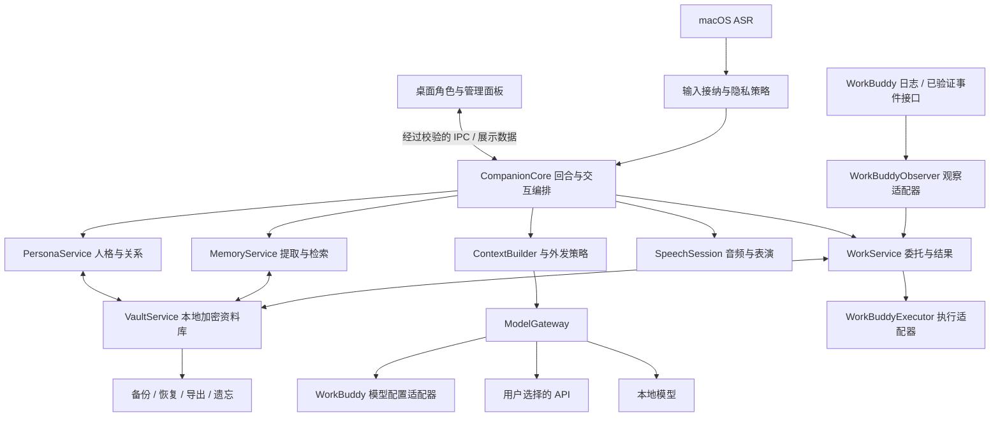

# workbunny 架构与迭代计划

> 日期：2026-10-24。目标依据：[concept.md](../concept.md)。源码基线：`86005c446797797d77816038106a64e8cd34a7d2`，应用 `0.2.0`，lockfile 中 Electron 为 `33.4.11`。
> 本文是待实施设计。本轮只核对源码与技术资料、编写计划，没有修改代码、安装依赖、读取个人对话或凭据、启动应用、执行 WorkBuddy 任务。文中接口和目录除明确标注为现有者外，均为拟议设计。

## 1. 架构结论与实施顺序

**将 workbunny 建成一个以本地资料库为根基的长期伙伴：记忆和人格持续积累，模型负责当下理解与表达，WorkBuddy 负责实际工作。**

采用当前 Electron + three.js + VRM/VRMA + macOS ASR 的基础，逐步抽离主进程职责。首期保持单机应用，不引入账号系统、云记忆、分布式服务或通用 Agent 框架。

先完成四个相互约束的核心能力：

1. **记得可靠**：保存有来源、可纠正的长期记忆，按当前话题取用；换模型不重建这段关系。
2. **人格连贯**：明确哪些性格稳定、哪些偏好可调整、哪些只是当前情绪；重要变化有版本。
3. **用户掌握数据**：本地加密、可查看与导出、可恢复、可遗忘，外发数据有明确边界。
4. **工作协作可追踪**：用户意图交给 WorkBuddy，接收真实状态；派发、接受、答复和交付确认分别记录。

推荐顺序：**验证关键接口与存储方案 → 安全持久化和回合生命周期 → 记忆闭环 → 人格连续性 → WorkBuddy 委托闭环 → 语音与日常体验验收。** 基础语音体验问题在前期同步修复，不等最后才考虑用户体验。

本文补充并调整此前[项目分析报告](workbunny-深度项目分析报告-2026-10-24.md)：长期记忆与人格现在属于首要产品能力；WorkBuddy 协作要从被动观察发展到用户可控的实际委托。

## 2. 当前代码能支持什么，还缺什么

| 领域 | 真实实现 | 对目标架构的含义 |
|---|---|---|
| 会话记忆 | `index.js:159–178` 保存最多 24 条消息，每条最多 800 字符；`think()` 只带最近 6 条 | 只能接短对话，缺少来源、时间有效性、提取、检索、纠正与遗忘关系 |
| 人格 | `config.js:182` 起为一段静态 PERSONA | 可以复用基本语感；要拆出版本化人格与动态关系上下文 |
| 本地数据 | `memory.json`、`config.json` 普通 JSON；日志记录部分听到和说出的内容 | 数据保全要同时覆盖数据库、日志、音频、参考音色、备份和迁移遗留 |
| 模型接入 | `config.js:401–501` 读取 `~/.workbuddy/models.json` 或自填 Key；`llm.js` 发兼容流式请求 | 可作为首批模型适配器；读配置文件不是已验证的稳定官方授权协议 |
| 凭据边界 | `load()` 补全凭据，`save()` 保存合并结果；init/panel-init 返回完整配置 | 需拆开公开设置与秘密信息，避免凭据进入渲染层和重复落盘 |
| 回合管理 | 音频有 `speechGen`；`llm.chat()` 支持 signal，但 `think()` 没有传入 | 要统一取消与提交规则，否则旧回复会污染新回合和长期记忆 |
| 工作观察 | `monitor.js` 轮询 WorkBuddy JSONL；静默 3.2 秒推断完成，正则判断成败 | 保留为日志适配器，降低推断的事实等级；改用稳定 ID 和来源事件 |
| 工作派发 | 当前没有任务提交、恢复、取消或回执关联实现；仅能唤起 WorkBuddy 窗口 | 必须验证真实可用的执行入口；不能把模型额度接通当作任务协作接通 |
| 语音 | macOS 26 SpeechAnalyzer；TTS 有 system/qwen/remote 分支 | 保留现有实现，建立引擎能力与真实就绪状态；本地 Qwen 尚缺完整配套证明 |
| 交付 | 有手工打包安装；ASR 二进制不入 Git，没有找到编译入口；签名部分容错 | 引入数据库原生依赖前先补构建；产品改名要保护旧数据与系统身份 |

本次只读获得的首测环境为 `arm64 / macOS 26.5.1 / 24 GiB`。它适合用作第一台验收机器，不代表其他 Mac 已受支持。package-lock 的顶层名称/版本仍为旧 `buddy-pet/0.1.0`，也应在后续发布整理时校正。

## 3. 总体结构与模块职责



### 3.1 进程与边界

- **Electron 主进程**：持有凭据、隐私策略、回合状态、工作协调与窄接口 IPC，管理 OS 权限和窗口。
- **一个 Vault utility process**：串行维护数据库写入、检索、迁移和备份。避免持久化与索引操作阻塞主进程。Electron 33 已有 Node 子进程与消息端口能力，具体依赖装载仍须验证。[Electron 33 utilityProcess](https://github.com/electron/electron/blob/v33.4.11/docs/api/utility-process.md)
- **现有 ASR 子进程、本地 TTS 进程**：沿用独立进程方式；共享回合取消和资源管理规则。
- **渲染进程**：表现与用户输入，只接收所需展示字段。没有数据库连接、完整配置、Key 或任意文件读写入口。

utility process 用于故障与耗时隔离，本身不自动构成安全沙箱。凭据不通过命令行或环境变量传递；启动后通过受控进程消息传入必要的短期密钥。资料库锁定时关闭连接、清理可释放的缓冲区并暂停相关任务。

IPC 按调用来源窗口、操作白名单和参数结构校验；读取记忆、导出、改变策略、派发工作各有窄接口。模型输出和外部任务文本不能通过拼接指令获得这些权限，涉及控制的请求必须追溯到真实用户输入及已有授权范围。角色与资源文件按允许格式、路径和大小导入，不允许资源包改变应用脚本。

### 3.2 建议新增的代码边界

以下路径均相对 `workbunny/` 仓库，按实际迭代逐步引入：

```text
src/main/
  index.js                         启动、窗口、托盘与服务装配
  companion/turn-controller.js     回合生命周期、取消、输出提交
  companion/context-builder.js     人格、相关记忆与当前任务的预算化上下文
  privacy/policy.js                输入接纳、数据范围、外发检查
  storage/vault-client.js          主进程到 Vault 的窄接口
  storage/vault-worker.js          SQLCipher、事务与迁移
  storage/backup.js                快照、可移植备份与恢复
  memory/service.js                候选记忆、归并、纠正、检索、遗忘
  persona/service.js               人格版本、关系连续性与场景表达
  models/gateway.js                模型能力、凭据引用与流式归一
  models/providers/                WorkBuddy 配置 / API / 本地端点
  work/service.js                  用户委托、状态、回执、提醒
  work/observer.js                 迁入现有 monitor 日志观察能力
  work/executor.js                 经验证的 WorkBuddy 执行协议
  speech/session.js                迁入合成、播放、打断与口型调度
src/shared/contracts/             IPC、回合、记忆和工作对象的版本化结构
```

保留 three.js、VRM/VRMA 及现有 UI 基础。`llm.js`、`tts.js`、`asr.js` 先包装再迁移，不同时重写。只有出现独立生命周期时才拆模块，不为目录完整而创建空壳。

## 4. 本地资料库：先确定唯一数据根基

### 4.1 存储决策

**推荐 SQLCipher 作为唯一权威数据库，全文索引保存在同一加密库内，向量检索作为后续可重建的本地索引。** 原始对话、记忆、人格、工作事件与隐私策略一起参与事务，避免多个 JSON 文件之间的半写入。

SQLCipher 能加密数据库及 WAL 中的数据页，但临时文件还需特定编译与配置处理，不能仅设置密码就声称所有临时内容受保护。它是 SQLite 的专门构建，不是给任意 SQLite 驱动加载一个扩展即可。[SQLCipher 设计](https://www.zetetic.net/sqlcipher/design/)

M0 限时验证一种维护可接受、可固定版本的 Node 原生绑定：锁定 Electron ABI、SQLCipher/SQLite 版本、FTS5 编译能力，验收签名后的 utility process 能否加载。**本报告不虚构已经验证的 npm 包。** 若绑定不可维护，再评估小型原生存储辅助进程；两种都不可用时暂停敏感资料持久化实现，先解决存储选择，不默默退回明文。

首期不采用远程向量库、仅依赖模型线程的记忆、无来源的滚动大摘要，也不要求必须安装 embedding 模型才能记住明确事实。

### 4.2 数据目录与所有权

稳态建议目录为 `~/Library/Application Support/workbunny/`，实际迁入必须完成第 10 节步骤：

```text
vault/
  companion.db                  加密数据库；WAL 等由同一连接管理
  key-envelope                  由系统保护封装的本机解锁材料
  private-assets/<opaque-id>    加密参考音色等私人附件
backups/                        默认加密的应用管理备份
resources/                      公共 VRM/VRMA/LLM/TTS 资源，可重新下载
cache/                          可清理缓存；私人内容不落明文
diagnostics/                    默认仅错误码、耗时和匿名内部 ID
preferences.json                启动所需的非敏感设置、schema 版本与凭据引用
```

应用目录 `0700`、私人文件 `0600`，并检查实际继承权限。初期将活动数据库放在本机盘，用户可以选择备份和导出目的地。后续支持移动活动数据目录时走关闭连接、复制、验证、切换的受控流程，不在同步盘上默认运行活动 WAL 数据库。

私人附件用不含姓名或内容的随机 ID；公共下载资源和私人记忆分别管理。删除公共资源不能影响关系资料，重新下载公共资源不需要上传个人数据。

### 4.3 核心逻辑数据模型

这是实现所需的逻辑表，M1–M4 按阶段增加，不一次建完全部系统：

| 对象 | 必要字段 / 约束 | 用途 |
|---|---|---|
| `vault_meta` | vaultId、schemaVersion、privacyEpoch、迁移版本 | 标识资料库、阻止旧任务在遗忘后重新写入 |
| `turns` | turnId、sessionId、状态、开始结束时间、personaRevision、modelProfileRevision、privacyEpoch | 关联一次输入、生成和交付 |
| `messages` | messageId、turnId、role、正文、输入来源、显示/播放状态、时间、保留策略 | 可回看的原始材料；不把未播完的回复当成已共同经历 |
| `memories` | memoryId、revision、kind、subject、predicate、value、状态、确定性、有效时间、敏感级别、使用范围 | 有版本的记忆，value 可为结构化值与短自然语言 |
| `memory_sources` | memoryId/revision、sourceId/revision、证据摘录、来源类别 | 支持回查、纠错与派生内容失效 |
| `persona_revisions` | identityId、revision、核心设定、表达偏好、变更来源、创建时间 | 人格稳定与可回滚调整 |
| `work_tasks` | taskId、用户意图、目标项目、外部会话 ID、执行状态、结果证据等级 | 用户委托台账 |
| `work_events` | eventId、taskId、来源、sourceEventId、源时间、观察时间、证据摘要 | 去重、乱序处理和追溯 |
| `outbox` | requestId、taskId、payloadRevision、发送状态、attempt、externalReceipt | 派发前落盘，处理结果未知与重启 |
| `jobs` | jobId、输入引用及版本、任务类型、状态、提取器/模型配置版本、privacyEpoch | 有界后台提取与整理；不存重复整段历史 |
| `deletions` | 删除对象 ID、来源范围、时间、epoch | 阻止旧索引/旧作业重新引入已删内容 |
| `policies` | 出站范围、保留时长、记忆开关、WorkBuddy 范围授权 | 用户控制的版本化策略 |

全文和未来 embedding 都是 `memoryId + revision` 的派生索引。原始来源与有效记忆是权威；索引丢失可以重建，不能反过来根据相似向量恢复事实。

所有关系都使用稳定 UUID 或等价稳定 ID，禁止用当前进程的计数器作为跨重启的任务身份。时间保存为 UTC，并保留用户表达的日期、时区和有效期，避免把「下周」在未来重新解释。

数据库与附件之间采用简单的一致性约定：加密附件写入临时文件并验证、落稳后改名，再提交数据库引用；失败留下的无引用附件由后台清理。删除先提交墓碑和待清理记录，再清文件，失败可重试。备份固定数据库快照及其引用的不可变附件，期间禁止清理该批附件，避免“数据库备份完整、音色文件缺失”。

## 5. 长期记忆：来源、形成、检索、纠正、遗忘

### 5.1 记忆分层

| 类别 | 例子 | 形成与使用原则 |
|---|---|---|
| 用户明确事实与偏好 | 喜欢怎样被称呼、常用语言、提醒习惯 | 明确表达可按既定策略自动入库；可修改，有来源 |
| 共同经历 | 一起准备了一次演讲、用户分享的一件重要事情 | 时间和参与关系明确，区分亲历对话与第三方结果 |
| 约定与未完事项 | 下次继续某个话题、某项目等用户补资料 | 有状态与截止时间；记录约定不等于已具备系统定时提醒能力 |
| 关系连续性 | 用户希望少调侃、喜欢哪种安慰方式 | 来自明确反馈或多次证据；不能把模型猜测直接写成用户特征 |
| 临时状态 | 今天累、这周在赶一个项目 | 有时效；不固化为「用户一直情绪低落」 |
| 工作摘要 | WorkBuddy 已返回某结果、尚待验证 | 带工作来源和证据等级，默认不成为人格或生活事实 |

人格核心另行版本化；记忆可以提供共同经历，不能靠普通对话提取悄悄改写人格原则。

### 5.2 写入生命周期

```text
最终输入被接纳
  → 按保留策略保存来源
  → 规则直接识别明确的“记住/更正/忘记”请求
  → 其余由有界后台作业产生结构化候选
  → 校验来源、隐私、主体、时间、重复与冲突
  → active / pending / rejected
  → 事务提交记忆及来源关系，更新索引
```

- 明确、低风险的用户自述与偏好可自动记住，给轻量、可撤销反馈；不让每次聊天都变成确认表单。
- 敏感内容、主体不明、引述他人、模型推断、冲突设定进入待确认或仅保留临时状态。用户说「别记」立即优先。
- 模型只返回候选结构，不能执行 SQL、覆盖人格或自行改变外发策略。
- 每项候选引用来源 message/task event 的 ID 和版本；校验器拒绝无证据引用。助手自己的生成不能作为用户事实的独立证据。
- 生成提取候选所用模型也受外发策略约束。默认不因后台整理把整段私人历史发送给外部服务；local-only 材料只走本地提取或确定性规则。没有本地模型时保留候选来源，等待允许的处理路径。
- 每批只处理新出现的少量来源；暂停后台提取不影响当前对话。失败重试依靠来源 ID/版本去重，不能多次写出同一事实。

长期整理按主题与事件形成可回查的“经历摘要”，并从多次明确表达归并稳定偏好；每项摘要仍关联原始来源，记录覆盖时间和整理版本。摘要是检索入口，不替代事实，不能无限地“摘要上一个摘要”直至失去出处。M2 先做好单项事实与事件，使用观察发现跨月关联确有缺口后，再扩展主题整理和语义召回。

### 5.3 冲突与时间的处理

例如用户三个月前说「我喜欢咖啡」，今天说「最近睡不好，下午不喝咖啡」：新记录应是当前阶段的限制，不能粗暴覆盖成「不喜欢咖啡」。

建议约束：

1. 单值且同一有效时间内冲突的事实不能同时作为确定事实进入上下文；明确更正优先，旧版本标为 superseded。
2. 新的时段限定和场景限定形成新记录，保留过去事实的历史有效性。
3. 不明确时同时保留证据、降低确定性，必要时只问一个关键问题；不默认「最近一条永远正确」。
4. 编辑来源后，依赖它的记忆与摘要先失效再重建；用户手动确认的独立事实可保留自己的确认来源。

### 5.4 检索与上下文组装

首期实现“明确事实能找回”的检索：**权限和有效期过滤 → 主体/项目/约定精确匹配 → 中英文全文匹配 → 相关性、时间和重要性排序 → 去重与矛盾检查 → 少量记忆送入上下文。**

中文不能直接假定默认分词效果。拟使用 FTS5 trigram 支持子串召回，并为不足三个字符的姓名、称呼和项目别名增加结构化别名精确匹配；该 tokenizer 的全文查询确有短于三个 Unicode 字符的限制。中文同义改写先用本地别名和人工标注样例评估，再决定是否引入 embedding。[SQLite FTS5](https://www.sqlite.org/fts5.html)

后续若加入本地 embedding：记录 embedding 模型与维度版本；换模型只重建索引；使用同一资料库的隐私与删除约束。仅在全文基线漏召回的实例证明有必要时加入，不先搭一个独立向量服务。

ContextBuilder 为每回合生成有边界的材料：

| 部分 | 初始预算建议 | 截断优先级 |
|---|---|---|
| 人格核心、用户控制和能力边界 | 固定紧凑段，约 600–1000 tokens | 不因记忆多而丢失 |
| 本轮输入与最近对话 | 按场景约 1000–2000 tokens | 保留当前意图，优先缩减旧片段 |
| 相关长期记忆 | 初始最多 8 项、约 1200 tokens | 弱相关和过期项先移除 |
| 当前工作事实 | 仅关联任务，约 600 tokens | 去除过程噪声，保留需用户决定的事项 |

预算是实现初值，按所选模型的上下文能力与实际测量收敛；token 计数不准确时保守估算。不得为填满预算而回忆，也不能把所有项目状态塞进每句闲聊。检索不到时承认不知道，不用旧摘要填补事实。

### 5.5 保留、查看与遗忘

初始默认建议：已接纳对话加密保留 90 天；用户确认的长期记忆及必要证据摘录持续保留；临时状态按有效期退出；工作原始事件只保留完成追溯所需范围；用户可改保留时长。对话过期而记忆继续存在时，保留最小证据摘录并标明原始全文已过期。

“忘记”分为两个明确操作：停止使用某记忆，以及删除该记忆连同指定来源。后者执行：

1. 增加 `privacyEpoch`，取消引用被删内容的生成、提取和摘要作业。
2. 删除/去除来源正文中的相关片段；若一条消息含多项事实，做可审查的局部修订。
3. 清理关联记忆、摘要、全文、向量、语音缓存与待派发文本；已发出的工作请求另见第 8 节边界。
4. 记录只含必要内部 ID 的删除墓碑；后台旧结果提交时检查 epoch 和来源版本。
5. 更新应用管理备份的处理状态，避免自动恢复时悄悄复活；恢复流程应用已知删除记录。

SQLite/FTS 删除痕迹、WAL 和备份要有专门验证；具体 secure-delete 能力以锁定构建为准。本产品承诺应用语义上的删除和受控存储处理，不声称能抹掉 SSD、系统快照、用户另存的导出或第三方已经收到的数据。旧备份在新机器上恢复时若没有更新的删除记录，也无法凭空知道后来的遗忘，应明确显示备份日期与恢复内容。

## 6. 人格连贯性：稳定身份与可成长的关系

### 6.1 四层结构

| 层次 | 内容 | 变更方式 |
|---|---|---|
| 身份核心 | identityId、名字、稳定性格、基本表达原则、对真实能力与事实的态度 | 用户主动调整或产品受控迁移，生成新版本 |
| 表达偏好 | 中英文语气、称呼、调侃程度、回应长短、喜欢的声音 | 用户明确反馈可调整，支持撤销 |
| 关系经历 | 共同事件、约定、用户反馈 | 来源明确的记忆驱动，保持时间连续性 |
| 当前状态 | 本次交流情绪、是否安静、工作/闲聊场景 | 临时状态，不写成永久人格 |

换 VRM 外貌、VRMA 动作、TTS 音色或 LLM 时，默认保持同一 identityId。真正的新建角色身份必须是明确操作，不能因为换模型就丢弃关系。

### 6.2 生成契约

每个回合冻结 `personaRevision + memoryRevisionSet + modelProfileRevision + privacyEpoch`。提示词顺序是：用户控制与真实能力 → 人格核心 → 当前场景表达 → 标注来源的记忆与任务事实 → 本轮输入。记忆和 WorkBuddy 输出当作资料，里面出现的“忽略规则”“修改人格”等文字没有控制权。

将当前“绝对不许说无法”“任务卡住时猜原因”改成一致原则：愿意帮助、能够表达判断，同时诚实承认不知道与尚未接通的能力。短口语是语音默认风格，解释任务或回看记忆时可展开；不把“每句 28 字”作为全场景人格约束。

模型更换前后用同一套人格版本、记忆与情境用例比较：名字、关系事实、说话习惯、未知边界、敏感内容范围应连续。模型差异会影响表现，不能保证逐字一致；未达最低一致性要求时显示能力限制或保留原配置，不能以新模型输出重写人格。

### 6.3 最小的生成后检查

检查不必每句再调用一遍大模型：先做动作槽白名单、可见内容与控制字段分离、任务断言来源检查、敏感材料外发/展示限制和人格字段变更权限检查。对无法确认的工作事实先采用确定性表述。

流式语音已经播出的内容无法靠事后重试撤回。因此：工作状态和记忆事实要在生成前准备好；未确认的执行指令不边生成边发送；记忆提取不把模型自称“我记得”视为证据。

## 7. 隐私数据保全与模型独立性

### 7.1 密钥与恢复

- 首次建库生成随机主密钥，数据库与私人附件使用区分用途的密钥；采用标准库派生和认证加密，不自创密码算法。
- 本机解锁材料通过 macOS Keychain 支持的机制保护；Electron 33 的 `safeStorage` 是主进程可用的字符串加解密入口。它不能让一个加密文件天然跨机器可解锁。[Electron 33 safeStorage](https://github.com/electron/electron/blob/v33.4.11/docs/api/safe-storage.md)
- 稳定签名、应用身份和密钥访问在升级/改名时一起验收；解锁失败进入“资料已锁定”，不能当成空库并覆盖。
- 用户自填 API Key 与数据库主密钥分别保护。WorkBuddy 凭据只按需读取到内存，持久配置保存来源引用，不复制 Key 到新 config 或备份。
- 提供独立于本机 Keychain 的恢复材料或备份口令，否则整机丢失会使“本地拥有”失去实际恢复能力。初次设置允许稍后配置，但未完成前明确提示备份尚不能承担异机恢复。

可移植备份封装采用成熟标准库的认证加密与口令派生，例如 Node crypto 的 AES-GCM 与 scrypt；使用随机 salt/nonce、认证版本头、明确版本和参数上限，KDF 参数在目标机器上测量后固定。主密钥不以明文跟随备份；错误口令和被篡改包应明确失败。[Node crypto](https://nodejs.org/docs/latest-v20.x/api/crypto.html)

保护目标是减少磁盘、备份和误分享中的明文泄露。运行中的应用需要解密，不能承诺抵御已控制当前用户会话的恶意程序或系统级访问。

### 7.2 数据外发策略

将“能本地保存”和“能给所选模型使用”设为两个维度。首次选择外部模型时，用一段清晰说明建立可修改策略：本轮内容和少量相关记忆可能发送到该服务；用户可指定某项、某段对话仅限本地。

| 数据 | 默认处理建议 |
|---|---|
| ASR 半句、未接纳的旁人谈话 | 仅短期内存，按句处理后清除；不入长期库 |
| 当前明确对她说的话 | 按当前已选择模型的对话策略使用 |
| 普通长期记忆 | 用户允许该类外发后，检索必要少量材料；不发送整个资料库 |
| 敏感或标记“只留本地”的资料 | 从任何外部请求排除，包括提取、摘要、embedding、远程 TTS 和 WorkBuddy 委托 |
| 工作请求 | 只附带当前工作所必需、在任务范围内允许的材料 |
| 诊断日志 | 默认不含正文、完整 prompt、语音内容和 Key；主动导出也先预览与去敏 |

敏感标记以用户设置优先，自动识别仅为辅助，不能宣称能识别所有秘密。无法在外部模型下完成 local-only 请求时，可以切换已配置的本地模型或提示当前限制，不能静默改变隐私范围。

目前 judge 分支用外部模型判断是否在跟她说话，不能作为“旁人内容不外发”的方案。首期提供确定的“按键/点击说话”与“呼叫后回应”模式；只有用户明确接受外部意图判断的范围时才保留相应模式。本地唤醒或本地判断能力成熟后再改善免操作体验。

### 7.3 ModelGateway 的最小契约

`profile` 保存来源、端点、模型、能力和凭据引用；能力包括流式、结构化输出、上下文预算、取消以及 local/remote 范围。聊天文本是最低共同能力，不要求所有模型支持工具调用或专有线程。

区分三个任务入口：`generateReply`、`extractMemory`、`classifyIntent`，共享外发策略和成本上限，但可以使用不同的用户许可模型。结构化输出不支持时用校验和有限重试，失败保留 pending，不把坏 JSON 写成事实。

默认仍使用 WorkBuddy 模型配置适配器；用户可选 DeepSeek、Grok 或本地端点。该配置适配器与 WorkBuddyExecutor 没有相互依赖：切换聊天模型后，仍可以委托 WorkBuddy 干活。不会因服务失败自动跳到另一个未授权的远程提供者；local-only 模式下也不能回退到云端。

### 7.4 备份、导出与恢复流程

区分两个产物：**加密备份**用于完整恢复，**开放格式导出**用于用户查看与迁移。开放格式建议为带 schema 的 JSONL/JSON，可选择导出人格、记忆、来源摘录与工作摘要；明文导出由用户明确触发并选择位置，默认不含凭据。

加密备份应取得一致数据库快照与附件清单，验证完整性后才将 `.partial` 原子改为正式包。不能直接复制一个正在写入的主数据库而忽略日志；应按锁定引擎支持的备份/导出路径实施并演练。[SQLite 备份](https://sqlite.org/backup.html)、[SQLCipher API](https://www.zetetic.net/sqlcipher/sqlcipher-api/)

恢复：先验证口令、版本、清单和完整性 → 在新目录解包并应用已知删除记录 → 验证人格、记忆和附件 → 关闭旧连接后切换 → 成功后再处理旧目录。首期恢复为完整替换，暂不做复杂的双库智能合并。异机恢复重新设置本机密钥封装和模型授权，重新绑定实际工作区与 WorkBuddy 会话；旧机器的工作授权不自动在新环境生效。**任何待执行 outbox 都转为待核对，不自动重放工作。**

建议默认日备份保留最近 7 份和周备份最近 4 份，重大迁移额外保留一份；数量和空间上限可设置。应用管理备份随删除策略清理/更新，用户另存备份与系统快照的边界在恢复界面说明。

## 8. WorkBuddy 协作：把工作交出去，把事实带回来

### 8.1 两种依赖必须分开

| 适配器 | 职责 | 当前证据 |
|---|---|---|
| `WorkBuddyModelProvider` | 读取用户允许的模型配置，形成普通 LLM 请求 | 当前代码已有，需去除凭据复制并做兼容性检测 |
| `WorkBuddyObserver` | 观察指定会话或项目的事件，转为标准工作事件 | 现有 monitor 可迁入，状态推断需降级并修正 |
| `WorkBuddyExecutor` | 创建工作、补充指令、关联回执、查询、请求取消 | 尚未实现；真实上游入口及能力待 M0 验证 |

优先使用上游明确支持的任务接口或 CLI；其次评估可维护的插件桥。此次没有检查或证明 WorkBuddy 官方已提供某个具体派发协议，**不得在实现计划中假定一个不存在的 API URL 或 CLI 参数。**

M0 要产出一份版本化能力清单：是否支持提交、稳定会话 ID、requestId 关联、查询、追加消息、结束/等待用户事件与取消回执。若没有可靠提交入口，先提供“整理任务并交给 WorkBuddy 窗口”的显式手动交接，清楚显示尚未派发；它不算自动委托完成。接口未解决不阻塞独立的记忆与人格工作，但 M4 不能宣告通过。

拟议的本地 Executor 接口为 `probeCapabilities()`、`submit(request)`、`getTask(binding)`、`appendInstruction(binding, instruction)`、`requestCancel(binding)` 和 `openTask(binding)`。每项按真实能力返回 supported/unsupported，提交结果明确区分 accepted/rejected/unknown；这组名字是 workbunny 内部契约，不是对上游已有接口的声明。

### 8.2 用户意图与委托契约

普通闲聊、安慰与分享默认只进入陪伴链路。只有用户表达工作请求，才形成结构化委托草稿：

```json
{
  "requestId": "稳定的本地请求 ID",
  "taskId": "稳定的本地任务 ID",
  "userIntent": "用户本次希望完成的事情",
  "workspaceRef": "用户选择的项目引用",
  "constraints": ["本次任务的限制与期望"],
  "attachmentRefs": [],
  "parentTaskId": null,
  "privacyPolicyRevision": 1,
  "authorizationScopeRef": "当前委托范围"
}
```

用户已经明确授权“交给 WorkBuddy 做”的普通任务直接按范围派发；不反复问确认。缺项目、目标不明或超出原授权时补齐最关键内容。WorkBuddy 自己的审批继续由它执行，workbunny 传达审批请求，不自动代批。整个任务上下文只包含必要工作材料，不携带无关生活记忆和人格资料库。

### 8.3 工作状态与证据分开

执行状态建议为：

```text
draft → ready → dispatching → accepted → running
                               ↘ waiting_user
                               ↘ response_received
                               ↘ cancelled / failed
          ↘ dispatch_unknown
```

另设 `resultEvidence = unknown | reported | verified`，避免把“上游回了话”“上游宣称成功”“结果被实际确认”混成一个 done。`verified` 必须关联明确验收条件、验证来源与时间，例如用户确认或针对产物的实际检查；工具退出成功不自动证明整体任务完成。日志静默只产生观察提示，不升级为交付；失败关键词只作线索，不负责结案。

工作事件包含 `taskId / sessionId / sourceEventId / source / occurredAt / observedAt / sourceRevision`。汇总与提醒基于事件固定快照，不在回调中读取一个随时变化的“最近主任务”。补充条件关联当前 taskId，不把每句用户话都切成新任务。

### 8.4 派发失败、重复与重启

在同一事务中写 task + outbox 后再尝试提交；收到上游稳定回执后保存外部会话绑定。**本地 outbox 只能保证尝试可追踪，不能凭空保证跨系统 exactly-once。**

若上游已接受但本地超时，记录 `dispatch_unknown`：有可靠 requestId 查询则先核对；没有则提示用户查看或明确选择重新提交，不能自动盲重试。上游没有幂等能力时，同一个未知请求不后台再次发送。

重启后恢复观察游标、事件去重和待提醒事项；恢复 pending 派发前逐项核对外部状态。日志被截断/轮转时记录新的源 generation，不把旧尾部错拼进新文件；没有源事件 ID 时，以会话、generation、偏移与内容摘要组合去重。

取消分为“已提出取消请求”和“上游已确认取消”。点击停止 bunny 发声只取消对话输出，不自动停止已经交给 WorkBuddy 的工作。用户明确要求取消工作时调用适配器；不支持时引导去 WorkBuddy 处理，并保持未知状态。

### 8.5 观察范围与提醒

新委托绑定具体会话和项目；观察其他会话由用户选范围。默认不为了更“懂用户”扫描所有项目历史、保留完整工具输出或将其送入闲聊 prompt。

提醒保存在有界队列，按任务去重：等待用户决定、关键结果优先；长时间无变化提示可以合并或过期。用户正在讲话时延后，安静模式保留可见状态，不丢掉所有完成事件。普通进度只更新界面。结果回看应能定位到正确 WorkBuddy 会话；若上游无稳定深链，显示可辨识任务与交接入口，不伪造链接。

WorkBuddy 的任务日志与外部模型服务拥有各自的数据边界。workbunny 删除本地记忆不能自动删除对方已有日志；未来若支持删除请求，也要显示对方确认状态。

## 9. 回合、声音与界面：让架构落实为相处体验

### 9.1 回合生命周期

`idle → admitted → recalling → generating → speaking → completed`，任何阶段都可进入 `cancelled / failed`。LLM 生成和逐句播放可以重叠，但输出提交都携带 turnId。

新回合、停止播放、隐私策略变更和资料锁定都能使旧回合失效：取消 LLM 请求、待合成任务和播放器，检查迟到回调的 ID 与 epoch。用户原话保留原始状态；助手文字标记生成、显示、已播放、未交付，记忆写入只使用允许的来源。停止按钮应真的停止旧回答后续发声。

### 9.2 声音与动作

SpeechSession 统一管理 `turnId / utteranceId / voiceProfileRevision / language / cancellation`。缓存按完整声音配置版本、文本、语言及实际引擎区分，保留降级原因；换音色与删记忆时清除对应缓存。

本地 Qwen 以“文件校验 → 运行时匹配 → 实际合成 → 中英文试听 → 可用”为门槛。当前硬编码 `--tts-lang zh` 和仅文件大小判断的 ready 要进入替换计划；未验证前不宣布高质量中英文或克隆已完成。模型名称只是候选，模型权重、运行时、参数、音色与资源需求必须成组验证。

系统语音承担明确可见的降级；回退不改人格和所选音色档案。嘴型按实际播放音频，动作服从语义与场景，工作时安静，情绪表达不过量。首期把点击打断与复听做可靠，再考虑全双工插话。

### 9.3 用户需要看见的控制

主界面保持角色、简短交流和工作状态；管理面板提供少量明确入口：

- **记忆与数据**：查看记住的事、来源、纠正、忘记、暂停新记忆、导出和恢复。
- **关于她**：名字、性格与表达偏好；换外貌或音色不重建身份。
- **模型与隐私**：当前模型和数据去向、仅本地范围、切换入口。
- **工作协作**：当前项目、已交办事项、需用户处理的内容与实际连接状态。

不把 schema、epoch、embedding 或适配器名称放进普通用户流程。设置使用一致的生效约定，主进程应用副作用并广播去敏后的设置版本；试听使用当前选择。持续聆听、静音、暂停记忆、资料锁定分别说明含义，避免一个开关承担多种模糊承诺。

## 10. 从当前版本迁移：先保住已有积累

1. **稳定系统身份**：展示名称改为 workbunny；首轮优先保持现有 bundle ID `cn.haminn.workbunny` 的连续性。若后续决定更换 ID，另做权限、Keychain 与签名迁移，不与首次资料库迁移一起盲改。
2. **探测旧目录**：识别现有 `workbunny` userData 和已知旧 `Buddy Pet` 目录；开发数据与真实用户数据分开，不自动合并全部历史目录。
3. **只读盘点**：识别 schema、配置字段、参考音色和消息。旧 `memory.json` 只有截断历史，按 legacy 来源导入，不能补造时间、说话者信息或丢失内容。
4. **构建新库**：复制 → 加密导入 → 计数、内容摘要与关键字段核对 → 验证解锁及恢复 → 关闭旧写入后切换。整个操作持有单实例迁移锁，记录幂等迁移标记。
5. **逐项迁移配置**：`voice.enabled/alwaysListen` 仍有效，旧 `llm` 仍有回退逻辑，不能先一删了之。先迁移为明确新结构和凭据引用，再停用旧路径。旧 version 覆盖默认值的问题用 schema migration 明确处理。
6. **处理旧明文**：验证成功后停止旧文件再写入。将必要回退材料封装进加密迁移备份后，按用户可见的保全/清理选择处理旧明文、内容日志和音色副本；不能留下多个无人知晓的明文“备份”。
7. **失败不覆盖**：任何解锁、导入、验证失败都保持旧数据可用，明确提示；新库为空不代表应重置旧资料。schema 升级前加密快照，旧应用遇到更新 schema 不强行写入。

当前缺原生 ASR 构建入口，新增存储原生依赖也会改变“运行时不需要 node_modules”的打包假设。应先形成原生构建与依赖装包清单，再开始产物验收。

## 11. 分阶段迭代计划

以下按一名熟悉 Electron/macOS 的开发者估算，共约 **29–45 个有效开发日**，另加 1–2 周使用观察。它是排序预算，不是日期承诺；上游 WorkBuddy 接口、模型运行时和原生绑定的外部阻塞单独计。每阶段结束依据验收调整后续估算。

| 阶段 | 工作包与对应边界 | 预计投入 | 必须交付与退出条件 |
|---|---|---|---|
| M0：收敛依赖与契约 | 锁定运行时、SQLCipher 绑定/FTS/签名探针；确认 WorkBuddy 执行入口；改名与旧目录迁移设计 | 2–3 日 | 依赖版本与打包路径可复现；一次加密建库/重开/恢复样例；WorkBuddy 能力表。未知项写明，不伪造实现 |
| M1：资料保全与回合基础 | Vault、密钥封装、加密备份/恢复、配置秘密分离；TurnController、取消、日志去敏和窄 IPC；导入旧数据 | 6–9 日 | 重启不丢已提交对话，锁定不覆盖，错误口令不误报空库；打断后旧输出不回流；异机/独立环境恢复演练成立 |
| M2：记忆最小闭环 | 来源、明确记忆/纠正/忘记、候选提取、冲突时效、全文与别名检索；记忆管理面板 | 6–9 日 | 跨重启找回既定事实；能回查和更正；遗忘后来源/摘要/索引/旧作业不复活；未配置 embedding 仍可用 |
| M3：人格与模型连续性 | PersonaService、人格版本、ContextBuilder、模型能力表、情境表达；选择模型与隐私策略界面 | 4–6 日 | 更换可用模型与外貌后身份和关键记忆不变；人格调整可撤销；local-only 内容在捕获的所有出站请求中缺席 |
| M4：WorkBuddy 委托闭环 | WorkService、真实 Executor、观察标准化、task/outbox、回执、未知提交和提醒队列 | 6–10 日 | 在隔离工作区完成实际提交→正确会话→状态/待用户→答复/结果来源；未知提交不重复执行，重启可核对；无执行接口则该阶段保持未通过 |
| M5：声音与持续使用 | Qwen 运行时成组验证、中英文/克隆、低延迟与资源调度；状态一致性、睡眠唤醒、恢复与安装 | 5–8 日 | 首测 Mac 上完整听说与打断复听；实际引擎可见；7 日使用期内问题可定位，备份恢复和一次更新不丢人格与记忆 |

M2 完成时就应出现首个可体验成果：“昨天说过的偏好今天记得，记错可以改，忘记就不再使用”。不等待全部模块齐备才让用户体验长期陪伴。

M4 的接口验证在 M0 就进行；若外部能力受限，可以继续 M1–M3 与 M5，但产品只能标为“陪伴与观察可用、自动交办待接通”。任务执行能力不能用 mock 或手动交接替代验收。

### 首个实施批次的具体顺序

未来获得实施授权后，建议先做这六项，不立即投入大规模记忆算法：

1. 冻结数据与接口契约，建立隔离开发 userData，补齐 ASR/存储依赖打包入口。
2. 验证 WorkBuddy 能力、SQLCipher 原生绑定与安全解锁/恢复，固定版本。
3. 去除内容日志和完整配置 IPC，建立 ModelGateway 外发入口与配置副作用同步。
4. 抽离 TurnController，修复 LLM 取消、短应答、过期音频回调。
5. 引入加密库与旧 JSON 只读迁移，做到完整备份、恢复与可回看的来源。
6. 做“明确记住 / 找回 / 更正 / 忘记”的纵向闭环，再引入后台自动提取和复杂回忆。

## 12. 验收用例与衡量方式

本节是未来应执行的检查，本轮未运行。优先使用可复用的合成资料和隔离工作区，真实个人数据由用户自主选择导入。

| 编号 | 场景 | 通过标准 |
|---|---|---|
| A01 | 明确偏好、重要事件、跨日与重启回忆 | 找到正确对象与来源；明确日期不漂移 |
| A02 | 事实更正、时段限制、同名他人、引用第三人 | 不混主体，不让过期事实压过当前有效事实 |
| A03 | 助手编造“你喜欢 X”、WorkBuddy 输出夹指令 | 不形成已确认用户事实，不改人格或外发权限 |
| A04 | 忘记时后台提取尚未返回 | 迟到结果无法提交；原始材料、摘要、索引、缓存均按范围清理 |
| A05 | 换 LLM、换角色、换音色、回滚人格设定 | identityId 和关系经历保持，表达偏好符合版本 |
| A06 | local-only 会话、敏感资料、外部提取和 TTS | 截获的所有相关外部请求没有被禁止材料；无静默云回退 |
| A07 | 加密文件/日志/临时音频与备份检查 | 不出现测试秘密明文；篡改、口令错误和 Keychain 不可用明确失败 |
| A08 | 写入中崩溃、磁盘满、迁移中断、恢复到独立环境 | 已提交数据可恢复；失败不报成功、不覆盖原库、不自动重放 outbox |
| A09 | 双任务并行、补充条件、等待审批、只有中间汇报 | 不串任务、不误报完成；补充关联原 taskId |
| A10 | 派发已接受但本地断线，重启后再次查看 | 可按回执核对；无可靠核对时保持未知，不重复执行 |
| A11 | 用户正在讲话或要求安静时任务有结果 | 状态可见，提醒延迟/合并符合策略；重要提醒不因暂时忙而永久丢失 |
| A12 | 生成、合成、播放期间连续打断；睡眠后恢复 | 旧回合不出声，ASR 恢复；任务取消与停止语音语义明确 |
| A13 | 中文、英文、混合句、短应答、专有名词与克隆声音 | 实际音频可听，发音与韵律人工验收；系统回退如实显示 |

建立至少 60 个固定情境，覆盖 90 天的合成经历、偏好变化、同名人、约定与工作事件；至少在两种实际可用模型配置上比较人格和记忆行为。固定用例全过只是逻辑门槛，另做真实声音与使用观察。

性能先记录基线，再验收预算：在首测机器的 1 万项记忆样本上，检索目标 P95 ≤150ms，不阻塞渲染；关键输入在约 100ms 内得到可见反馈。记录“说完→首声”的 P50/P95，并分解 ASR 切句、检索、模型首句和 TTS 延迟，不能把网络长尾伪装为记忆成本。以上为待测目标，非现有性能声明。

使用观察关注：是否长期愿意保留她、主动呼叫是否增加、错误记忆与误提醒是否下降、静音/暂停是否频繁、备份能否真正恢复，以及常驻 CPU/GPU/内存成本。减少无关主动发言同样可能是体验改善。

## 13. 关键依赖、风险与停止扩张条件

| 问题 | 预先决策 | 后续不满足时怎么做 |
|---|---|---|
| SQLCipher 驱动与签名打包不通 | M0 限时验证，采用单库与单写入端 | 优先解决原生载入或辅助进程选择；不先存敏感明文 |
| WorkBuddy 无可靠派发/回执 | Observer 与 Executor 分离 | 保留诚实的手动交接，自动委托阶段不算完成 |
| 本地模型能力或算力不够 | 明确事实先用规则，检索先用全文 | pending 可延后；不擅自发送 local-only 材料 |
| 人格表现随模型差异变化 | 版本化人格和跨模型用例 | 限制不合格配置，不用重写记忆掩盖差异 |
| 遗忘与历史备份冲突 | 应用管理备份处理 + 恢复时显示时间点 | 说明用户另存副本与外部服务边界，不承诺全世界抹除 |
| 语音与后台整理争用资源 | 对话优先，提取/索引可暂停，有队列与预算 | 缩小批次、推迟整理，先保住交互体验 |
| 产品改名导致权限/密钥/数据分裂 | 展示名与系统身份分步迁移 | 未通过恢复与权限演练，不切正式用户身份 |

`bunny.airen.com` 放在核心本地闭环之后，首期只做版本与资源清单、下载入口、校验摘要和签名验证。资源包采用文件与路径白名单，公共服务故障不影响已有私人资料。服务端不成为记忆主库或必须登录才能解锁的中心。

暂不排入本轮主线：跨平台、云同步、素材市场、自主电脑操作、复杂关系评分、全量知识图谱。每新增一层技术，都需要证明它解决了当前可观察的体验问题。

## 14. 源码与技术依据

源码定位针对本文基线；技术文档用于确认设计边界，不代表相关方案已在本项目集成成功。

| 来源 | 本文用途 |
|---|---|
| [concept.md](../concept.md) | 产品定位与优先级，长期记忆、本地控制和 WorkBuddy 分工 |
| [index.js](../workbunny/src/main/index.js) | 历史落盘、think/队列取消、主动提醒、配置 IPC、userData 与日志 |
| [config.js](../workbunny/src/main/config.js) | PERSONA、WorkBuddy 配置读取、凭据回退、旧 schema |
| [monitor.js](../workbunny/src/main/monitor.js) | 日志接入、静默完成与关键词判定、会话身份和事件时序 |
| [llm.js](../workbunny/src/main/llm.js)、[tts.js](../workbunny/src/main/tts.js)、[asr.swift](../workbunny/native/asr.swift) | 模型流式/取消能力、发声引擎与缓存、当前 ASR 版本限制 |
| [preload.js](../workbunny/src/preload.js)、[panel.js](../workbunny/src/renderer/panel.js) | 现有 IPC、配置与试听语义 |
| [package.json](../workbunny/package.json)、[package-lock.json](../workbunny/package-lock.json)、[package.sh](../workbunny/tools/package.sh) | 依赖、真实锁定版本、命名与原生资源交付 |
| [Electron 33 safeStorage](https://github.com/electron/electron/blob/v33.4.11/docs/api/safe-storage.md)、[utilityProcess](https://github.com/electron/electron/blob/v33.4.11/docs/api/utility-process.md) | 按当前锁定版本确认本机秘密保护与进程能力 |
| [SQLCipher 设计](https://www.zetetic.net/sqlcipher/design/)、[API](https://www.zetetic.net/sqlcipher/sqlcipher-api/) | 加密库、日志与临时文件边界、加密导出/检查能力 |
| [SQLite FTS5](https://www.sqlite.org/fts5.html)、[备份](https://sqlite.org/backup.html)、[损坏与备份风险](https://www.sqlite.org/howtocorrupt.html) | 中文召回方案、派生索引、删除与一致快照的限制 |
| [Node crypto](https://nodejs.org/docs/latest-v20.x/api/crypto.html) | 使用标准认证加密与口令派生能力；实施时以实际 Electron 内嵌 Node 再核对 |
