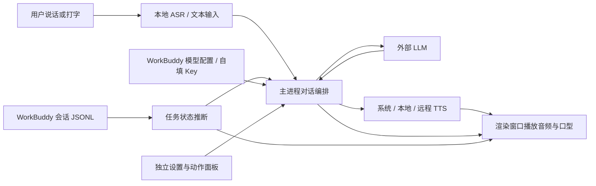

# workbunny 深度项目分析报告

> 分析日期：2026-10-24。代码基线：`zhyuzh3d/workbunny`，`main`，提交 `86005c446797797d77816038106a64e8cd34a7d2`，应用版本 `0.2.0`。
> 命名口径：WorkBunny 是当前仓库名；workbunny / workbunny 是需求文档和程序使用的产品名；baby 是伙伴的默认名字。
> 方法：阅读需求、前身插件及核心业务源码，进行有限的离线行为复现。区分「文档记录」「代码事实」「本次复现」「分析建议」，不把历史验收记录当作本次运行结果。

## 一、核心判断

**workbunny 的最终目的，是成为用户在 AI 工作过程中的常驻伙伴：平时有生命感而不占注意力，用户开口时能自然回应，工作发生关键变化时能给出可信、简短、有用的反馈。**

这一定位由「可爱、聪明、有用」「常驻但不持续调用模型」「只关注任务状态与结果」「一句到两句口语回应」共同指向。它要同时解决两件事：用户独自工作时缺少陪伴，以及使用 AI 执行较长任务时需要反复切回查看进度。最终应让用户感到：**有人陪我，也确实替我看着事情。**

目前项目已经具备相当完整的个人使用原型：透明桌面窗口、VRM 角色、语义动作、常驻识别、流式模型回复、分句发声、任务日志观察、独立设置和恢复机制，都有真实实现。它已超过单纯的角色展示 Demo。

但它更适合被定义为：**针对作者机器形成过使用链路、功能覆盖较广的早期 Alpha；尚未完成可迁移、可信赖的产品闭环。** 需求文档记录了历史局部实测，本次源码分析则发现，核心链路仍会在任务判定、事件归属、对话打断、设置生效和安装复现上失去一致性。不能据此称为成熟桌面伙伴，也不能证明已适合面向普通用户发布。

当前最重要的下一步，是把「会表现、会回应」提升到「事实可信、交互连续、安装可复现」。动作数量、服务商数量和设置入口已经足以支持验证产品价值，继续扩充这些项目的边际收益较低。

## 二、资料范围与证据边界

### 2.1 本次使用的资料

1. 用户指定的外部文档：`/Volumes/MAC-SSD1T/WorkBuddyCache/workspace/2026-10-23-23-15-25/workbuddy-daily-tip/workbunny-产品要求与开发进度.md`。
2. 同目录的 `README.md`、插件清单、钩子配置、`skills/daily-tip/SKILL.md`、技巧数据、选取脚本、面板模板与本地服务器。这里的 SKILL.md 作为被分析的项目资料阅读，没有执行其中的插件操作。
3. 当前根目录的 [VRMA 动作说明](vrma说明.md)。
4. 当前仓库的需求副本、`src/main/` 核心模块、preload、主渲染及设置面板、贴地和切段实现、原生 ASR、打包安装脚本与现有验证工具。

外部需求文档与仓库中的需求副本逐字一致，因此本次没有「两套要求不同」的问题。但文档中的历史运行目录是 `buddy-pet/`，当前检出目录是 `workbunny/`；涉及旧产物和个人配置的描述只能视为历史现场记录。

### 2.2 本次实际检查

| 检查 | 结果及含义 |
|---|---|
| 动作表与磁盘核对 | 92 个不同动作 key、92 个文件、20 个槽位、18 个 LLM 槽位，缺失 0、多余 0。证明清单一致，不证明全部动画视觉正确 |
| 实际可扫描角色 | 仓库内为 D/E/F/G 四个角色，中文名为可可、阿雅、琪琪、美莉；没有 `58.vrm`。个人模型被 gitignore 排除，符合仓库边界 |
| 现有 `node tools/monitor-test.mjs` | 全部检查通过，覆盖双会话、系统通知过滤、完成事件和另一任务继续运行等既定场景 |
| Monitor 隔离事件复现 | 复现中间汇报误完成、成败关键词误判、用户补充导致旧任务被记为放弃，以及完成事件与全局主会话不一致 |
| 分句器隔离复现 | 输入「好。嗯。」产生 0 个可朗读句子，短应答会被丢弃 |
| 配置模块隔离复现 | 用虚构配置与虚构凭据验证：旧 `version: 1` 保存后仍为 1，旧 `llm` 仍能作为实际回退来源 |
| 干净检出交付检查 | 当前没有 `node_modules/`、`bin/asr`、`dist/`；仓库有 Swift 源码，但所读工具和 package scripts 中没有对应编译入口 |

本次没有启动桌宠、采集麦克风、调用收费模型、连接个人远程 TTS、安装或覆盖应用、修改系统权限，也没有进行浏览器或截图视觉验收。因此，真实音质、持续识别稳定性、口型观感、长期资源占用、当前已安装版本的行为及旧 dist 的内容，均不属于本次已验证结论。

本报告采用本地资料和当前实现分析，不对外部模型当前可用性、服务价格、第三方平台接口承诺或素材授权效力作独立确认。

## 三、从需求演化看产品最终目的

### 3.1 前身是使用引导，当前是工作陪伴

`workbuddy-daily-tip` 原型解决的是「用户不知道 WorkBuddy 有哪些能力」：SessionStart 选取技巧，通过第一条用户消息的上下文注入，尝试展示右侧面板。它有节流、分类、去重、搜索和已学标记。

workbunny 把关系从「偶尔出现的一条技巧」改成「持续在场的角色」。用户不必先打开面板，可以看见她、碰她、直接说话；她也不只是讲功能，而是知道 WorkBuddy 正在忙什么、是否交付、是否太久没有动静。这是产品关系的升级。

两者共同的设计价值是：**在合适的时机，用尽量少的话，让用户更顺畅地工作。** 但本次没有发现桌宠与 daily-tip 的代码接线。不能把技巧推荐、学习进度或个性化教学列为 workbunny 已实现能力。它们是可借用的探索方向，是否合并仍应由实际需求决定。

### 3.2 三个要求需要形成同一个闭环

| 要求 | 实际用户价值 | 应如何判断做成了 |
|---|---|---|
| 可爱 | 愿意让她留在桌面，建立熟悉感 | 长时间看不厌、反应合场景、动作与声音协调，而非单看动作数量 |
| 聪明 | 听懂意图，知道自己掌握与未掌握什么 | 不乱接旁人的话、不猜任务事实、不把中间汇报当结果，能接住连续表达 |
| 有用 | 减少用户盯进度和切窗口的负担 | 提醒对应正确任务、结果可信、关键事项不漏，能方便地查看原始结果 |

三者存在约束关系。动作过多会打扰工作；为了显得机灵而猜测原因，会破坏信任；为了安静而直接丢弃完成提醒，会损失 usefulness。产品经理真正需要管理的是这组取舍，而非逐项把功能打上勾。

### 3.3 应建立什么长期关系

结合现有要求，合理的产品终态包括四层：

1. **在场**：常驻、安静、低资源占用，视觉上有生命感。
2. **可交流**：开口后有及时反馈，能顺畅接话、被打断、恢复聆听。
3. **懂当前工作**：掌握任务状态和结果，用可信的人话提醒用户。
4. **逐步熟悉用户**：记住用户明确表达的偏好，改善提醒方式和陪伴方式。

前三层有明确需求和代码支撑；第四层是本报告对「长期伙伴」的产品推导，当前仅有有限对话历史，尚未形成偏好学习系统。没有证据表明近期必须把它扩展为自主操作电脑的通用 Agent、任务执行平台或跨设备服务。

### 3.4 现阶段最合理的用户与价值验证

首要用户是长期在 Mac 上使用 WorkBuddy、能接受桌面角色与语音交互、经常等待 AI 任务的人。当前实现还依赖本机 WorkBuddy 文件格式、个人设备经验和较新的 ASR 系统能力，这使它更适合小范围定向试用。

初步价值假设应是：**用户愿意连续保留桌宠，并因她的提醒减少无目的查看 WorkBuddy 的次数。** 收费意愿、市场规模、用户留存和情感依赖程度都没有现有数据支撑，不能由作者的开发投入推导出来。

## 四、真实架构与当前完成水平

### 4.1 实际运行关系

这张图揭示两个重要边界：第一，workbunny 通过读会话日志观察 WorkBuddy，不是在执行其任务，也没有独立验收产物；第二，本地语音识别和默认离线发声不等于整个对话离线，回复依赖所配置的外部 LLM。

### 4.2 分层成熟度

| 层面 | 当前判断 | 主要依据与限制 |
|---|---|---|
| 产品概念 | 较清晰 | 「可爱、聪明、有用」已落实为工作场景中的具体设计约束 |
| 角色表现 | 实现较丰富，质量未完整验收 | 动作槽位、随机轮换、表情、点击反应、视线和口型均有实现；跨角色穿模、动作过渡及全部素材质量无本次视觉证据 |
| 对话与语音 | 核心管线已搭建 | 支持流式分句、音频队列、闭麦与回声过滤；打断、并发、短应答和设置变更存在实现缺口 |
| 工作理解 | 有观察能力，可信度不足 | 可合并多会话上下文，但完成和成败主要靠启发式判定，尚无独立结果验证 |
| 长期陪伴 | 初步 | 有最近对话落盘，没有结构化偏好、记忆管理或效果证据 |
| 用户控制 | 入口基本齐全，契约未统一 | 设置按身体部位组织合理，但保存、立即生效、试听、静音和暂停各有不同语义 |
| 工程恢复 | 有实用积累，缺稳定性证明 | 看门狗、日志、闭麦超时等解决过具体问题，但不能替代持续运行与故障恢复验收 |
| 可交付性 | 偏弱 | 原生二进制构建缺口、个人路径和设备假设、签名容错及安装覆盖方式需整理 |
| 外部用户验证 | 尚无足够证据 | 没有连续使用数据、误提醒率、首次成功率或有效提醒反馈 |

因此，不能用一个「总体完成 80%」来描述现状：表现层与可信层的差距，比功能数统计更重要。

### 4.3 已经值得保留的设计

- **语义槽位**把模型语义与具体表演分开。18 个 LLM 类名映射到丰富动作，比把 92 个动作名都塞进提示词更容易控制。
- **默认系统发声**降低对局域网服务的依赖；远程失败熔断和系统兜底体现了对基本可用性的重视。
- **工作时安静待命、只讲关键状态**的方向正确，避免把工具流水变成噪声。
- **身体部位式设置与独立窗口**符合伙伴的产品心智，也减少对角色画面的遮挡。
- **局部可观测性**已出现：发声来源、听见到出声计时、ASR 状态、渲染调试和多会话回归工具都可作为后续质量工作的基础。

这些是产品资产，值得在修复一致性时保留，不需要为整理工程而推倒重来。

## 五、影响最终目标的关键差距

### 5.1 任务监督目前观察到的是「对话结束迹象」

**证据：** `monitor.js` 将助手文本记为候选结果；后续工具调用或 reasoning 会取消候选；候选存在且静默超过 `3200ms` 就记为完成。成败依赖 `FAIL_WORDS` 正则。任何符合最低长度的真实用户消息都会先结束旧任务，再开始新任务。[S3]

本次用真实 Monitor 类、虚构事件复现：

| 输入场景 | 当前结果 | 产品应表达的事实 |
|---|---|---|
| 助手说「我先检查一下，稍后继续。」后暂时没有新事件 | `ok` | 只有中间汇报，尚无可靠交付信号 |
| 助手说「已修复之前的失败问题，全部完成。」 | `failed` | 单凭出现「失败」无法判断结局 |
| 助手说「还缺少凭据，需要你先登录才能继续。」 | `ok` | 正在等待用户补充，不能称为办成 |
| 用户在执行期间补充「只处理登录页」 | 旧任务进入 `abandoned`，新任务开始 | 很可能是同一任务的约束更新 |

这些偏差不只是边角 bug：用户把「替我盯着」的信任交给产品，而产品可能在没有结果时宣布结果。即便识别到了最终答复，也只是 WorkBuddy 的陈述，不能自动证明文件、发布或真实交付成功。

**建议：**优先区分「执行中」「等待用户」「收到答复」「中断或取消」「结果待确认」。如果可获得明确的回合终结事件，应优先使用；在尚未确认上游可提供何种契约前，保留启发式但降级措辞、记录来源与置信度。先确保说真话，再提升结果摘要的机灵程度。独立结果核验应按具体任务选做，不能默认拥有。

### 5.2 观察事件没有被可靠地绑定到提醒

**证据：** `taskDone`、`taskLong`、`taskStall` 回调拿得到对应会话，但 `proactive()` 重新读取 `monitor.snap`，生成时又使用全局 `monitor.context()`；扫描中的 `publish()` 在逐会话 `tick()` 之后才执行。[S3][S4]

本次双会话样例中，A 完成时事件对象为 A，而主动播报读取的主会话仍是 B。事件发生时的全局视图还把 A 列在「正在执行」，同时在历史中记录 A 已完成。这证明上下文快照存在不一致窗口，不代表每次一定念错，但足以破坏可靠归属。

此外，`proactiveAllowed()` 不允许时直接返回；监控事件没有待提醒队列。用户正说话、LLM 忙、刚启动或距离上次提醒过近，都可能使完成播报被跳过。状态条仍可能显示结果，但语音提醒不会稍后自动补发。

**建议：**用小型不可变事件记录固定 `eventId / sessionId / taskId / state / source / time`，播报只围绕该事件构造上下文。忙时延后、重复时合并、过时时丢弃；任务完成与休息建议应有不同优先级。无需先引入大型消息系统，一个有界本地队列就可以解决当前问题。

### 5.3 「有判断」与「不编事实」的提示词发生冲突

系统人设要求「还没看到结果就说还没看到」「不要臆造权限、路径、网络原因」，但停滞提示明确要求「猜一个最可能卡住的原因」。任务完成提示也要求说明「卡在哪」，而监控不一定有这个事实。[S2][S4]

同时，人设的「绝对禁止推脱」「不许说我无法」与「不知道就直说不知道」存在张力。当前没有文件操作等工具调用执行环节，普通用户提出执行请求时，过强的配合人设可能让表达越过实际能力。

**建议：**为每次播报分开提供「已知事实」「未知项」「允许给的建议」。让人格负责语气，让事实约束负责内容。可以说「八分钟没看到新动静，去看一眼是否在等确认」，不能说「卡在权限了」，除非来源确实说明如此。确认未知和明确能力边界，也属于聪明。

### 5.4 语音管线已经接通，但缺统一的对话生命周期

主要实现链路是：ASR 分句 → 可选意图判断与回答 → LLM 按句输出 → TTS 合成 → 渲染播放 → `audio-done` 回收。[S4][S5]

这里有三项优先问题：

1. **停掉声音不等于取消旧回答。** `stopSpeaking()` 清空音频队列并递增 `speechGen`，但 `think()` 没有传入 `llm.chat()` 已支持的 AbortSignal。旧模型响应仍可继续向队列追加句子。新输入也没有被统一串行化；`busy` 主要阻止主动播报，没有阻止多个用户回答并行生成。源码路径显示有旧回答回流、交错和历史顺序混乱风险，本次未发真实模型请求复现。[S4][S5]
2. **短应答可显示但不出声。** 分句器遇到句号就消费片段，但纯文字不足两个字符时不调用 onSentence；本次「好。嗯。」被全部丢弃。应保留短片段或在最终结果回收尚未朗读文本，而不是把沉默误当角色个性。[S5]
3. **当前常规路径是半双工。** Swift 只有收到 `--aec` 才尝试回声消除，主进程 `asrOpts()` 没有传入；因此通常在她说话时闭麦，点击角色才是可靠打断路径。代码保留了可插话的设计分支，但不能把它当作当前默认效果。[S4][S6]

**建议：**先定义唯一回合 ID 与状态：聆听 → 理解 → 生成 → 合成 → 播放 → 收尾。新回合和打断同时取消或使旧回合的 LLM、TTS、动作和回调失效。先把点击打断与恢复聆听做稳定，再决定是否投入真正可用的语音插话。

### 5.5 「持续监听」与「低打扰」尚未成为统一策略

本地过滤只排除极短噪声、近似回声等情况；其他有意义的识别句子在 judge 模式下会被送到 LLM，由同一次生成决定回答或 `<skip>`。所以「空闲无语音时不调用模型」有实现依据，但「不是对她说话就不消耗外部模型」不成立。发送时还会附带监控上下文与最近对话。[S4]

「别打扰」会抑制十分钟主动播报，但不关麦，也不阻断此期间普通 ASR 句子进入回答判断；显式叫名字可继续交流是合理的，旁人谈话仍不断判断则可能违背用户对安静的预期。长期默认监听还涉及用户是否清楚文字会发给所选模型服务。

**建议：**将模式收敛为少数能说清的状态，例如常驻可回应、仅呼叫回应、暂停聆听；主动提醒再有独立的安静策略。说明用户关闭的是声音、主动提醒还是麦克风，提供一个确定可见的停止采集入口。依据真实误唤醒数据再判断是否需要本地唤醒词，暂不扩建复杂感知体系。

### 5.6 设置页有入口，不代表所有选项真的控制了行为

| 问题 | 当前源码事实 | 影响 |
|---|---|---|
| 常驻监听开关保存后 | 通用 `pet:config` 只保存；没有据 `voice.alwaysListen` 调用 start/stopListen | 保存关闭时，当前监听可继续运行；从关闭状态保存开启也不保证立即开始 |
| WorkBuddy 思考强度 | 面板可选择并保存；resolveLLM 在 WorkBuddy 模式固定 `thinkingSupported: false` | 界面形成可控预期，请求实际不携带该控制参数 |
| 自有服务商思考档位 | `medium` 与 `high` 都映射为同一个启用布尔值，`low` 映射关闭 | 名称表现为三级强度，实际只是开关语义 |
| 保存与即时生效 | 外貌即时生效；部分 TTS 控件即时保存；引擎按钮先改草稿；试听读取已保存配置 | 用户可能在看新引擎时听到旧引擎，难以理解是否已应用 |
| 设置状态同步 | 面板初始化取一次配置，未建立持续事件同步；主窗的配置也不是集中订阅更新 | 托盘、主窗口和设置窗口可能各保留旧状态 |

以上结论来自 IPC 与面板对应处理路径，不依赖外部服务行为。[S2][S4][S8]

**建议：**统一「选择即应用」或「编辑后保存」的约定；试听显式使用当前草稿；配置变更由主进程应用运行时副作用并通知所有窗口。不支持的控件应隐藏、禁用或说明限制。

### 5.7 本地 Qwen 是集成雏形，不能视为下载即用

代码有两个 GGUF 文件的下载器、进度、取消、参考音频复制和调用 `llama-tts` 的实现；也已经向 UI 返回 `hasRuntime`，面板有缺运行时的提示。**原文档把「需要补运行时提示」列为待办，这一项在当前代码中已部分完成。**[S7][S8]

真正没有闭环的是：

- `qwenReady()` 只判断两文件存在且各大于 100 MiB，未验证完整长度、哈希或加载结果；这只能称为文件存在检查。
- 「已就绪」徽标只看文件，不看运行时；下载完成提示还可能写成「选个音色就能用」。
- 没有锁定并验证与目标模型匹配的运行时版本、命令参数和资源要求。本报告没有外部验证该组合兼容性，不能因为有 execFile 调用就认定兼容。
- `qwenTTS()` 不根据 `qwen.voice` 选择是否克隆，只要 `refFile` 存在就传入参考音频；上传后选回 default，仍可能继续使用参考文件。
- 声音缓存的一层只按文本和情绪取 key，修改声音配置不清空；另一层返回缓存时不保留实际引擎、降级原因等元数据。降级音频还可能遮住之后的引擎恢复。
- 资源与进程生命周期尚未统一：本地执行超时设为 120 秒，主进程合成看门狗为 30 秒，单纯结束队列等待不等于结束实际合成子进程。

**建议：**系统语音继续承担稳定基线。本地能力按「未安装 → 下载中 → 文件完整 → 运行时可用 → 合成验证成功」展示真实状态。只有最后一步通过，才提供「可使用」承诺。当前只列 default/clone 两种模式，也不应包装为已经具备丰富内置音色库。

### 5.8 生命感的瓶颈已从素材数量转向行为协调

真实代码比需求中的「切动作时一次常量补偿」更复杂：会在模型加载时执行位移冻结、竖直对齐、脚接触分析与两骨 IK，再烘入动作。它有明确技术投入，但是否对每个角色有效仍需实体验收，不能把脚滑问题写成已彻底解决。[S9]

目前尤其值得关注：

- 完成状态的庆祝分支还引用旧 key `spin` / `Clapping`，与现有动作表不匹配；这一路径无法按预期播出。LLM 另行触发 cheer 不能替代该分支正确性。
- 空闲自娱分支没有排除 `phase === 'work'`，会按 18–38 秒间隔抽取动作；它与「工作时安静站着」的意图并未完全一致。
- 同槽随机只考虑槽位和是否加载，没有体现站坐姿、角色衣物、动作强度或场景限制；表中 `off` 标识也没有在槽选择函数中成为通用过滤规则。
- 流式语音按句进入播放，动作/表情主要在整段模型返回后触发；开始 speaking 又可能转回待机，缺少一句话、一段声音和一组动作的统一时间关系。
- 92 条动作都在首次角色加载前读取，切角色还要重建与处理动作；实际启动和切换延迟未在本次测量。

**建议：**先挑选一组跨角色稳定的默认动作，补充「角色兼容、站/坐、强度、允许场景、冷却」元信息。随机负责变化，场景策略负责恰当。无需立刻建设复杂情绪模型；把「忙时少动、讲话别乱切、重要结果有回应」做好，生命感会比再加几十条动作更强。

### 5.9 个人记忆和产品可信边界都还很薄

当前 `memory.json` 保存最多 24 条对话消息，请求携带最后 6 条；这是短期上下文延续，不是对用户的长期理解。主动生成的回复也会进入同一历史流，没有结构化地区分用户偏好、系统事件和普通闲聊。[S4]

配置文件以普通 JSON 保存凭据；`load()` 还会补全 WorkBuddy 凭据，后续 `save()` 写入合并后的配置。初始化接口把完整配置传给渲染层。当前有 contextIsolation 和关闭 nodeIntegration，这是正面基础，但「默认复用额度」仍然是读取本机配置文件，不等于拥有一个已声明、稳定的官方接入契约。[S2][S4]

**建议：**先提供清晰的数据与控制边界：什么文字会外发、使用哪个服务、怎样暂停、怎样清除对话。随后再做用户明确同意的少量偏好记忆，例如称呼、音量、提醒频度、偏爱的角色。凭据应留在主进程并采用适当的系统存储；展示层拿去敏信息即可。没有必要在本阶段建立全量生活记忆或云端画像。

### 5.10 安装交付还没有摆脱开发现场

当前干净检出有原生源码却没有 `bin/asr`，也没有找到把 `native/asr.swift` 构建为该路径的脚本。`package.sh` 直接复制二进制，意味着新机器无法仅按现有标准入口完成整个构建。[S1][S6][S10]

兼容性也需要分层说明：`package.sh` 声明最低系统 `11.0`，但实际 ASR 使用 macOS 26 API，低于 26 的分支直接报不支持。需求原话中的「最近至少五年」明确落在默认 TTS 上，不能泛化为用户已经要求整套应用支持五年；但同样不能用 say 的广泛兼容性宣称整套产品都支持。

其他交付弱点包括：签名失败有 `|| true` 容错，可能没有形成明确构建失败；安装用原位 `ditto` 覆盖，旧包独有文件可能残留；打包直接复制整个 `src`，不会依据 gitignore 自动排除本机额外放入的个人模型；仓库未提供完整的开发/构建 README 或统一检查入口。工具中直接写 TCC 数据库的脚本属于特定机器的处理手段，不宜成为普通用户安装流程。[S10]

**建议：**建立最短可复现路径：依赖安装 → 原生编译 → 显式资源清单 → 打包 → 签名校验 → 安装 → 首次运行。保留现有脚本中已经验证有价值的启动经验，同时让失败有明确状态。个人模型不入 Git 与不进入发布包是两道不同边界，需要分别控制。

## 六、对原进度文档的校正

| 文档表述 | 当前分析口径 |
|---|---|
| 五个角色已完成 | 命名支持五个，Git 仓库实含四个；第五个依赖本机个人模型，不能当作全新安装默认资产 |
| 92 动作、20 槽位 | 清单与文件本次已核实；视觉品质与角色兼容性仍需实测 |
| 对 WorkBuddy 的监督已完成 | 已实现多会话日志观察；完成判定、成败识别和事件播报尚不足以承诺可靠结果监督 |
| 旧 `llm` / `voice` 都是死键 | 不成立。`llm` 仍是解析回退和加载补全来源；`voice.enabled`、`voice.alwaysListen` 仍控制运行；`autoSpeak` 等字段则需逐项查证 |
| version 卡在 1 属个人残留 | 不只是残留：默认 version=2，但无显式迁移，旧值会覆盖默认并再次保存；本次隔离复现成立 |
| Qwen 缺运行时提示待补 | 提示已有，真正需补的是可用性状态、运行时配套与真实合成闭环 |
| 系统 TTS 已实测成功 | 接受为历史局部证据；不能替代完整听说回合、真实播放和口型的本次验收 |
| dist 内容陈旧 | 原文档的历史已知问题；当前 dist 不在 Git 且本地不存在，本次不确认旧包具体内容 |
| 看门狗与透明窗口稳定 | 恢复代码确实存在；当前代码审阅不能重证历史稳定运行结论 |

进度文档最需要改进的，是从「某模块打勾」转为「哪个场景、什么版本、什么环境、具有什么证据」。这样才能避免局部验证形成整体完成的错觉。

## 七、后续迭代路线：先可信，再顺畅，再长期陪伴

以下工作量是便于排序的粗估，按一名熟悉项目的开发者、无需解决外部服务阻塞计算；不是交付日期承诺。每阶段以出口条件为准，不应为了版本号继续叠加功能。

### 阶段 A：可信的个人试用基线，约 3–6 人日

| 优先事项 | 目的 | 出口条件 |
|---|---|---|
| 修正任务判定措辞与成败规则 | 停止把未知包装为成功 | 中间汇报不报完成，等待用户能区分，无法确认时明确说未确认 |
| 事件绑定、上下文快照、有界待提醒队列 | 不串任务、不因暂时忙碌漏掉关键提醒 | A/B 并行时完成事件归属准确；繁忙后可补发并合并重复事件 |
| 回合取消与队列代际一致性 | 用户打断后立即取得控制 | 旧 LLM 增量、迟到合成与回调不再进入当前回合 |
| 监听配置应用、试听语义、短应答 | 消除直接可见的失效 | 保存关麦立即停止采集；试听当前选择；「好」「嗯」能正确发声 |
| 补齐原生构建与资源清单 | 从干净检出得到可审查产物 | 有一条记录清楚的构建路径，包内容可核对，失败能阻断交付 |

本阶段不要求所有模型与所有音色可用。稳定默认路径优先，未验证能力明确标识即可。

### 阶段 B：可以持续使用的伙伴，约 5–10 人日

- 选择并说明支持的 macOS 范围；若兼容较旧系统是明确目标，再评估 ASR 回退方案与实际机器覆盖。
- 将系统语音默认路径完成一次真实「听到 → 回答 → 出声 → 口型 → 重新聆听」验收，再做连续多轮及打断。
- 建立小规模稳定动作集合、工作时行为策略、角色切换失败回退与状态同步。
- 修正 Qwen 真实可用性标识；运行时配套没有验证前保持实验属性。
- 完成日常持续运行、睡眠唤醒、网络中断、设备拔插、正常退出与崩溃恢复的必要实测。
- 提供暂停、清除对话和基本数据说明；不要求普通用户处理技术文件或系统数据库。

出口是：用户能连续使用数天，常见故障能恢复或明确说明；主窗、托盘、设置和实际状态一致。

### 阶段 C：验证长期价值，先做 1–2 周小范围使用观察

本阶段主要是学习，不应一开始堆新模块。征得用户同意后，可用本地简短记录或少量人工反馈观察：

| 指标 | 想回答的问题 |
|---|---|
| 首次成功对话与首次有效任务提醒 | 用户能否跨过安装配置到达价值点 |
| 用户说完到首次可听回复的 P50/P95 | 对话是否自然，长尾卡顿是否破坏体验 |
| 错误完成提醒、串任务、漏提醒 | 「替我盯着」是否可信 |
| 非对她说话却回应的次数、频繁静音/暂停 | 是否打扰正常工作 |
| 提醒后是否查看正确结果、是否减少反复切回查看 | 提醒有没有实际用途 |
| 数日后是否仍主动保留并呼叫她 | 新鲜感之后是否有持续价值 |
| 日常 CPU/GPU、内存与能耗 | 常驻成本是否可以接受 |

先记录基线，再约定改善目标。当前没有数据，直接写「误判低于 1%」「留存达到多少」会制造精确感，不能作为本报告已知事实。

### 阶段 D：在价值成立后，选择性增加成长能力

优先候选是低成本、高关联的个性化：用户主动确认的偏好、提醒习惯、任务结果回看、根据明确上下文给一条使用建议。

daily-tip 可以成为内容来源，但合并前应解决它本身的反馈断点：

1. 选取脚本在注入上下文时就写 `seen` 与 `shown`，此时模型可能因用户有具体任务而完全不展示；「被选中」不等于「看过」。
2. 钩子推荐的 tip 与面板 hero 各自选取，没有明确的 ID 传递，可能展示不同技巧。
3. 面板已学状态在 localStorage 或 `progress.json`，选取器只读 `state.json`，没有用学习反馈调整推荐。
4. 技能中的关闭做法是增大间隔；`notify: false` 只关闭系统通知，不是完整停用开关。

因此，若要合并，应先统一 `selected / displayed / dismissed / learned / tried` 的含义和 ID，再由 baby 在用户愿意接受的场合轻量呈现。验证「一条建议有用」后再投入自动内容抓取与个性推荐。

## 八、实现上的最小整理方案

当前不需要重写框架、引入大规模服务或把全部状态塞进数据库。建议围绕现有模块补齐五个契约：

| 契约 | 最小内容 | 解决什么问题 |
|---|---|---|
| 工作事件 | 来源、稳定任务 ID、事件 ID、时间、状态、证据、是否确认 | 状态推断与最终事实混淆，事件串任务 |
| 对话回合 | turnId、取消信号、当前生命周期、允许提交的副作用 | 打断后旧回答复活、并发语音和回调污染 |
| 配置应用 | 校验、迁移、持久化、运行时应用、全窗口同步 | 保存了但没生效、多窗口陈旧状态 |
| 声音能力 | 所选引擎、实际引擎、就绪原因、配置版本、缓存元数据 | 试听不一致、降级不透明、缓存掩盖切换 |
| 交付产物 | commit、依赖锁、构建环境、资源清单、签名结果 | 源码、个人安装包与正式产物脱节 |

`index.js` 已承担窗口、ASR、LLM、TTS、监控、IPC、自检和恢复等约 1800 行职责。可以在修上述问题时顺势抽出回合编排和提醒调度，但不宜先做全量重构。判断是否值得抽取的标准，是它能否让生命周期和测试边界更明确。

建议建立一个小而实的场景集合：单任务、双任务、补充指令、等待用户、中间汇报、成功中含「失败」、临时静音、打断、迟到返回、缺运行时、声音切换、正常退出。离线场景证明逻辑；真实安装和音频体验另外验收，二者不互相替代。

## 九、当前不值得优先扩张的方向

- **继续扩充动作总量。** 92 条已经足以形成变化，先提高默认选择的正确率和跨角色质量。
- **更多服务商和更多无实际作用的参数。** 先让已有选项可靠、诚实。
- **自动操作电脑或代替 WorkBuddy 执行。** 目前最清晰的价值是陪伴与观察；执行能力需要另行定义任务与权限边界。
- **跨平台、账号云同步、素材市场。** 当前安装与单机闭环尚未稳定，提前扩张会放大维护负担。
- **用主动发言频率制造存在感。** 长期陪伴靠可预测、恰当与熟悉感；安静本身也可以是成功行为。

## 十、最终建议

将下一阶段目标写成一句可验收的话：

> **在一台明确支持的 Mac 上，用户安装后可以持续使用 baby：她能接住对话、被可靠打断，准确指出哪件工作有了什么新消息，并在不知道时说清不知道。**

这比「完成所有模块」更接近产品的最终目的。workbunny 已经拥有足够丰富的角色与管线，接下来决定它能否从新鲜玩具变成长期伙伴的，是用户能否放心把注意力交给她。

## 附录：主要代码证据索引

以下路径相对当前项目根目录；行号针对本报告代码基线。文中判断由对应完整函数及其调用路径共同得出，不仅依据注释。

| 编号 | 来源与定位 | 支撑内容 |
|---|---|---|
| S1 | [package.json](../workbunny/package.json)、[gitignore](../workbunny/.gitignore) | 版本、依赖、启动入口、未跟踪二进制与个人模型边界 |
| S2 | [config.js](../workbunny/src/main/config.js)，175–236、305–380、401–521 行 | 动作语义、人设、默认值、模型解析、旧字段回退、配置读写 |
| S3 | [monitor.js](../workbunny/src/main/monitor.js)，35–49、84–90、267–455、461–547 行 | 扫描、任务切分、静默判定、关键词成败、视图发布与上下文 |
| S4 | [main/index.js](../workbunny/src/main/index.js)，159–178、449–616、620–936、1035–1170、1178–1392、1724–1755 行 | 历史、语音队列、对话编排、主动提醒、监听、IPC 与运行时副作用 |
| S5 | [llm.js](../workbunny/src/main/llm.js)，19–66、72–173 行 | 标签解析、短句丢弃、思考参数、流式接口与取消能力 |
| S6 | [asr.swift](../workbunny/native/asr.swift)，497–615、651–670 行；[asr.js](../workbunny/src/main/asr.js) | 系统版本、语言资产、麦克风与 AEC 启动条件、子进程管理 |
| S7 | [tts.js](../workbunny/src/main/tts.js)，95–141、198–260、286–365 行 | 本地运行时、参考音色、缓存、降级、下载与就绪判定 |
| S8 | [panel.js](../workbunny/src/renderer/panel.js)，94–105、121–161、193–234、262–299、393–438 行；[panel.html](../workbunny/src/renderer/panel.html) | 设置组织、草稿与保存、思考档位、运行时提示与试听 |
| S9 | [app.js](../workbunny/src/renderer/app.js)，363–378、498–569、1095–1195、1249–1283、1372–1504、1549–1573 行；[ground.js](../workbunny/src/renderer/ground.js)；[motion-cut.js](../workbunny/src/renderer/motion-cut.js) | 角色加载、动作选择、生命感策略、旧动作 key、状态条与贴地切段 |
| S10 | [package.sh](../workbunny/tools/package.sh)，12–37、55、77–102 行；[install-app.sh](../workbunny/tools/install-app.sh)；[grant-permissions.sh](../workbunny/tools/grant-permissions.sh)；[watchdog.sh](../workbunny/src/main/watchdog.sh) | 原生资源依赖、最低系统声明、签名、覆盖安装、开发现场脚本与恢复 |
| S11 | [avatars.js](../workbunny/src/main/avatars.js)，23–37、76–112 行 | 五个命名映射与真实目录扫描的区别 |
| S12 | [monitor-test.mjs](../workbunny/tools/monitor-test.mjs)；[test_persona.js](../workbunny/tools/test_persona.js)；[ground-test.mjs](../workbunny/tools/ground-test.mjs) | 现有验证能力及边界；本次只运行第一项，未调用后两项 |

外部前身插件的主要证据文件均位于用户指定目录：`README.md`、`scripts/pick_tip.mjs`、`panel/template.html`、`panel/server.mjs`、`hooks/hooks.json`、`skills/daily-tip/SKILL.md`。该目录属于外部参考资料，没有复制其代码或修改其状态。
