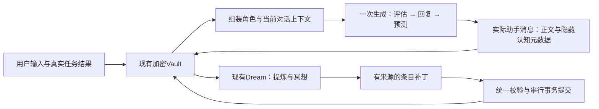

# WorkBunny 自我理解与预测驱动对话开发计划

制定于2026-10-28，架构重构于2026-10-29 · 已按A—E范围实施于0.11.0 · 代码基线0.10.0。

本文替代2026-10-28初稿，保留开发决策与交付边界。实施结果与验证见[0.11.0交付记录](workbunny-0.11.0-自我理解与成长闭环.md)。外部平台经营与离线送达仍属于本文第9节约定的后续独立接入项。

## 1. 产品意图与收敛目标

目标是让 Bunny 成为有持续自我、有理解和主见、能够把握交流节奏并从相处中成长的伙伴。她在授权范围内也可以自主发起想法、尝试事情，再带着真实经历回来交流。

本轮讨论确定的产品选择保持不变：

1. **自我理解只有一份。** 私聊、生活、工作读取同一组有效条目。场景可以触发条目里的不同适用条件，不产生三套人格。
2. 用户的简短身份和行为设定是整合材料；用户直接修改自我理解是明确修改；单条或整份锁定阻止 Bunny 自主改动，不阻止主人直接编辑。
3. Bunny 可以根据对话、真实任务结果及自主经历更新未锁定条目。低影响日常成长不逐项要求用户批准。
4. **采用语义预测质量作为理解质量和对话掌控力的主要内生反馈。** 同时考虑本轮与历史表现，用于判断何时推进、倾听、追问、收束或转换话题。
5. 每轮最终生成顺序为：**上一轮预测评估 → 本轮回复 → 新预测**。评估要在同一次生成中先于回复出现，不能客户端事后重排。
6. 掌控力服务于理解用户、正向引导和舒服相处。用户可以改变方向或要求停止；把预测命中率、回复率或聊天时长最大化不是产品目标。

技术目标是：**一套加密资料库，一个认知写入口，一次前台最终生成，一个后台学习流程。** 先完成“经历改变下一次行为”的完整闭环，再增加自主活动。

## 2. 初稿中需要替换的设计

| 初稿方案 | 本版决策与理由 |
| --- | --- |
| 新增recordClass、global_self、原生self_commit，并允许来源范围降低 | 撤回。自我理解属于共享的角色配置，通过固定角色接口读取；其条目和证据保存在加密私有区。普通记忆的范围规则不变 |
| 人格、预测、关系、冥想分别扩展服务与状态机 | 合并为认知资料读写、前台回合处理和现有后台分析三个职责，不为每个概念建立子系统 |
| 单独保存预测日志、评估日志、回合日志和汇总 | 评估与预测附在实际助手消息上；只保留可重建的小型会话投影，避免多份事实和跨表配对 |
| Meditation拥有独立定时器和常规模型调用 | Meditation是Dream分析中的反思职责，共用批次、调度、模型预算和提交端 |
| 身份、用户、关系、世界分别建设完整模型 | 唯一自我理解采用专用条目；用户/关系理解复用普通记忆；环境理解复用真实任务、观察与经验 |
| 所有未来能力同时影响首期底层 | 首期交付一个垂直闭环；检索增强和自主活动沿现有契约后续接入，不预建通用图谱或执行平台 |

保留初稿中的锁定、来源、版本、有序协议、时间锚点和授权要求；减少实现它们所需的持久副本、特权操作及前台调用。

## 3. 总体架构：事实、认知与运行视图



三个层次各有一份权威：原始消息/任务记录说明发生过什么；自我条目及普通记忆说明当前如何理解；RoleView、会话汇总和检索结果只是运行时视图。视图失效后从权威记录重建，不成为新的长期人格或事实来源。

继续使用MemoryService、原生SQLite、加密信封、来源DAG、现有模型适配与WorkBuddy分工。首期不增加数据库表、数据库可见性类别、Agent框架或常驻后台服务。

## 4. 最小数据模型

所有新字段放入现有加密value；类型由应用验证，tag仅作索引和展示。物理kind与记录语义分开，不用tag授予更新权限。

| 资料 | 物理位置 | 权威与生命周期 |
| --- | --- | --- |
| 自我条目 | kind=persona，schema=self-entry/v1 | 一条逻辑entryId，多份不可变修订；group固定为bunny-self |
| 简短身份/行为输入 | kind=persona，schema=self-settings/v1 | 用户输入版本；整合后不再次作为绝对人格常驻提示词 |
| 自我控制头 | kind=state，schema=self-head/v1 | 唯一revision、有效条目引用、整份锁及条目锁、设置处理进度；不存第二份人格正文 |
| 用户/关系/行为经验 | 现有memory/knowledge记录 | 增加必要的memoryKind与条件、依据；延用普通资料范围和确认状态 |
| 本轮评估与新预测 | 实际助手message.value.cognition | 与正文一次落盘、不可事后改写；不进入普通全文索引或可朗读正文 |
| 会话投影 | RAM；需要恢复时用一条有来源state | 最近有效回复、待评估预测、有限历史统计；可从消息重建 |

自我条目最小字段：entryId、revision、facet、text、可选condition、origin、sources。facet限定身份、倾向、价值、行为、兴趣等用途。作者、权限、时间和版本由程序赋值，不相信模型自填。

锁只在控制头中保存一份，界面把锁状态与条目合成展示；不在每份正文修订中再维护一个竞争的锁。控制头引用条目属于版本指针，不登记成来源DAG父项，防止删除一个来源时把整份锁状态一并删除。

### 4.1 全局自我理解：角色配置通路

**语义全局不要求数据库记录公开。** 自我条目、设置和控制头统一存private/2，实际来源照常登记，完全遵守现有原生范围校验。这不会形成“私聊人格”：固定的loadRoleView只按bunny-self与严格schema加载唯一有效条目，不接受调用方传入scene或任意检索条件。

该宿主内部接口可以读角色配置，向三个场景提供相同的条目正文、条件及逻辑条目ID。它不返回来源原文、审计说明和私人记忆列表。来源查看走独立的主人管理界面。原始证据仍由普通范围规则保护。

这是用户明确选择的角色共享通路，与现有共通角色设置的用途一致；不把普通资料重新标成全局，也不修改memory-scope或原生来源范围继承规则。自动条目只能抽象 Bunny 自身的倾向与行为，不夹带可识别的用户私密事实、账号或事件。直接编辑入口明确标示“三场景共用”，秘密仍走独立保管路径。

上下文分为RoleContext与EvidenceContext：前者是行为配置，后者是聊天事实与任务证据。回复记录selfRevision用于追溯，但不把角色条目ID混入普通事实sources，否则工作回复会因角色记录位于private而意外升为私聊。实际用于回答的私密事实仍必须进入EvidenceContext及来源DAG，不能借角色通路带出。

遗忘来源会使相关自我条目和未来RoleView失效；不因为某段旧回复曾受一种语气影响，就递归删除全部后续对话。旧回复若使用过被遗忘的事实，仍按其事实sources删除。共享性格变化跨场景可感知，是这一产品选择本身；保护目标是原文与可识别事实不随角色视图外带。

### 4.2 条目与锁的更新规则

| 来源 | 更新方式 |
| --- | --- |
| 修改简短身份/行为输入 | 保存输入版本，优先排入同一后台分析流程，与旧条目整合；成功后说明实际变化，失败保留旧人格 |
| 主人UI直接编辑 | 精确保存用户确认的正文；可以编辑锁定条目，原锁保持 |
| 主人对话明确要求更新自我理解 | 使用本轮真实主人来源定位并修改；含糊目标澄清一项，引用/假设/外部消息不构成授权 |
| Dream中的自主学习与归并 | 只改未锁条目，保留依据与适用条件；不得通过新增相反条目、改条件或隐藏条目架空锁 |

整份锁定时，自动流程不能新增、修改、移除或重排有效人格；候选可以留待处理，但不进入RoleView。解锁后只重评仍相关的材料，不自动重放过时提案。明确要求“优化自己”不等于解锁；明确逐条直接修改属于主人操作。

锁保证存储的有效内容不被自主改写，不把自然语言人格描述假装成逐字可执行代码。停止、静音、删除和操作授权由程序直接执行，不受性格协商影响。

控制头保留移除和锁定状态。来源被遗忘后缺失的条目不从旧正文恢复，读取时撤出并修复指针；用户独立直接确认的新修订按自己的实际来源处理。普通范围规则和来源删除不为锁定让步。

### 4.3 一个认知写入口

拟新增CognitionRepository，复用MemoryService.serial和现有write事务，提供loadRoleView、loadTurnContext、commitPatch三个主要职责；不再另建SelfModel、关系、冥想各自的写服务。

所有设置整合、主人直接编辑、对话修改与后台学习都生成同一类ChangeSet：稳定requestId、宿主确认的actor、读取的baseSelfRevision、来源快照和有限add/replace/remove补丁。模型只提出内容与目标，不决定actor、锁权限或有效版本。

提交过程：模型调用在队列外完成；进入现有串行队列后，重新读取控制头，核验版本、锁、来源指纹和隐私generation；把新修订与控制头放入现有一次write事务。原文水位、记忆与分析回执也使用既有提交模式。每批均小于原生200项/200来源限制，不引入同批新父项依赖。

当前单实例、单MemoryService写队列是并发前提。全部认知修改必须经此入口，包括恢复和删除协调。SQLite事务保证该批原子性；应用在队列内检查revision。现有epoch主要用于删除/恢复失效，不能冒充每次编辑的版本锁。首期不为尚不存在的多写者引入原生人格专用事务协议；未来若支持多进程编辑，再评估通用条件写入。

陈旧版本或来源变化不提交旧补丁。因锁定而不适用的自动补丁记录为未采用，其他合法记忆可继续保存；技术校验失败则不推进对应提交水位。用户编辑时不得静默部分成功，返回清晰结果。

自我版本改变时作废角色缓存和其他旧角色迟到回复，不递增用户遗忘generation来误停无关任务。当前主人修改人格的成功回执绑定提交结果，本次修改不能把自己的回执也取消。

## 5. 前台闭环：一次最终生成，直接影响本轮节奏

### 5.1 输入与有序输出

每轮加载唯一RoleView、当前可见记忆/真实任务状态、最近实际对话、上一条有效预测及历史评估汇总。用户/关系理解从现有记忆按需取用，不预建一份完整世界模型或把多年资料常驻上下文。

模型一次最终生成三个有序阶段，正常聊天不新增三个串行模型调用。既有联网工具往返、格式修复与上下文重试仍使用原有有界机制。

```json
{
  "protocol": "dialogue-v2",
  "stages": [
    {
      "stage": "review",
      "grade": "opposite",
      "note": "他明确只想倾诉，上一轮误判为想听建议，先停下建议。",
      "grasp": "adjust",
      "pace": "listen"
    },
    {
      "stage": "reply",
      "reply": {"kind": "chat", "text": "那我先听你说。最让你烦的是哪一段？"}
    },
    {
      "stage": "prediction",
      "expect": "用户继续讲最让他烦的环节，暂时不要求解决方案。"
    }
  ]
}
```

数组顺序是协议要求，不能依赖JSON对象键顺序，也不能客户端重排假装模型已先评估。模型先看到输入中的历史汇总，再生成本轮review，随后回复可利用两者，最后预测用户下一步。适配器验证顺序与字段后，把reply交回现有动作校验/执行逻辑，不重做Secretary或桌面执行器。

评估note与新预测各以一两句为限，重点保留差异与下一步语义方向，不输出长篇独白。RoleView影响稳定风格，review.pace影响当下策略；移除普通聊天一律1–2句、随机抽语气等与节奏控制竞争的固定表达机制，改为简短默认、按情境展开。

动作只能来自reply中的合法intent；身体标签只从reply.text提取，不能沿用传输层对整包raw扫描出的motion/emo。语音队列携带回复身份，文字、声音和动作围绕同一回复表达。本轮语义判断与旧关键词情绪线索矛盾时，优先本轮语义；现有情绪累计器只提供连续状态，不另起一次情绪判官调用。

### 5.2 评估与掌控状态

| grade | 语义 |
| --- | --- |
| match 基本对 | 主要意图、话题方向及预期动作基本吻合 |
| direction_match 大方向对 | 核心理解吻合，细节或表达不同 |
| branch_miss 猜错分支 | 相关范围内押错主要分支，需要换回应方式 |
| opposite 方向相反 | 用户明确表达与预期相反的需要或态度 |
| miss 未命中 | 主要预期没有覆盖实际内容，可注明用户主动换题等原因 |
| unassessed 暂不可评估 | 首轮、配对失效或尚无有效实际反馈 |

预测写一个具体主方向，不用包罗所有可能的表述取巧。新预测在下一次输入到来前固定；未来用户未回复时保持待评估，不制造错误评估。

程序提供此前最多24次有效评估：最近6次反映短期，把更早最多18次作为背景，并附样本数、连续偏离和最近纠正点；不把同一批分数重复加权。全部从真实消息元数据计算，模型不能编次数。

模型在review中综合当前差异和历史，输出steady/adjust/rebuild/insufficient四种grasp，以及listen/clarify/explore/advance/close等简单pace。稳定时可主动推进，偏离时换分支或重建理解，资料不足时自然探索；不额外增加一个“掌控力评分模型”。长期表现按话题和当前允许范围解释，旧话题成绩不直接代表新话题也熟悉。

这是产品选择的主要反馈回路，必须实际影响本轮回复。首期用隔离回放验证后启用于用户选择的新对话，不把影子记录另做成一个长期未闭环的产品阶段。

### 5.3 直接把认知附在消息上

助手message仍以value.content保存实际给用户的正文；value.cognition只保存本轮review、新prediction、所评估的前一回复ID、宿主生成的会话身份与selfRevision。predictionId可由实际回复ID派生；主键、配对ID与actor由宿主绑定，不采信模型自编身份。

下一轮把前一条实际回复的prediction与本轮主人输入比较；新的review随新的助手消息保存，不回写旧预测。一次回复及其评估/预测是一条不可变消息，消除了“回复已保存，预测却属于另一次重试”的跨记录问题。

会话投影只是pending预测引用、有限统计及交付状态，可从相关消息重建。无需维护独立预测表、评估表和事件溯源平台。普通历史、搜索和朗读只使用content，预测不被当成已经发生的事实；Dream明确读取认知字段作为反馈。

### 5.4 提交与真实交付

复用已有voice-turn身份和取消令牌。先确认本轮用户最终输入，再验证整包输出；以稳定回复ID幂等保存助手正文及cognition，成功后发布给UI/TTS。修复与重试沿用同一回合身份，不能重复记分。模型请求不在数据库事务中等待。

可扩展现有addMessageOnce，而非新增一套消息提交服务；同ID重试同时核对正文、来源与cognition指纹，不能只比较text便接受不同预测。用于后续配对的交付状态与回合状态由宿主维护，模型的“已交付”声明不算回执。

用户/来源记录已在此前保存，因此新助手消息只引用已存在来源，符合现有原生外键检查。实际使用过的旧预测消息和事实进入sources；selfRevision单独记录，不作为事实来源。重建统计也核对其引用仍存在。

首期继续整包校验后展示，不同时改造提前流式发声。评估可为unassessed，新预测可为null，不因缺少可评估对象阻断正常回复；非法整包按已有有界修复处理，不能先播控制数据再补救。

ASR续说、取消、切会话/场景、来源删除和旧回复撤销会使相应配对失效；外部Character与内部事件不能冒充主人反馈。语音打断、播放不完整或重启后交付不明时不硬记分。需要恢复的交付状态用现有state记录，作为消息的子记录，不修改原消息破坏来源指纹。

动作分支继续使用现有action；review可随实际操作回执正文保存，新预测为null，避免把计划成功当成用户已看见成功。内部任务通知不消费预测；若改变了用户面前的最近回复，则使旧配对失效。首期不为回执额外启动一次预测调用。

## 6. 后台闭环：在Dream中学习，而非增加一套冥想引擎

保留现有Doze压缩、Dream提炼、Deepdream归并的调度与独立水位。**Meditation是Dream分析相处/共事表现的职责，默认与本批提炼共用一次模型调用。** 正常批次同时返回普通记忆与少量自我/用户/关系理解补丁，仍交给统一认知写入口。

分析输入包括有来源的原话、隐藏预测评估、少量相关理解与已验证任务结果；环境理解直接使用现有观察与任务经验。先看本批实际证据，再决定哪些方式做得好、哪里误解、下次怎样调整。一次通常0–3个自我补丁即可，不强迫每批都“成长”。

触发继续用现有MemoryMaintenance：普通资料按现有阈值和到期规则处理；设置变更、明确纠正或连续偏离可请求一个合并的小批优先处理，不必等50条消息。没有新增资料不调用。前台开始时后台暂停或取消，共用免费模型可用性检查、调用预算和失败冷却，不增设独立常驻计时器。

设置整合与经验学习使用同一个分析器、同一补丁结构。主人直接编辑不经过模型消化；解锁或重试只处理最新仍有效输入。Dream完成原文分析后，即使某个自我补丁因锁定被拒绝，仍可保存其他合法记忆并记录未采用原因，不因它无限循环。

Deepdream可以归并普通记忆和自我条目，但自我部分仍走同一锁/版本提交检查。先在相关小簇整理，不把全部历史人格版本反复送给模型。未尝试的替代策略只是建议；已验证任务与用户明确反馈才形成相应结果证据。

学习结果能修订未锁自我理解、普通用户/关系记忆及适用条件，不能修改程序权限。需要复杂开发或工具改进仍交给WorkBuddy，不由梦境执行记忆中的代码。

## 7. 检索增强：解析一次，数据库有界扩展

新结构化记忆在加密value中统一保存recordedAt/当时时区、事件时间区间与精度、事实有效期、计划/已发生状态，以及已知人物/地点/项目引用。原话不改。普通偏好可以没有事件日期；未知身份保持未解析，不能用同名哈希假装唯一人物。

“昨天”以原句时间解析，例如2026-10-26的昨天始终为2026-10-25；“上个月”是区间，“每周二”是重复规则。查询端也把相对时间和指代解析为明确条件，不把“今天”“这个”“那座城市”原样当有效检索键。

简单时间、已确认联系人、明确任务/项目引用本地解析；复杂指代按需使用现有对话模型回查或澄清，不给每句聊天增加一个前置解析调用。先建立确实需要的实体锚点，不预建覆盖所有世界对象的知识图谱。

普通正文仍用现有索引；在keywords/refs中为具体实体、事件、项目增加有命名空间的精确HMAC键，预留既有512词项上限内的索引预算。旧记录无新字段时按原路径可检索，后台增量补齐，不先全库迁移。

关联搜索复用同一API：第一轮最多20条，挑前3条中的具体ref键，第二轮合计最多20条，最后去重核验选6–10条。最多扩展一次；禁止按“工作”“开心”等宽词扩散。refs是检索关联，不登记为现有来源links的双向边，不增加图数据库。

每一轮仍在原生查询阶段做范围与状态过滤，再解密少量候选验证时间、实体和来源。数据库检索快不代表额外LLM轮次免费；性能预算覆盖整个组装过程。

## 8. 最小模块边界与现有代码接入

| 责任 | 计划落点 |
| --- | --- |
| 认知资料读写、角色视图、条目与锁 | 拟新增cognition-repository.js；复用[memory-service.js](../src/main/memory-service.js)、[memory-evidence.js](../src/main/memory-evidence.js) |
| 有序协议、回合认知、有限统计 | 拟新增dialogue-cognition.js；适配[reply-format.js](../src/main/reply-format.js)、[reply-request.js](../src/main/reply-request.js)及既有动作验证 |
| 事实提炼与冥想、设置整合 | 扩展[workbuddy-free.js](../src/main/workbuddy-free.js)、[memory-maintenance.js](../src/main/memory-maintenance.js)，确有复杂度时再拆纯分析适配器 |
| 前台接线与交付 | [index.js](../src/main/index.js)、[voice-turns.js](../src/main/voice-turns.js)、语音队列；不给协调器塞第二个执行引擎 |
| 身份/行为输入与条目管理 | [config.js](../src/main/config.js)、现有设置与记忆界面；只读同一权威条目 |
| 时间和ref检索 | 扩展现有提炼器、MemoryService及[vault-crypto.js](../src/main/vault-crypto.js)；原生查询能力不足时再做最小扩展 |

首期只引入前两项明确的新模块。角色、用户、关系、世界、冥想、主动等产品名不各对应一个服务。新增文件按实际职责拆分，不预先建立通用认知框架。

## 9. 交付顺序：先完成一个垂直闭环

| 阶段 | 可验收成果 | 范围 |
| --- | --- | --- |
| A 统一自我理解 | 两个简短输入、条目直接编辑/对话修改、全部/单条锁、唯一RoleView与旧设置迁移 | 建立数据契约与统一写入口，不改原生范围规则 |
| B 预测驱动对话 | 一次最终生成评估—回复—预测，消息附属元数据、历史趋势和节奏控制 | 实际影响回复；复用现有语音回合、格式修复和动作执行 |
| C 从相处中成长 | Dream同批提炼与冥想，利用评估和真实任务结果更新未锁条目与相关记忆 | A→B→C→下一轮A形成首个完整版本；不是三个互不关联的演示 |
| D 更准的回忆 | 时间/对象规范化、ref键与两轮检索、旧资料增量补齐 | 数据契约在A确定，增强检索在核心闭环稳定后交付 |
| E 主动与自主活动 | 低频联系、独立目录内自主创作、真实结果分享 | 复用同一记忆/学习与Secretary/WorkBuddy执行，另加必要的授权和打扰预算 |

**首个目标版本以A+B+C全部连通为完成标准：修改设定能形成连续人格；预测偏差改变本轮节奏；真实反馈经后台学习改变后续行为；用户锁定在全过程有效。** 不先建设所有远期基础设施，也不把后台成长无限后置。

E中的持久授权明确工具、目录、账号、对象、动作、期限与成本范围，范围内自主选择、不逐次重复询问。角色与心情不能生成权限。跨渠道共享打扰预算、静默时段与去重；未回复不追问或换渠道追问。写作/小作品先行，实际产物和回执进入现有任务记录，失败如实保留。

真实社交平台、朋友圈/视频号互动、经营公开账号和离开锁屏电脑后的送达是后续独立接入项。实施前逐平台核查可用能力、身份、披露范围与规则；“三个主人场景共用角色”不等于向第三方公开全部资料。本计划不默认授权这些外部活动，也不自动修改/部署Bunny自身程序源码。

## 10. 迁移、恢复与失效

升级前备份应用配置与加密Vault。保留原文及现有指纹；旧profile、persona快照和sceneProfiles作为一次迁移材料，整合为一个自我模型。条件相容的场景习惯进入同一组条目，矛盾不硬拼；旧设置不再作为第二套人格追加到提示词。

新控制头存在后，启动和设置更新不再调用旧personaRevision来充当新人格写入口。用户移除条目时保留明确的移除意图，后台不自动重新启用；重置人格与清空全部资料是主人操作，界面须说明是否同时清除简短输入和锁。清空后的启动不得从旧config静默恢复已清除的自我理解。

身份/行为输入与有效条目存加密库；config.json保留必要的普通产品配置，不新增一份明文自我理解。迁移状态落盘幂等。首次整合失败保留可识别的旧共通人格运行并显示状态，不能后台悄悄创建另一份人格。

现有导出已遍历各类记录，可覆盖新persona/state和message.cognition；需要升级应用层schema校验及恢复后的RoleView重建。旧备份的persona设置字段只作为迁移输入，不能覆盖已恢复的新自我条目。恢复不得依赖重放旧模型输出。

来源删除先取消旧分析与请求，继承现有generation/epoch规则；清除角色缓存、会话投影和检索缓存。控制头保留用户锁，引用缺失时撤出条目并更新版本，不恢复已遗忘正文。还原备份后统计只从现存消息重建。

自我修订、用户遗忘和会话切换使用各自已有的版本语义：selfRevision负责人格变化，generation负责隐私失效，voice/context令牌负责当前请求。它们作为本轮快照一起验证，不混成一个会误停全部任务的计数器。

## 11. 验证与性能门槛

| 检查 | 必须证明的结果 |
| --- | --- |
| 人格与控制 | 三场景RoleView完全一致；直接编辑准确生效；锁覆盖设置整合、学习、归并和并发迟到提案；主人仍可直接编辑 |
| 角色/证据隔离 | 工作请求得到同一人格但不含私聊原文/事实；引用人格不把工作回复抬为私聊；普通资料无法冒充角色schema |
| 一次生成的闭环 | 实际输出顺序合法；review能改变同轮回复；回复正文与预测一次保存；隐藏字段从不朗读、索引或冒充已发生事实 |
| 预测配对 | 首轮、未回复、用户换题、ASR续说、取消、播放打断、内部通知、重试和重启均有定义；不重复记分，不事后改预测 |
| 后台学习 | 好经验与误解都可产生后续行为变化；无新增不调用；锁定补丁不阻塞其他合法记忆，技术失败不推进水位 |
| 来源与恢复 | 遗忘后条目/反馈/缓存不复活；完整备份恢复条目、锁、来源与消息；旧设置不会取代新人格 |
| 检索与规模 | 原句日期不漂移，未知实体不猜定；两轮候选/深度有界；refs不污染来源DAG；旧记录无需先全库改写 |
| 自主扩展 | 授权可撤销，前台可打断；跨渠道不重复打扰；分享有真实结果，发送不确定不重发 |

先用隔离Vault与固定对话回放检查数据/协议，再用经用户启用的真实对话验证长期体验；不把模型字段合法等同于已证明人格成长。回放至少覆盖“误以为用户想听建议→评估相反→先倾听→后续不重复误解”这条完整路径。

性能目标以现有配置测基线后确定：普通聊天不新增固定前置模型调用；自我视图按selfRevision+generation缓存；历史汇总最多读24条；后台共用现有预算，模型调用在写事务外；索引/召回有明确候选上限。记录新增输入/输出量、首字/首声、本地组装p50/p95及后台日调用，不靠超短固定话术冒充低延迟。

初始可调参数只保留少量：自我条目总预算、6/24评估窗口、每批少量自我补丁、20+20检索候选与后台调用预算。内部参数不变成用户需要配置的一排旋钮。

## 12. 研究与设计依据

本方案首先依据当前代码：MemoryService已有串行队列，原生write已有事务与来源校验，消息支持加密附属字段，原始persona设置本来就通过共通角色提示词影响回复。新增能力优先沿这些边界实现，而非为产品名重新铺设框架。

[SQLite事务文档](https://www.sqlite.org/lang_transaction.html)说明同一数据库只能同时存在一个写事务；这支持集中提交短批次，同时也要求模型调用不要占着写事务等待。这个机制本身不证明应用的锁规则正确，锁与版本仍需在唯一写入口检查。

[Generative Agents](https://arxiv.org/abs/2304.03442)提供了经历、反思与后续计划相连的研究范例，可借鉴其闭环职责划分；本计划不据此承诺真实多年陪伴质量。预测作为主要掌控信号是本轮已确认的产品设计，实际效果以本产品的回放和相处证据检验。
