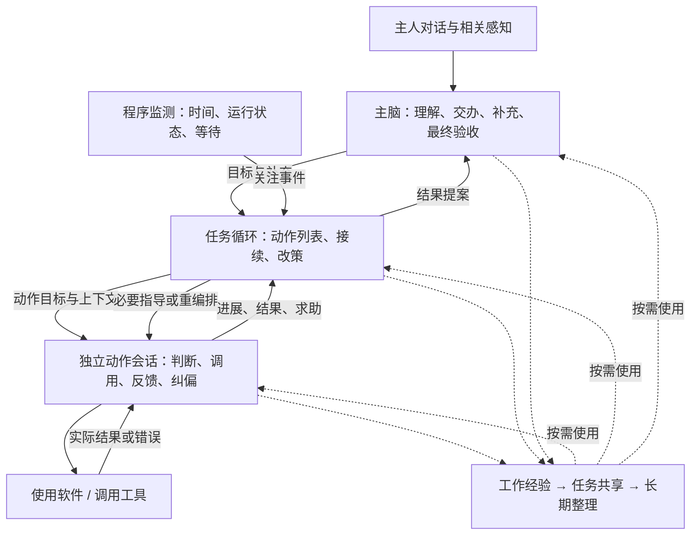

# 任务系统设计思路

日期：2026-11-13。状态：理想架构提案，供后续设计使用，**不表示当前程序已经实现**。本文按秘书、代办的实际定位设计，借鉴 Codex 的成熟执行机制；不以现有代码结构限定方案。当前产品要求和实现状态分别见[产品需求](product-requirements.md)和[架构设计](architecture.md)。

## 1. 产品定位与设计原则

Bunny 负责理解主人意图、调度协调、日常软件操作、检查验收和汇报。复杂的软件工程、专业研究和复杂产物制作主要委派 WorkBuddy。Bunny 自己运行的代码通常只是短小脚本或工具片段；“通常不超过约百行”是范围参考，不作为机械的代码行数限制。

业务相对简单，执行环境仍可能不稳定：界面变化、来信延迟、工具失败、操作结果不明、主人中途补充，都需要妥善处理。设计重点是可靠接续、灵活纠偏和及时学习，避免以复杂规划补偿薄弱的执行循环。

最高行动原则：第一目标是想办法完成任务。在影响可控的范围内积极行动、勇于尝试，根据反馈反思、补救和换路，接受小错误，持续收敛经验。按结果质量、耗时、无效尝试和主人介入次数评价能力。

架构坚持**统一、通用、收敛**：把必要保障放进共用运行机制，把方法与判断权交给 LLM，把软件技巧放进经验。先减少失联、重复和信息断裂，再考虑增加机制；能用同一条路径解决的，不另建调度器、恢复系统或审核层。

三层分开、复杂度不同：**主脑保持整体自我视角并最终验收；任务循环负责轻量编排、接续与防卡住；动作循环是独立、完整、连续的智能体执行核心。**

## 2. 从 Codex 借鉴的机制

Codex 的可借鉴价值是模型与工具的连续执行机制：维持工作上下文、取得真实反馈、处理失败、接受中途指导、保存并接续工作。Bunny 可以采用这些通用机制，同时按日常事务控制规划和调用成本。[Codex harness 的公开说明](https://developers.openai.com/blog/codex-as-a-platform)

| 借鉴点 | 适合 Bunny 的用法 |
| --- | --- |
| 连续的智能体会话 | 用于动作循环，工具结果回到原会话，模型接着行动 |
| 清楚的工具接口与真实反馈 | 调用成功、实际结果、错误、仍在运行或等待分别表达，便于自行调整 |
| 执行中可以追加指导 | 主人补充和任务指导进入正在工作的上下文，保留已有进展 |
| 工作状态可持久接续 | 记录目标、计划、动作状态、关键结果与工作认识，等待和中断后可继续 |
| 上下文按需加载与压缩 | 简单动作保持短上下文；需要时检索经验、展开资料、压缩旧过程 |
| 调度与模型判断分工 | 程序负责运行、资源、取消与事件；LLM 负责理解、计划、判断和换路 |

会话、事件、追加指导与中断的公开接口见[Codex App Server](https://learn.chatgpt.com/docs/app-server)；按需技能与连续上下文见[Skills、Shell 与 Compaction](https://developers.openai.com/blog/skills-shell-tips)。下文的三层职责、动作列表和监测节奏是针对 Bunny 提出的设计，不声称是 Codex 的内部实现或已验证的最优参数。

## 3. 三层职责与共用基础

| 层次 | 默认上下文与职责 | LLM 何时参与 |
| --- | --- | --- |
| 主脑循环 | 自我叙事、相关记忆经验、感知、对话与任务概要；理解主人、交办补充、全局判断、终审汇报 | 有对话、相关全局事件、任务求助或结果提交时 |
| 任务循环 | 当前交办、动作列表、动作结果、相关经验与最新补充；安排、接续、改策与汇总 | 首次需要规划、补充影响计划、动作异常或求助、需要重编排、准备结案时 |
| 动作循环 | 上层准备的动作说明、必要任务意图、当前观察、连续执行历史与所需经验；自主完成小目标 | 持续按真实反馈推进，等待期间休眠，唤醒后接续原会话 |

三层共享一个运行内核，复用模型调用、工具执行、上下文组装、事件、计时、持久化、资源协调和取消机制。各自拥有独立的调用状态和工作上下文，不重复维护几套互相竞争的任务事实。

同一任务的计划、结果和控制变更有序保存，再唤醒相应循环，防止补充被旧结果覆盖或后继动作拿到未保存的成果。运行内核不因一次保存、模型或工具故障把局部错误扩散成全局等待；恢复仍回到原任务。

默认按列表顺序推进动作，确有需要时才安排并行。等待和感知可以独立运行，实际桌面输入协调使用同一份资源；等待外部结果不长期占住桌面。

任务循环不是常驻的大型规划智能体，也不在每次动作操作后调用另一轮 LLM。动作循环保留完整的自主执行能力，不能退化成只按上层脚本逐条点击的执行器。三层可以使用同一模型，不要求三个模型常驻。

程序约束尽量收敛到真实访问范围、主人停止、明确预算、重大影响、实际资源容量和调用协议。固定方法顺序、逐操作核查、重复身份确认、固定反思次数、必填理由证明、每次改策都上报审批，不作为通用前提。资源限制主要约束实际占用的模型、输入和工具，避免等待中的目标因任意数量上限挤掉新工作。业务判断可被新反馈修订；程序拒绝也要给出可理解的具体原因，便于 Bunny 判断是否换用其它可行方法。

## 4. 实施计划：可以动态调整的轻量动作列表

### 4.1 任务和动作保留什么

任务保存：有效目标与完成期望、主人相关补充、实施计划、当前运行/等待情况、已取得的结果。计划保留简短修订记录，便于接续和反思。

实施计划默认按顺序列出少量有目标的动作，未来步骤可以暂写粗略意图，需要执行时再展开。不要求完整流程图、所有分支或未来界面的坐标。

| 动作信息 | 作用 |
| --- | --- |
| 稳定标识与小目标 | 区分动作，明确它要取得什么结果；一次点击通常属于 Operation |
| 启动安排 | 默认接上一步；需要时声明依赖、事件或时间条件 |
| 动作上下文 | 任务脑为此动作编写的说明，包括相关任务目标、输入、要求、已知结果和可回查资料 |
| 粗略预期耗时 | 供任务监测参考，可由 LLM 在执行中调整；缺失时先按通用监测默认值运行 |
| 状态与结果 | 表达待执行、运行、等待、已结束或已撤下，保留实际结果与尚未解决的问题 |

上下文和策略由 LLM 按需组织，不把此表扩张成每次必须填满的复杂表单。程序只需要能保存和调度动作的基本结构。

例如“联系某人了解项目情况并汇总”，可以先有两项动作：

1. 完成目标联络与交流。建立来信观察、主动询问、等待及回复保留在同一动作会话中，以维持对话连续性。
2. 整理实际取得的信息，准备任务结果。直接引用前一步结果，不重新询问已经得到的信息。

如果第一项动作已经能够完整整理结果，任务脑可以合并或撤下第二项。观察工具属于可调用的能力，不必把每一次采样或每一条回复都升级为独立动作。

### 4.2 新任务怎样开始、怎样接续

| 事件 | 任务循环的处理 |
| --- | --- |
| 收到新任务 | 保存交办，形成或采用已有实施计划，准备首个动作上下文并立即启动 |
| 上一动作完成 | 保存结果，将实际结果传给后继动作；已有安排清楚时直接接续，无需另做一轮批准 |
| 动作等待 | 保存等待条件、必要订阅或复看时间，释放暂不需要的模型和桌面资源 |
| 新信息或主人补充到达 | 有关动作接收增量；影响计划时由任务脑重新安排，保留原结果 |
| 动作出现局部错误 | 反馈给原动作循环自救；不因普通错误立即撤回整个任务 |
| 动作求助、未达成或监测发现疑似停滞 | 调度任务级反思，注入指导、调整动作、重试、换路或继续等待 |
| 计划已走完或没有动作可推进 | 任务脑判断补充动作、明确等待、提出失败挂起，或提交整体结果 |
| 主脑退回整改 | 原任务修订动作列表，补齐差项并重新提交，不另起一件重复任务 |

任务始终有后续归属：正在执行、明确等待、待处理事件或待裁决。程序发现任务尚未结束却没有任何接续安排时，唤醒任务脑。定时巡检只是这个事件驱动循环的一项能力。

已有下一动作可以由程序按计划启动，但它收到的实际结果仍由动作自己的 LLM 理解。若发现输入不足、上一步结果改变了前提或计划不再合适，就反馈任务脑调整，避免机械沿旧列表走到底。

后续反例也可以推翻早先动作的完成判断。任务脑可以回看、补救或重做有关部分，保留仍有用的成果和已发生效果，无需把整项任务清空重来。

## 5. 动作循环：完整、自主、有韧性的执行核心

### 5.1 默认执行方式

动作启动时建立自己的连续智能体会话，载入任务脑准备的说明和当前必要信息。循环为：

**理解当前目标和反馈 → 选择软件使用方法或工具 → 执行当前有价值的一步或一组操作 → 接收实际结果 → 继续、纠偏、等待或结束。**

工具结果直接接回当前会话。普通失败也是反馈，交给同一个动作继续处理。需要观察才截图，需要检索才加载经验；不强制每次操作前后检查，不把一组连贯键鼠操作拆成多轮无意义调度。

动作会话保存当前认识、已尝试的方法、关键结果、待解决的问题和本轮经验。内容较长时压缩旧过程，保留决策背景与结果引用；不能每一步重建一个失去此前认识的快照。重试通常沿原会话继续，确需重置时也携带简短工作摘要和已发生效果。

明确等待期间保留会话和唤醒条件，不持续请求模型。区域观察等工具可以继续采样，发现变化后投递事件；动作被唤醒时再结合当前目标理解变化并决定后续操作。

### 5.2 反思与换路怎样发生

出现不符预期的反馈时，先把实际结果接回原会话，保留部分成果，让动作自己判断当前差距。它可以质疑画面解释、工具回执含义、上下文、旧经验和上层拆解，不把第一次解释当作不可修改的事实。尚未想清根因时，也可以先做影响小、能取得反馈的尝试。

工作上下文简短保留当前困难、试过的路径及其结果、仍有用的成果和下一步打算，随正常推理更新。重新调用模型、清缓存、重启会话或改提示措辞，都不清掉这些经历。同一困难持续出现时，任务脑也能看到此前尝试，避免再次建议同一条失败路径。

可选择的突破方向包括：补充能区分不同解释的信息；小步尝试以检验原前提；纠正自己前面的错误；查找适用经验和已有工具；改变操作方法、输入或动作粒度；回退到合适位置重来；请求任务脑调整前置动作或改用其它软件，复杂部分交给 WorkBuddy。这些是选择空间，不是必须逐项走完的固定流程，也不扩大原交办允许的方法。

是否检查、检查什么、何时换路由 LLM 自主决定，反思、观察和行动可以在同轮组合。提示它让反思影响下一步实际行动，或形成有意义的等待；不要求先写完整论证才允许尝试。新信息排除了一个错误解释，也可能是进展；程序不以画面变化、调用次数或新措辞独自证明目标推进。

如果模型反复表达计划却没有操作、有效等待或明确交接，运行内核将这种情况反馈给原动作。普通局部自救不逐步上报；反复无进展、需要改动任务安排或动作主动求助时，由任务脑从更完整的本任务历史重新判断。任务脑也可以质疑早先计划，不能只给一句“继续重试”。

动作可自判完成、等待、当前无法完成或需要上层改变条件。局部未达成不等于任务失败；任务仍有可行路径时主动改策。确实没有值得继续的方向时，保留成果与困难，提交主脑裁决，避免把韧性变成无休止地尝试。

### 5.3 程序提供的运行保障

这些保障集中在共用运行内核，沿原调用处理，复用于所有动作，不按软件或错误另建控制流程或逐操作审查链：

| 保障 | 最小机制 |
| --- | --- |
| 反馈能回到执行者 | 调用与结果对应；工具返回实际结果、具体错误、部分成果或仍在运行的入口。普通失败进入原会话，不直接丢弃动作 |
| 故障不会无限占住执行 | 模型、工具和保存等待支持取消与有界超时；资源忙时让出执行，留出接续机会，不立即判业务失败 |
| 已有影响不会因换路丢失 | 保留尝试与效果，区分可以重试的未执行步骤和已经发生或结果不明的步骤；继续从剩余工作出发 |
| 指导和重启有明确归属 | 普通指导在适当边界进入原会话；重启先停止或隔离旧执行，迟到结果不覆盖新状态 |
| 关键认识能够接续 | 目标、最新补充、工作摘要、结果引用和等待位置随任务保存，压缩或恢复后仍可取用 |

参数或响应格式不合时，给原模型具体反馈，修正当前调用；不从不完整输出猜测操作，也不清空整个动作重新理解任务。

取消一次等待、模型请求或执行器，不应被解释成主人取消了整个业务目标。任务脑的规划或反思调用也使用同一套超时、恢复和监测能力；原动作无需指导仍能推进时可以继续，需要等待指导时释放资源，避免父子互等。

超时只结束本地等待，不推定外部操作未发生或已经停止。在途工作仍按原记录收尾，只约束与它冲突的执行，不因此冻结其它可推进的工作。明确预算耗尽限制资源消费，不自动证明业务目标已经失败。

### 5.4 等待与唤醒也要形成闭环

让出执行前，先记住所等条件、接续位置和有关观察/外部工作；事件恰好在切换期间到达，也要保留在任务待办中。收到事件后接续原动作，重复唤醒不重复执行已完成步骤；模型决定怎样合并来信和后续回应。

观察工具失效、订阅中断和外部工作异常应作为运行事件返回，不能静默伪装成“还没有变化”。程序可以恢复计时、观察连接和待办投递，方法不再可用时由动作或任务脑换路。纯等待不消耗持续推理，但必须仍有可工作的唤醒来源或下次复看安排。

程序恢复先还原任务、必要等待及主人暂停/停止状态，只接续原本允许继续的工作。重新观察当前状况，结合旧结果决定剩余工作，不盲目重放恢复前的键鼠、发送或命令。正常唤醒、异常恢复和主脑退回，都沿原任务的同一条接续路径处理。

## 6. 上下文：LLM 负责语义，程序保证交接不丢

任务脑应在启动动作时，依赖自身推理组织相关上下文，包含动作目标、相关任务目标、必要输入和限制。哪些信息重要、需要多少背景、怎样拆解意图，由 LLM 判断；不编写业务规则来替它判定上下文是否足够。

程序保留任务与动作的对应关系、实际交接内容、原交办和最新补充的回查入口，并确保已经选中的信息不会被静默丢弃。它可以检查基本数据结构和实际模型容量，不增加另一轮“语义完整性审核”，也不机械复制全部上层上下文。

动作发现信息不足、前后矛盾或拆解可能有误时，可以自行补充检索、读取父任务相关材料，或请求任务脑澄清和改策。上层的解释同样可修订，不能把错误的小目标永久固定下来。

每个循环默认使用专注的上下文，内部可按需调整检索问题、资料来源、筛选与详略、压缩方式和预算。任务与动作不默认载入完整自我叙事；需要人物关系、交流风格或其它相关内容时可以主动选择片段。共享精简的基本行动原则即可。

上下文组装服务两件事：当前有足够信息去行动，以及关键认识能在后续执行中延续。按需取回和来源回查减少重复装载；经选择的资料仍服从实际访问范围和模型容量，不因自主配置而自动扩权。

相关交办、经验或工具发生更新时，组装器在下一次合适的执行边界提供增量，让循环自行吸收；无关更新不机械取消正在工作的动作。运行提示只加载当前职责的精简原则和相关资料，不把整篇设计文档或全部失败历史塞进每轮请求。

## 7. 动作监测：1.5 倍预期与长动作分钟监测

### 7.1 默认关注节奏

设动作预期耗时为 E，默认监测点为启动后 1.5 × E。若这个监测点超过 60 秒，则另外增加每 60 秒一次的监测，持续到动作结束或转入明确等待。重合的监测点合并。

| 动作预期 | 默认关注点举例 |
| --- | --- |
| 20 秒 | 30 秒仍未结束时关注 |
| 3 分钟 | 60、120、180、240 秒，以及原定的 270 秒 |
| 10 分钟 | 每分钟关注，原定的 15 分钟点保留并与当分钟合并 |

这是一组可由 LLM 调整的默认值，不是超时即失败的硬规则。预期耗时在原规划中顺带估计，不单独调用模型；没有估计也不阻止动作开始，先采用分钟级通用监测，再按需要调整。

定时观察服务不按“订阅持续了多久”判为卡住。正常等待来信、等待定时点或外部事件时，任务保持等待状态；监测关注它的唤醒与执行是否正常。外部工作长时间未返回时，可以按预期安排复看，不要求持续占用模型或桌面。

### 7.2 监测怎样进入 LLM 判断

程序采集已有运行事实：当前动作、累计耗时、最近结果与进展、当前模型/工具是否在运行、等待状态、已有错误。监测本身不强制新增截图、操作软件或抢占桌面，也不直接裁定业务卡死。

到关注点时，任务循环取得一次分析机会：若已有计划判断或反思正在处理，就合并监测信息，不叠加平行的分析调用；近期已有适用判断和明确关注安排时可以复用。确需新的语义判断时唤醒任务脑；一次分钟监测不机械等于一轮独立 LLM 调用或一次动作中断。

复用判断只持续到已安排的下次关注点，重要变化可以提前唤醒；不能因为曾经判断“继续等待”就永久跳过后续分析。监测的唤醒不依赖正在被监测的模型或工具先返回；指导尚未落实或落实后仍无进展时，仍能再次进入原任务的改策过程。

任务级反思按需读取当前目标、计划、动作工作摘要、最近实际结果和尝试，不能只凭计时数字分析。动作在正常执行中维护这些信息，不为每个监测点另开一轮模型生成摘要。

明确错误、动作主动求助、重复无效尝试、等待条件失效等可以提前触发分析，无需等到 1.5 倍。持续有价值进展的动作也可以继续，时间只是判断材料。

### 7.3 判断和处理权交给 LLM

任务脑结合上下文决定：继续、不干预、注入指导、建议动作换角度观察、调整预期、改变实施计划、重启动作，或结束当前动作并处理结果。需要时把问题交回动作，让它在原会话中自行反思和换路。

不要求固定次数的核查，不把“必须给出某种理由/证明字段”作为调整预期或继续执行的准入条件。提示词鼓励具体、负责、注意时间，但不靠固定理由表或业务检查器代替判断。

累计耗时、已有结果和尝试保留，供下一次判断使用；修改预期或重启不抹去这些事实。程序保证监测与反思请求不丢失、不并发重复，是否值得继续及怎样继续由 LLM 掌握。

## 8. 软件使用、工具与经验的关系

### 8.1 两类能力的产品概念

| 类别 | 定义与例子 | 经验怎样支持 |
| --- | --- | --- |
| 软件使用 | 操作外部软件；WorkBuddy、微信、浏览器、Finder、终端都属于软件 | 软件的用法、场景、有效方法和注意事项进入相关经验 |
| 工具 | 可直接调用的执行能力或资源；包括 Bunny 自带工具、自创脚本和代码片段 | 经验可以引用工具，说明何时使用、怎样调用、适用条件和实际效果 |

截屏、持续区域画面监测与变化对比、BOPER 键鼠操作都是自带工具。动作可以调用这些工具去使用软件；例如先观察软件画面，再用 BOPER 操作。自创脚本可以成为某种软件方法的辅助工具，也可以完成独立的小计算或文件处理。

在运行接口中，这些可调用能力可以采用统一的工具调用协议；这不改变“软件是被使用的外部环境，工具是可调用的执行资源”的产品分类。给模型展示精简的软件与经验入口、相关工具目录，详情按需展开。

### 8.2 WorkBuddy 委派与自创工具

使用 WorkBuddy 执行复杂工作是一种软件使用动作。Bunny 保留原目标、工作关联和交付要求，等待外部进展、补充指示、接收成果；复杂专业实现由 WorkBuddy 完成，Bunny 承担协调与最终结果责任。

Bunny 自创工具优先解决小范围、结果容易理解的问题，先在当前任务中试用。有复用价值再纳入可发现的工具资源，记录简短用途、调用方式和依赖；同类能力优先复用或合并已有工具，避免每次任务都生成一套新脚本。

自带工具和自创工具共用一个目录和执行入口：用简短说明让模型知道用途，需要时取得调用参数、返回说明、实际资源和版本，通过原工具执行机制运行并接收结果。临时工具可在当前任务登记、立即试用；持久保存后，后续动作也能发现并直接调用，不能只留下一个无人能执行的脚本路径。新增工具无需为任务系统增加专用分支或再建控制通道。

工具依赖缺失、运行失败或环境变化时，具体情况回到动作循环，由它选择修复、调整调用、换已有工具或软件方法。相关经验标明本次不适用的条件；程序不会因为存有工具名称就宣称它可用，也不因一次局部失败永久禁用整个能力。

软件的具体操作方法保存在经验中，通用框架负责观察、执行、事件、恢复等能力。不能把某软件的界面技巧硬编码为所有软件的执行规则。

## 9. 经验与工具：即时生效，持续整理和收敛

### 9.1 三个作用范围

| 范围 | 何时生效 | 怎样收敛 |
| --- | --- | --- |
| 动作工作经验 | 有价值反馈出现后立即影响本动作后续执行 | 在连续会话中修订当前认识，保留关键结果，压缩重复过程 |
| 任务共享经验 | 与后续或其它动作有关时立即传递 | 任务脑更新相关动作说明；在运行的动作于适当边界吸收变化 |
| 长期经验与工具 | 值得复用时增量保存，动作结束和任务结案时整理 | 与已有经验比较、合并同类、保留适用条件和反例、更新工具引用 |

即时使用无须等待长期经验审核。局部发现可以先作为工作假设去尝试；有用的经验也不必等整个任务结束才保存。动作和任务结束时，只整理新的、修订的或值得复用的内容，无新发现就不增加学习调用。

经验提炼尽量合在原有执行、反思或收尾推理中，保留简短结论和实际结果引用。程序负责保存、更新和投递相关变化，不要求每次工具调用再跟一轮学习模型。完整原始材料可回查，进入后续上下文的是精简、可修订的工作认识。

### 9.2 从保存到后续使用的闭环

**发现 → 本轮采用或试用 → 保存/修订 → 后续召回 → 再次使用与反馈 → 合并更新。**这条闭环连接经验的积累与使用；保存成功不能代替实际复用，也不要求每个发现都先试用才允许保存。

当前任务得到有用发现时，立即更新工作上下文；相关动作在后续接续时收到增量，不必等待后台整理完成。下一动作或新任务启动时，上下文组装器按目标、软件和当前情景选择相关经验及其工具入口；遇到卡点时，再按实际错误、失败方法或缺失能力重新检索。选择资料的语义仍由 LLM 掌握。

检索结果带可展开的来源与可调用工具引用。找不到时，模型可以换问题、回看已有经验或查询软件/工具目录，不能仅凭一次空搜索就认定没有能力。工具本身通过统一目录登记，经验提供使用方法，两者分别可以发现、相互引用。

经验被加载、方法被采用和取得结果分别看待：仅出现在上下文里，不足以说明该经验导致了成功。真实工具调用及结果由运行内核关联，LLM 结合实际采用的方法判断效果。新的成功、失败和反例回到原经验条目，修订方法或适用范围，而不是不断追加相互矛盾的新规则。

### 9.3 怎样避免污染和泛滥

一条经验尽量表达清楚“什么条件下，采用什么方法，实际遇到了什么结果”；推测的原因和实际观察分开。单次发现可以保存，但不自动变成全局定律。反例出现时修订或缩小适用范围，不把旧经验当成不可改变的前提。

同一发现经动作、任务、主脑多次转述，只保留同一来源的关联，不重复积累为多份支持。临时现场状态留在工作上下文，软件技巧进入软件经验，通用执行方法进入通用经验；代码缺陷仍由通用机制修复。

持续整理沿统一记忆机制进行：增量吸收、去重合并、处理矛盾、归档过时内容、合并功能重复的工具，形成简短可检索的有效版本。上下文默认取当前适用的少量经验，历史和完整工具资源按需回查。后台整理不阻塞正在进行的动作，也不为每条经验串联多层审批。

工具整理保留正在使用的版本及结果关联，不在后台覆盖运行中的脚本；相关动作在合适边界决定是否采用更新。

### 9.4 试错的累计影响

LLM 在原思考中关注累计尝试、已产生的影响和剩余补救空间；程序保留这些事实，不强制每次操作额外审查。小失误可以接受，但反复试错导致的重复发送、覆盖、资源消耗等，也应影响下一次选择。

普通低影响工作中，即使前提不确定或旧结果尚不明确，只要可能重复的后果可接受，仍可以小步尝试、改变方法继续。真实的主人停止、权限撤销和重大破坏性影响保留必要边界；不能通过抹去旧效果或假称没有发生来恢复尝试机会。

## 10. 主脑最终验收与任务闭环

动作判断自己的小目标，任务脑判断整体目标是否具备提交条件；两者都不直接取代主脑的最终验收。计划完成后若仍有缺项，任务脑可以先补充动作；准备结案时提交整体结果与必要依据。

主脑使用自我叙事、有效主人交办、实际结果和相关全局信息进行判断：接受成功、确认合理失败或挂起，或者附意见退回原任务整改。这样既保留 Bunny 整体层面的参与，也不让主脑介入正常的每次操作。

退回后由任务脑修订计划，动作继续自主解决，再次提交。主脑的视角更广仍可能误判；意见与交办或实际结果冲突时，任务脑可以带材料澄清。最终结论经同一任务状态落实，不同时保留两套矛盾的执行命令。

终审围绕主人真正关心的结果，不临时增加无关要求。必要的结果判断与给主人汇报可以结合在同一次主脑推理中。交付是否属于目标按交办决定；整改保留已发生的交付，只补差项。结果和有价值的经历回到整体记忆。

主脑暂时不可用时，保存待审结果和下次唤醒安排，不重做已经完成的动作、不冒充验收成功。恢复后接着处理同一任务结果。

## 11. 设计优先级与评价

优先做强独立动作会话的连续反馈、容错、反思换路与上下文接续；任务层采用少量动作列表，保证新任务开始、动作接续和异常改策；主脑负责整体交办、补充及终审。执行、恢复与等待共用运行路径，经验和工具共用记忆、目录与召回入口。

用少量可区分机制优劣的场景评估，不以“多跑了几轮”证明韧性：

| 场景 | 应观察到的能力 |
| --- | --- |
| 原前提判断有误、同一路径连续无效 | 动作能小步探索、修订解释并改变实际方法，任务脑不再反复建议旧路径 |
| 工具中途失败、已有部分成果 | 保留成果，从剩余工作继续，必要时修复前序错误 |
| 等待切换时事件到达、观察工具中断 | 事件不丢失，能够唤醒或修复等待，不把观察失效当成没有消息 |
| 主人补充、执行取消或程序中断 | 新要求生效，旧结果不覆盖新工作，恢复不盲目重放既有影响 |
| 同任务后续动作及新任务遇到类似问题 | 能召回刚获得的经验，找到并实际调用相应工具，结果继续修订经验 |
| 经验过期、工具条件改变、主脑退回 | 能修订旧认识或工具用法，自主补齐差项，无需主人逐步指挥 |

同时保留简单任务基线，比较结果质量、耗时、无效模型往返、重复错误、经验与工具实际复用、主人介入次数。新增保障应减少卡点和重复劳动，不能让普通顺利执行普遍变得更慢、更繁琐。
