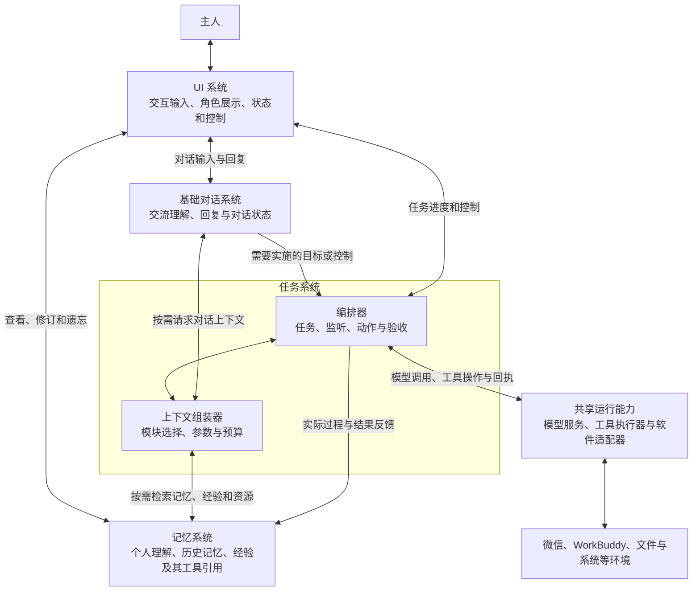

# WorkBunny 整体架构设计

日期：2026-11-03。本文以当前工作区 0.24.6 源码为现状基线，定义整个项目的目标结构和演进方向；**目标结构不代表已经实现**。产品目标是积极、主动、自主、自我进化，详见[产品目标与智能体设计原则](产品目标与智能体设计原则.md)。任务系统的迁移、回退和逐项验收细节沿用[统一任务编排重构计划](2026-11-03-统一任务编排重构计划.md)。

## 1. 总体结构

WorkBunny 的三大产品系统是**UI 系统、记忆系统、任务系统**。此外，**基础对话系统**是交互域内职责独立的能力：它负责与主人沟通，既不等同于 UI 渲染，也不把普通对话当成长时任务。Electron、原生桥、模型服务、加密存储和系统权限是共同运行基础；这些划分是逻辑职责，不要求对应独立进程。

- **UI 系统**负责交互输入、角色形象与动作、文字/语音输出、任务状态与控制，以及记忆管理界面。
- **基础对话系统**负责理解主人的话、结合上下文交流并生成回复；对话中形成需要实施或验收的目标时，保留主人原意与来源交给任务系统。讨论、询问和假设本身不自动变成任务。
- **记忆系统**负责 Bunny 自我内容的更新和管理，包括个人理解、历史记忆和主要服务任务执行的经验；工具是经验可引用、共享的资源。软件技能可视为按软件、用途等分类或标签组织的一组经验。记忆通过 Doze、Dream、Deepdream 等机制整理、提炼和更新，是自我进化的核心基础。
- **任务系统**负责基础对话触发的目标及其他已授权任务的实施和验收。核心是**编排器**与**上下文组装器**：前者组织行动并应对异常，后者紧密连接记忆系统，灵活选择当前所需经验、引用资源和其他上下文。
- **工具的职责边界**：工具的描述、能力、历史效果和版本由记忆系统作为资源信息管理，经验可引用它们；实际程序和适配器提供可调用能力。任务系统结合目标选择并调用工具，跟踪执行、授权和回执。资源可以先于经验登记，工具知识不是授权，记住一个工具也不等于已经执行它。

三大系统和基础对话能力可通过现有主进程协作，不必新建平行数据库。基础对话可以直接请求上下文组装能力，不必启动任务编排或占用长期任务名额；任务编排器不可用时，应尽可能保留基础对话和记忆管理。资料的用户查看、修订与遗忘可经应用服务直接访问记忆系统，不必经过任务队列。

## 2. 当前代码与目标差距

| 系统 | 现有主要实现 | 已有基础及需收敛之处 |
| --- | --- | --- |
| UI | [`src/renderer`](../src/renderer)、[`preload.js`](../src/preload.js)、[`index.js`](../src/main/index.js)、[`embodiment.js`](../src/main/embodiment.js) | 已有桌面角色、动作、对话、语音、任务卡片、设置和记忆面板。窗口与服务通过 IPC 交互，部分交互和状态拼装集中在主进程；应保证显示的是任务与记忆的真实状态。 |
| 基础对话 | [`index.js`](../src/main/index.js)、[`reply-request.js`](../src/main/reply-request.js)、[`dialogue-cognition.js`](../src/main/dialogue-cognition.js)、[`secretary.js`](../src/main/secretary.js) | 已有主人对话、回复协议、认知上下文与任务分流，但相关逻辑仍分散在主进程和多个服务；尚未形成本文描述的独立职责边界。 |
| 记忆 | [`memory-service.js`](../src/main/memory-service.js)、[`memory-maintenance.js`](../src/main/memory-maintenance.js)、[`cognition-repository.js`](../src/main/cognition-repository.js)、[`experience-memory.js`](../src/main/experience-memory.js)、[`agent-learning.js`](../src/main/agent-learning.js) | 已有加密资料库、对话与事实、来源/场景、压缩提炼、自我理解、任务经验和部分技能经验验证；工具知识及经验检索仍分散，完整的跨任务学习与复用尚待完善。 |
| 任务 | [`agent-runtime.js`](../src/main/agent-runtime.js)、[`agent-service.js`](../src/main/agent-service.js)、[`agent-interpreter.js`](../src/main/agent-interpreter.js)、[`adaptive-task.js`](../src/main/adaptive-task.js) | 已有统一任务入口、持久队列、工具调用、状态与恢复；同一任务仍以单个主 `step` 为主，会话有专用观察路径。通用业务动作生命周期和统一上下文组装器尚未实现。 |
| 自主生活与监督 | [`companion-autonomy.js`](../src/main/companion-autonomy.js)、[`secretary.js`](../src/main/secretary.js)、[`task-supervision.js`](../src/main/task-supervision.js)、`memory-maintenance.js` | 已有授权内的自主活动、工作委派、状态监督和后台整理，但它们目前仍有独立的触发与协作逻辑。演进时统一状态、上下文和资源协调，保留既有授权、记录与用户体验。 |
| 支撑能力 | [`llm.js`](../src/main/llm.js)、[`workbuddy.js`](../src/main/workbuddy.js)、[`desktop-service.js`](../src/main/desktop-service.js)、[`desktop.swift`](../native/desktop.swift)、[`vault-db.js`](../src/main/vault-db.js) | 已有多模型接入、桌面视觉/键鼠、加密存储及系统桥。共享资源仲裁和错误分类仍需在任务层统一，而不复制底层实现。 |

当前前台对话在 [`index.js`](../src/main/index.js) 聚合角色、记忆、工作状态和历史；[`conversation-brain.js`](../src/main/conversation-brain.js)、`adaptive-task.js`、`agent-interpreter.js` 和 `desktop-service.js` 又分别构造自己的模型输入。已有 [`context-budget.js`](../src/main/context-budget.js) 做请求预算和裁剪，但它不是覆盖各业务场景的统一上下文组装器。

[`agent-tools.js`](../src/main/agent-tools.js) 当前还将 `skill.tools` 清单作为调用硬门槛；[`software-skill-package.js`](../src/main/software-skill-package.js) 加载有清单与校验的内置软件经验。目标是将技能的参考方法、工具的技术契约和主人的真实授权分清：允许 Bunny 在已授权范围内选择合适的通用能力，不靠技能配方穷举所有步骤。现有清单在迁移完成前仍然生效。

当前代码中的 `SkillRegistry` 还承载带 `run` 的可执行任务适配和能力声明，软件包则将 Markdown 资源拼接为指引；这与目标中的“按标签检索经验”不是同一实现。迁移时先保留这些运行接口及旧任务兼容，再逐步把可参考知识接入记忆检索，不能直接删除现有技能执行器。

## 3. UI 与基础对话：自然交互、沟通和任务衔接

UI 负责文本和语音输入、角色呈现与动作、语音输出、任务状态与控制、记忆和设置管理。基础对话系统负责与主人交流、理解上下文、保持对话连续性，并在形成任务目标时将其交办给编排器。角色是有连续人格与经历的伙伴；UI 不自行创造任务完成结论，也不把模型计划显示为已执行结果。

- 交互入口保留原始交办、来源和必要上下文，并将控制意图交给任务系统；普通聊天、任务面板和已授权的主人渠道采用一致的任务身份和控制语义。
- 状态条和详情展示任务、当前动作、最后有效观察、等待原因、真实结果及可用控制；同一个委派不显示为多个重复业务任务。动作完成、任务完成、结果交付和待核对各自有事实依据。
- 用户可以查看、修订、删除记忆和经验，管理角色、自我理解与授权；停止任务即停止其子动作，已发生或不确定的外部效果仍需核对。
- 界面只持有所需状态投影。模型、工具和资料的实际调用及授权检查在主进程服务层完成；当前通过 `preload.js` 的受限 IPC 连接，不能把渲染层当作权限来源。
- 角色形象、动作、说话状态和最近交互作为动态身体状态提供给上下文组装器；长期自我理解与人格锁由记忆系统管理，不因切换界面或模型而各自形成一套人格。

基础对话持有短暂的对话轮次与生成/呈现状态，读取记忆和必要任务进展来回答主人；对话记录和反馈由记忆系统管理。它可以调用上下文组装器的轻量接口，并在确实需要执行目标时提交给任务编排器。普通聊天不进入业务任务队列；同一交办原文及来源在交接时应保持一致，不重复产生任务。

当前输入/输出能力包括 [`asr.js`](../src/main/asr.js)、[`tts.js`](../src/main/tts.js)、角色/动作目录和渲染器；它们服务于交互，并不改变记忆和任务的责任边界。

## 4. 记忆系统：长期理解、经验、技能与工具

### 4.1 保存什么

| 类别 | 内容和用途 | 当前对应 |
| --- | --- | --- |
| 历史记忆与经历 | 对话原文、时间、说话者、事件和 Summary；为回答与回溯提供依据 | `memory-service.js`、`message-blocks.js`、`context-compression.js` |
| 个人理解、关系与成长 | 对主人和相关人物的理解、偏好、已确认事实、待确认线索、关系、兴趣及目标 | `memory-knowledge.js`、`user-facts.js`、`companion-growth.js`、`companion-affect.js` |
| Bunny 的自我理解 | 身份、行为、人格认识及主人锁定的内容 | `cognition-repository.js`，并保留修订和锁定语义 |
| 任务经验与软件技能 | 任务目标、可复用做法、真实结果和失败/恢复证据；软件技能是按软件及用途等组织的经验视图 | `experience-memory.js`、`agent-learning.js`、`interaction-strategy.js`；内置软件知识位于 `src/software-skills/` |
| 工具资源 | 可被经验引用和共享的工具说明、能力、版本、使用效果及程序引用 | `software-skill-package.js`、`agent-skills.js`、`agent-tools.js` 以及 `experience-memory.js` 中相关目录和定义 |

目标是统一这些知识的**查询与引用方式**，不是把所有内容压成一段提示词或迁移进同一张新表。内置程序、随包技能文件和已授权文件仍可在合适位置保存；记忆保存可追溯的描述、来源、状态与必要引用。已存工具必须检查当前版本、可用性和任务授权，才能被任务系统调用。

### 软件技能：面向软件和用途的经验视图

经验是记忆的一种，工具是经验可引用的资源。软件技能可以用经验分类或标签表达：例如按微信、消息回复、语音识别筛选出的相关经验；它是随条件查询得到的视图，不必另建一套知识或调度系统。一条经验可以不引用专用工具，也可以引用多个工具；同一工具可以被多条经验共享。工具能先独立登记和发现，不为使用它虚构经验。

执行时，组装器按目标、软件、当前阶段和环境选择相关经验，把概要或必要的完整内容连同适用条件、可信状态及工具引用提供给模型。Bunny 结合现场自主选择、组合、实验、核验并更新方法；经验不是必须按顺序执行的固定配方。没有命中某个标签或既有技能时，仍可检索相邻经验、发现已授权工具并自主探索。

经验与工具可以随产品内置、由主人或外部资料提供，也可以由 Bunny 在实践中发现、创造和改进。不同来源都应标明适用条件、实际验证情况和版本；经验是可修正的参考，旧工具失效时应主动分析、调整或寻找替代方案。

工具的自我进化由任务系统与记忆系统协作完成：

1. 执行任务时先检索适用工具和经验；现有工具不够用时，Bunny 可在已有任务、文件和系统授权范围内组合现有能力，或创建、修改适合当前目标的脚本/工具。
2. 明确新工具的用途、输入输出、适用范围、依赖和可能影响；按实际影响选择必要的检查或可恢复的小规模试用。已有授权内的可恢复尝试无需逐步再问主人，也不必等待多次历史成功才能首次使用。
3. 根据真实运行结果和核验证据修正工具；把有效方法、来源、适用条件、版本与结果写入记忆，供后续任务检索。模型设想、测试结果与真实任务效果分别记录，不把推测冒充已验证能力。
4. 工具更新时保留可回退版本；正在使用的动作保持可追溯的版本和回执，在合适检查点采用新版本。旧工具、依赖或来源失效时重新核对、修复或切换方法，不让过期经验阻断任务。

可执行工具的文件可以保存在已授权的任务或用户数据位置，记忆系统管理其描述、来源和版本；任务系统负责实际调用、结果核验与反馈。工具按实际效果和已有权限适配运行，不因“技能里原先没有”就拒绝；产品正式程序及工具契约的变化仍需通过相应验证和安全升级。当前经验记录、技能包和工具执行器还没有完整打通这套自主创建与演进流程，不能视作现有功能已经具备。

### 4.2 记忆如何产生和演进

1. **即时记录**：对话、主人反馈、任务观察、动作过程及真实回执按范围记录；实时执行状态由任务系统负责，记忆系统提供持久化和检索基础。
2. **提炼和整理**：通过 Doze、Dream、Deepdream 等机制形成不同层次的记忆；结合任务成败归纳可迁移经验，保留来源和原始证据。
3. **候选与验证**：主人传授、模型推测、一次实测和多场景证据分别标识。候选方法可在授权内的适当场景尝试，不必等历史成功才开始；未经实际核验不能标成已验证。
4. **复用与修正**：按任务、对象、环境和作用域检索相关知识，提供给上下文组装器作为参考；实际无效时修正、降级或回退。有效经验可跨相似任务复用，不自动覆盖主人明确指令。
5. **长期进化**：从反复失败、恢复和新需求中提出方法、参数或工具改进，按影响选择隔离验证和实际效果检查；逐步积累能力，不能把未经验证的程序替换为正式运行契约。

| 核心机制 | 主要作用 | 输出如何使用 |
| --- | --- | --- |
| **Doze** | 对已发生的对话形成有来源的 Summary，压缩历史上下文。 | 让较长历史更易被对话和任务按需使用；原始对话仍可按已有权限回查。 |
| **Dream** | 从对话及任务经历中提炼事实、关系、自我认识或经验，并识别经验引用的工具资源。 | 形成带证据和可信状态的记忆或候选，供后续理解、行动与进一步核验。 |
| **Deepdream** | 整理已有记忆和经验之间的关系、重复、冲突、时效，以及工具引用和版本。 | 改善检索和长期理解；有冲突或不确定时保留依据，不把推测写成确定事实。 |

这三者是记忆系统的核心整理机制，不要求所有学习都发生在后台整理时：任务进行中也可以形成临时经验、在后续执行中验证，再写回长期记忆。当前 Dream 主要处理对话消息，Deepdream 主要整理普通记忆；面向任务经验和工具引用的类型化处理仍需实现。复用同一整理调度器的具体设计见[经验与工具的记忆演进设计](经验与工具的记忆演进设计.md)。

记忆的价值既是连续的陪伴和理解，也是让 Bunny 以后更擅长完成任务。经验属于记忆，技能是经验视图，工具是经验可引用的资源；实时调度、动作是否已执行以及授权是否有效仍以任务运行时和宿主校验为准。

### 4.3 来源、隐私和删除

沿用现有加密 Vault、来源引用、场景/可见范围、版本、用户锁定和删除机制；工作、生活、私聊的派生记录不能因换标签降低来源限制。检索结果应包含适用范围、可信状态与来源，删除或修订来源后使相关派生知识、任务上下文及缓存失效；历史外部动作不因删除记录而被假定撤销。缓存、指标和诊断默认不复制长期保存的消息正文或截图。

当前加密和来源机制见 [`memory-scope.js`](../src/main/memory-scope.js)、[`memory-evidence.js`](../src/main/memory-evidence.js)、[`vault-crypto.js`](../src/main/vault-crypto.js)。现有 `agent-journal` 把任务记录存进同一加密资料库：**物理存储可共享，任务状态的业务所有权属于任务系统**，避免记忆整理覆盖运行中的事件和回执。

## 5. 任务系统：统一编排行动与上下文

### 5.1 内部组成

| 核心模块 | 责任 |
| --- | --- |
| 任务入口与理解 | 接收主人请求、明确目标/对象/授权和完成条件；需要时用模型理解上下文，简单确定的控制命令可由程序直接处理。 |
| **编排器** | 管理任务接纳、身份、状态、期限、监听、条件循环、动作依赖、并发、停止和恢复；向 UI 发布真实状态。 |
| **上下文组装器** | 按当前任务及阶段，从任务状态、记忆、事件、工具、环境和角色状态中选择必要信息，生成有预算、可追溯的模型输入。详见 5.2。 |
| 模型调度与结果解析 | 依据需要选择可用模型/视觉能力，管理异步结果、超时与结构校验；模型输出是决策建议，由运行时结合当前状态执行。 |
| 动作与工具执行 | 一个业务动作可组合多次模型判断和程序调用，有自己的实例、检查点、验证和恢复；实际工具由注册契约及相应适配器执行。 |
| 观察、核验与交付 | 定时或事件驱动检查屏幕、文件、接口或数据；验证实际效果并按指定渠道交付，保留未知状态和证据。 |
| 自我修复与学习反馈 | 可恢复异常先分析并换方法，保存必要过程和真实结果，向记忆系统提交可复用经验；不让错误修复覆盖原任务目标或已发生的效果。 |

监听可以是“定时器 + 一次检查 + 条件判定”；在适合时也可接收事件。窗口区域偏移或识别异常时重新定位。检查未发现变化只影响本次采样，不取消由先前变化触发的动作或等待中的模型决策。

目标是业务动作独立异步、父任务可停止子动作；有依赖的步骤顺序执行，无冲突的动作与观察可并行。默认不因其他联系人或其他任务的新事件中断当前动作；仅在事先声明的同任务、同目标规则成立时替换旧动作。GUI 键鼠短时串行；等待模型、计时或外部工作期间不占用键鼠租约。当前 `ActionLifecycle` 主要管理单次工具调用，以上完整业务动作机制属于待实现目标。

### 编排器：有韧性的自主行动

编排器的职责是让 Bunny 朝任务目标持续推进，为自主思考、尝试、核验和学习提供运行保障；不能把每种软件的具体步骤固化成唯一流程。每项任务保留目标、授权、事件、动作、阶段和证据，模型或程序可以根据实际反馈选择已授权的工具、重新定位或调整步骤，软件技能与历史经验只提供参考。

异常发生时，编排器应依据**实际阶段和证据**选择处理：

- **尚未执行或确定可恢复**：保留触发事件，重新观察、修复上下文或更换方法后继续；普通的布局变化、临时故障、一次检查无变化不应使任务终止。
- **等待外部条件或服务**：保留动作并按可观察的条件唤醒；在等待期间处理其他不冲突工作，恢复后从原任务继续。超时或预算用于触发分析、调整和退避，不直接等同于放弃目标。
- **效果不明**：主动寻找画面、文件、接口状态或回执核对；确认未执行才重试，确认已执行则继续后续步骤，仍无法判断时保留待处理，避免重复外发。
- **需要主人参与或任务无法达成**：在自行分析、探索和核验后，确实缺少主人才能提供的决定、信息或授权，或者现有条件下无法达到目标时，说明具体原因和已有进展，再暂停或报告。主人主动暂停、停止或撤销授权始终生效。

编排器要同时支持灵活探索与稳定运行：失败反馈可以触发新的思考或备选工具，明确有效的动作不因无关事件被取消；任务取消传播给子动作，已发出的副作用继续核对。按任务协调状态写入和资源访问，避免观察器、模型结果及执行器相互覆盖；所有重规划应保留原目标、待处理事件与已确认结果。

### 5.2 上下文组装器：一个统一入口，多种按需配方

上下文组装器是任务系统的核心能力，也是任务系统与记忆系统紧密连接的地方。大量有价值的材料来自个人理解、任务经验及其引用的工具资源；组装器根据当前任务、阶段和环境决定是否检索以及取多少，不把整个记忆库和任务历史塞进模型。基础对话、任务理解、会话回复、视觉操作、异常诊断与记忆整理可使用各自的组合方式，但复用同一组来源、范围、预算和校验规则。

**输入契约**至少包括：请求目的和阶段、会话/任务/动作与触发事件、主人目标及对象、当前场景和授权版本、所需模型能力、时效/预算、取消信号。**输出契约**至少包括：已整理的模型消息、允许使用的工具目录、来源与证据引用、预算/裁剪情况及有效版本；实际调用前仍由宿主核验当前授权与参数，不能把模型看到的目录当成执行凭据。具体字段在实施中按现有接口渐进确定，不预设新协议版本。

材料按需选择：

1. **不可丢失的当前事实**：主人原始目标与明确要求、当前对象、触发事件及必要原文、任务阶段与授权范围、与当前动作相关的已确认回执或可追溯引用、操作所需证据和输出契约。
2. **相关记忆**：角色自我理解、近期对话、相关事实、目标进展、适用经验及其工具资源引用；按场景、对象、来源、时间和可信状态筛选，区分主人指令与外部数据。
3. **运行环境**：必要的当前画面/文件/接口结果、可用工具及其参数和副作用、近期失败与已尝试方法；只附当前决策需要的部分。
4. **模型预算与动态修复**：参考模型输入、输出和图像容量；优先收缩可选历史、摘要或分段处理，不静默删除原目标、新消息、授权和已确认结果。格式或上下文错误可调整当前请求并重试，保留原始记录。

#### 内容模块和参数按情况调整

上下文由可组合的内容模块提供，模块是数据与能力的组织方式，不要求引入新的脚本语言或固定模板。基础模块可覆盖当前对话/任务、Bunny 自我理解与个人理解、历史记忆及 Summary、相关经验与引用资源、可用工具、环境观察、过程与回执、输出要求；不同阶段可只选择其中必要部分，并允许以后增加模块。

每次组装可结合目标和反馈调整参数，例如：历史轮次、时间范围、检索主题与数量、相关性和可信状态、经验适用条件、工具的应用/能力范围、是否包含画面及其区域、摘要粒度、各模块预算和输出额度。初始选择可以采用轻量的程序策略；遇到信息不足、模型报错或任务探索需要时，Bunny 可主动补充检索、调整参数、重组上下文或选择已配置且适合的能力，不必每一轮为选模块额外调用一次模型。

例如普通聊天侧重最近对话和相关个人理解；软件操作侧重目标、当前画面、适用经验和可用工具；异常修复侧重出错阶段、已尝试方法和真实效果。三者共享组装接口，所取内容和参数随实际情况变化。记忆检索得到的是有来源的参考，主人授权和工具实际可用性仍在执行时独立核验。

#### 按需提供软件经验

1. **检索**：结合目标、软件、操作用途、当前阶段、环境和遇到的问题，使用分类/标签及相关性检索适用经验；先按场景与来源权限过滤，再参考适用环境、证据、时效、主人纠正和最近失败排序。标签是检索线索，不是强制执行规则；缺失标签或首次遇到的软件也应尝试相邻经验与通用能力。
2. **选择内容**：简单场景优先提供短概要及必要的适用条件、可信状态和工具引用；操作细节、异常恢复、冲突或模型主动请求时按需加载完整经验及证据。预算紧张时可减少条目或分段提供，但不能删掉影响选择的限制，把候选说成已验证，或丢掉不同条件下的有效替代方案。
3. **使用与更新**：模型根据当前观察决定是否参考经验，并可请求更多细节；当阶段、环境或问题发生变化时重新检索，避免一直携带无关内容。引用工具与可用工具目录分别核对，由宿主在实际调用时检查版本、能力和授权；工具也可以独立发现。

例如处理微信语音消息时，可选择带“微信、语音、识别”标签的经验概要，遇到转文字操作或等待识别异常时再取得相应细节；看到新消息后仍由任务依据当前真实画面继续行动。知识提供不得变成额外的等待关卡，检索未命中或后台整理未完成时仍使用已有上下文和可用工具推进。

组装器应记录所选模块、参数、来源引用、裁剪原因和耗时，便于发现信息不足、冗余或延迟；不在普通日志保存私密正文和截图。为提高效率，可按权限和版本复用稳定片段，并只更新变化部分；不得因减少请求而漏掉当前目标、新事件或必要回执。

上下文可复用稳定片段，但缓存必须随场景、来源删除/修订、授权、目标、联系人、事件、技能版本及环境证据变化而失效。**状态写入版本**只用于并发控制，不能因为另一对象的事件或一次普通采样就让当前动作的模型结果过期。模型返回后按对应目标、授权、事件和必要的最新环境核查；真正前提改变时重定位或重规划，画面静止和无关像素变化不应直接丢弃原动作。

现有 `memory.context()`、`context-budget.js`、前台对话、会话回复、视觉规划及异常修复中有可复用能力。实施时先抽取公共契约和适配器，逐入口迁移；不强迫所有模型调用使用相同提示词、同一种回复协议或同一模型。

### 5.3 目标、事实与副作用

任务系统按“观察 → 思考 → 行动 → 核验 → 调整”推进，必要时请求模型换方法或使用其他已授权工具；技能经验只是参考。定时、模型或重试预算到达时分析是否有进展，避免无效空转；不能仅因内部次数、缺少现成步骤或一次画面没变化而放弃。

记录应区分准备、聚焦、输入是否发令、草稿、提交是否发令、已确认与结果不明。已知未执行时重新定位并继续；效果不明时主动利用可见画面、文件或状态核对；只有仍无法判明时才保留待处理。外部系统无法被本机无条件保证恰好执行一次，不把未知结果冒充失败后重发，也不把未经核实的结果冒充完成。

## 6. 典型数据流

1. **日常对话**：UI 接收文字/语音 → 基础对话系统理解主人的话，并按需通过组装器取得相关记忆 → 模型回应 → UI 展示/朗读 → 对话和反馈进入记忆。普通回复不创建长期任务。
2. **对话形成任务**：主人在交流中提出需要实施或验收的目标 → 基础对话系统保留原文和来源并交给任务系统 → 编排器明确任务、对象和完成条件 → 组装器按阶段检索相关经验及资源并选择概要或完整内容 → 自主执行和核验 → 结果通过基础对话或约定渠道交付。单纯讨论或提出假设不自动创建任务。
3. **持续照看联系人**：任务建立对象与监听 → 定时检查画面或接收事件 → 可靠新消息与游标持久化 → 组装该联系人的上下文并生成回复 → 独立动作操作微信 → Bunny 自行核验 → 回执和适用经验进入记忆 → 继续监听。同目标连续来信可合并，其他对象不随意中断正在进行的回复。
4. **工作交办和跨软件交付**：编排 WorkBuddy 或其他已授权工具 → 等待和检查真实结果 → 按任务指定渠道交付 → 记录成果、回执和可复用经验。WorkBuddy 是外部工作执行者，不再创建另一套用户可见的重复任务。
5. **自行解决新问题**：动作失败 → 获取最少必要的观察、上下文与错误 → 模型或程序提出替代路径 → 在现有授权内尝试并自查 → 从原任务继续 → Dream 提炼带来源的候选经验及工具引用，Deepdream 后续对照真实证据整理和修正。
6. **自主生活与记忆整理**：在已有授权、期限和资源条件下产生个人活动或整理请求 → 复用任务系统的模型、上下文与资源协调 → 行动结果或整理结论按来源写入记忆 → UI 按需展示。自主生活、后台整理和前台聊天不应为了统一架构而全部挤占用户的长期业务任务名额。

微信示例仅使用外部截图、视觉/OCR 与通用键鼠；联系人、会话和写入结果按视觉证据核实，不使用微信内部接口、数据库或 UI 树。其他软件按其已有授权和实际适配能力选择方法。

## 7. 运行、性能与演进原则

- **主动且有进展**：可自行处理的异常先诊断、重观察、换方法并继续；停顿、用户介入和最终失败应有具体原因。操作节奏由实际就绪状态驱动，避免无必要的固定长等待。
- **并发与资源**：任务/动作/事件分别有身份，按任务安全提交状态；GUI 输入、模型调用、截图和后台整理各有合适的资源控制与公平性，避免慢模型占用整个桌面。维持当前业务任务名额和待启动规则，除非产品另行调整。
- **效果和隐私**：保留操作意图、提交和核验回执，避免重复外发；日志记录阶段、耗时、原因与匿名化标识，不默认记录正文、截图或凭据。
- **启动与恢复**：启动后按实际状态初始化角色界面、配置、模型接入和加密资料；资料库锁定或不可用时保留原位置并展示状态，不创建空库掩盖问题。恢复任务时先加载来源、授权、事件和副作用检查点，再决定继续或核对；关闭、锁屏、授权变化与主人停止均传播给对应工作，不重放结果不明的外部写入。
- **实测而非假定**：对常见交互和已打开会话的回复测量事件到执行/核验的时延、模型次数、GUI 等待、空闲 CPU/内存及失败恢复；正常场景力争几十秒完成回复，阈值基于可复现基线确定。分别记录离线夹具、真实应用和长期运行证据。
- **渐进迁移**：先固定现状和兼容样本；优先修复已确认的输入前误判与自动核对缺陷；再统一动作与上下文契约，逐个接入监听、会话、工作委派、通用操作和经验学习。保留在途任务、加密资料、来源、授权、动作回执及用户设置；验证升级和回退，不双执行外部写入。

## 8. 验收标准

| 验收方面 | 需要证明的行为 |
| --- | --- |
| 基础对话与交办 | 普通交流不创建长期任务；明确交办保留原文和来源并进入同一编排器；任务编排中断时尽可能保留基础对话。 |
| 记忆与自我进化 | Doze 形成可回查来源的对话 Summary；Dream、Deepdream 按各自职责提炼和整理；任务经验及工具引用能按适用条件检索、验证、修正和遗忘。组装器按软件和阶段提供相关经验概要或完整内容，未命中标签仍可自主探索。 |
| 灵活上下文 | 普通聊天、软件操作和异常诊断选择不同的内容模块与参数；信息不足或超出预算时可重组，当前目标、事件、授权和必要证据保留。 |
| 韧性与自主解决 | 未见过的任务、界面变化和工具失败可结合已有能力探索替代路径并自查；不因固定次数、模型延迟或一次画面静止就丢弃原任务。 |
| 生命周期与效果 | 无关事件不随意打断动作；任务停止传播给子动作；持续来信及时处理，真实结果自主核对，重启或升级不丢事件、不重复外发。 |
| 性能与体验 | 分别测量上下文组装/检索耗时、模型和工具调用次数、动作进度、内存/CPU 与真实任务完成时间；可访问性、语音、角色、实际应用和长期运行单独验收。 |

本设计是项目整体框架。当前实现限制、具体阶段与验收样例以[统一任务编排重构计划](2026-11-03-统一任务编排重构计划.md)、[统一执行框架](agent-runtime.md)及对应源码为准。
